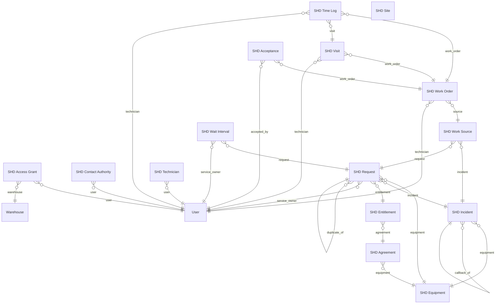

# KẾ HOẠCH NGHIÊN CỨU CHUYÊN SÂU — DOCTYPE × MODULE ERPNEXT × MAPPING DỰ ÁN SMARTHELPDESK

*Tài liệu kế hoạch nghiên cứu để trình bày với giảng viên — dự án Hệ thống thông tin SmartHelpDesk (doanh nghiệp giả định AIS — Alpha Industrial Services).*

| Hạng mục | Nội dung |
|---|---|
| Repo nghiên cứu | `Baronger23/ERP.SmartHelpDesk`, nhánh `develop` (commit nền `049ee89`) |
| Nền tảng kiểm chứng | Frappe v16.33.1 + ERPNext v16.34.2 + MariaDB 11.8, chạy qua `frappe_docker` (localhost:8080, site `frontend`; site kiểm thử `shd-test.localhost`) |
| Tài liệu liên quan | File tổng quan đã có: `docs/Tim-hieu-du-an-SmartHelpDesk-ERPNext-Frappe-Mapping-2026-10-28.md` (kiến thức nền); bộ ADR và Chương 7 Fit-Gap trong repo; bộ test tích hợp 21 + 5 test lịch SLA |
| Bộ diagram đi kèm | Thư mục `diagrams-smarthelpdesk/` — 11 diagram, mỗi diagram có 3 định dạng: `.mmd` (mã Mermaid, sửa được), `.svg` (chèn báo cáo Word/PDF), `.png` (chèn slide) |
| Cách dùng file này | Đây là **kế hoạch nghiên cứu**: nó chốt câu hỏi, phương pháp, dàn ý từng chương, các kết quả đã kiểm chứng được từ mã nguồn để đưa vào báo cáo, danh mục diagram và ngân hàng câu hỏi phản biện. Báo cáo nghiên cứu hoàn chỉnh sẽ được viết triển khai đúng khung này, không thay đổi kết luận nếu không có bằng chứng mới |

---

## TÓM TẮT KẾ HOẠCH (đọc 3 phút)

Nghiên cứu trả lời **ba câu hỏi** mà giảng viên đặt ra cho mọi dự án ERP tùy biến:

1. **DocType là gì ở tầng sâu?** Không dừng ở "DocType giống một bảng", mà đi vào cơ chế metadata-driven của Frappe: định nghĩa lưu ở đâu, lược đồ vật lý sinh ra thế nào, vòng đời document và docstatus, các loại quan hệ Link/Table/Dynamic Link, phân quyền, hooks — và dự án đã dùng DocType khác thông lệ ở điểm nào (khai báo bằng code Python; 28 DocType, 64 quan hệ Link, **0 bảng con Table**).
2. **ERPNext có sẵn những module nào trên bản cài thật của dự án?** Kiểm chứng bằng chính Module Def/DocType của site đang chạy (v16.34.2), phân biệt rõ: module có trong ERPNext, app riêng chưa cài (HRMS, Frappe Helpdesk), và module có nhưng AIS không cần (Manufacturing, POS...).
3. **Mapping từ nghiệp vụ dự án sang ERPNext cho ra quyết định gì?** Áp dụng phân tích Fit-Gap để phân loại từng nhu cầu M01–M10 vào 5 nhóm quyết định: **dùng thẳng native / cấu hình nhẹ / nâng cấp bằng thành phần tự xây cạnh native / xây mới hoàn toàn / chưa làm** — mỗi quyết định đều có căn cứ đo được từ mã nguồn và test, không dựa cảm tính.

Sản phẩm cuối: một báo cáo nghiên cứu 3 chương + bộ diagram + phần Q&A phản biện đã chuẩn bị. Phần lớn bằng chứng đã thu thập xong trong quá trình rà soát mã nguồn ngày 28/10/2026; kế hoạch này tổ chức lại thành dạng trình bày được và chỉ ra phần nào cần bổ sung trước khi báo cáo (quan trọng nhất: **commit lớp SHD vào git** để giảng viên mở repo là thấy, và viết triển khai Chương 1 ở mức sâu).

---

## 1. BỐI CẢNH VÀ LÝ DO PHẢI NGHIÊN CỨU BÀI BẢN

Dự án tồn tại **hai lớp triển khai** trên cùng một nền ERPNext:

- **Lớp script giữa kỳ (legacy demo):** script Python bên ngoài gọi REST vào các DocType native (Issue, Asset, Asset Maintenance, SLA native) cộng 19 Custom Fields và Client Script. Nhanh để demo, nhưng logic nằm ngoài hệ thống.
- **Lớp custom app SHD (v3, hiện hành):** một Frappe app đúng chuẩn tại `apps/smart_helpdesk` — 28 DocType tự khai báo, 40 lệnh nghiệp vụ qua một API duy nhất có idempotency, engine SLA riêng, nhật ký sự kiện SHD Event; chỉ dùng native cho master data, sổ kho, mua hàng và hóa đơn.

Chính sự tồn tại của hai lớp này làm nảy sinh các câu hỏi mà giảng viên chắc chắn sẽ hỏi: *vì sao không dùng Issue có sẵn? vì sao tự viết SLA khi ERPNext đã có SLA? module nào của ERPNext bị "làm lại", module nào dùng thẳng?* Nếu trả lời bằng cảm tính ("thấy thiếu nên làm mới") sẽ không đứng vững. Nghiên cứu này tồn tại để mọi câu trả lời đều có **căn cứ dạng công thức: "native có X, nhưng đo được là thiếu Y, nên dự án làm Z, bằng chứng ở file/test W"**.

---

## 2. CÂU HỎI NGHIÊN CỨU VÀ CÁCH KIỂM CHỨNG

### RQ1 — DocType ở tầng sâu

| Câu hỏi con | Cách kiểm chứng | Nguồn bằng chứng |
|---|---|---|
| Định nghĩa DocType được lưu và vận hành như thế nào trong Frappe? | Đọc tài liệu chính thức Frappe v16 + đối chiếu hành vi thật trên site (tạo/sửa DocType → kiểm tra bảng vật lý) | frappeframework.com (DocType, DocField, lifecycle hooks); DB thật: `tabDocType`, `tabDocField`, `tabSHD Work Order` |
| Dự án khai báo DocType khác thông lệ ở đâu, hệ quả là gì? | Đọc `schema.py` (28 DocType khai báo bằng dict Python), `install.py` (tạo DocType bằng code ở after_install/after_migrate) thay vì JSON fixture trong thư mục doctype/ như app Frappe thông thường | `apps/smart_helpdesk/smart_helpdesk/schema.py`, `install.py` |
| Hệ quan hệ giữa các DocType của dự án có hình dạng gì? | Trích xuất tự động toàn bộ trường Link từ schema (đã làm: **64 quan hệ Link**, đích đến gồm 8 DocType native) | Bảng phụ lục A của file này; diagram D5a–D5d |
| Vì sao dự án có 0 trường Table (bảng con) trong khi ERPNext dùng Table khắp nơi cho dòng chi tiết? | Đối chiếu cách ERPNext tổ chức dòng (Sales Invoice Item là child table) với cách SHD tách dòng thành DocType độc lập có vòng đời riêng (SHD Charge, SHD Material Use...) và phân tích đánh đổi | schema.py (đếm fieldtype); mã nguồn ERPNext |

### RQ2 — ERPNext có những module gì

| Câu hỏi con | Cách kiểm chứng | Nguồn bằng chứng |
|---|---|---|
| Bản cài v16.34.2 của dự án thực tế chứa những module nào? | Liệt kê Module Def và DocType theo module ngay trên site đang chạy, không chép danh sách từ trang quảng cáo | Site `frontend`/`shd-test.localhost`; tài liệu ERPNext v16 |
| Module nào là app riêng, không nằm trong ERPNext? | Kiểm tra danh sách app đã cài trên site (chỉ có frappe + erpnext + smart_helpdesk) | `apps.txt` của site; HRMS và Frappe Helpdesk vắng mặt là bằng chứng |
| Module nào có nhưng mô hình AIS không dùng tới? | Đối chiếu bản đồ quy trình AIS (M01–M10) với từng module | Chương 7 Fit-Gap trong repo |

### RQ3 — Mapping và quyết định sửa / thêm / nâng cấp

| Câu hỏi con | Cách kiểm chứng | Nguồn bằng chứng |
|---|---|---|
| Mỗi nhu cầu M01–M10 rơi vào nhóm quyết định nào? | Phân tích Fit-Gap theo thang 5 nhóm (mục 7.1), từng dòng mapping phải chỉ được file/DocType cụ thể ở cả hai phía | ADR, Fit-Gap, mapping đã rà soát 28/10 |
| Các quyết định "tự xây thay native" có căn cứ đo được không? | Mỗi case phải có ít nhất một bằng chứng định lượng hoặc test: 5 test lịch SLA, test tranh chấp giữ tồn 2 kết nối, phân tích neo thời gian của native SLA | `scripts/tests/` (21 test tích hợp, 5 test SLA) |
| Phần nào còn thiếu để gọi là hoàn chỉnh? | Kiểm kê trạng thái ba mức: đang chạy / đã thiết kế / chưa làm, đối chiếu pyproject và mã nguồn | `pyproject.toml` (tự khai "no AI runtime"), DESIGN.md |

---

## 3. PHẠM VI

- **Trong phạm vi:** Frappe/ERPNext đúng phiên bản dự án đang chạy (v16); app `smart_helpdesk` trên nhánh `develop`; lớp script legacy chỉ xét ở vai trò lịch sử và bài học, không đề xuất phát triển tiếp.
- **Ngoài phạm vi:** đánh giá hiệu năng production, bảo mật vận hành, triển khai thật cho doanh nghiệp thật (AIS là doanh nghiệp giả định phục vụ môn học); dựng bench WSL theo phương pháp giảng viên demo (đã quyết định làm sau, không chặn nghiên cứu này vì mọi bằng chứng đều lấy từ repo và site Docker hiện có).

---

## 4. PHƯƠNG PHÁP NGHIÊN CỨU

1. **Đọc tĩnh mã nguồn (static reading):** rà soát toàn bộ cây thư mục repo; mọi khẳng định về dự án phải trỏ được tới đường dẫn file cụ thể.
2. **Đối chiếu tài liệu chính thức:** khái niệm Frappe/ERPNext lấy từ tài liệu v16 của nhà phát triển, không lấy từ blog tóm tắt; chỗ nào tài liệu và hành vi thật lệch nhau thì ghi nhận hành vi thật.
3. **Phân tích Fit-Gap chuẩn triển khai ERP:** nhu cầu nghiệp vụ → khả năng native → khoảng lệch đo được → quyết định (cấu hình / mở rộng / tự xây / không làm), kèm lý do vì sao không chọn mức can thiệp nhẹ hơn.
4. **Kiểm chứng thực nghiệm:** kết quả test trên site kiểm thử `shd-test.localhost` (21 test tích hợp + 5 test lịch SLA, chạy đạt ngày 15/10/2026 theo dữ liệu validation của repo) được dùng làm bằng chứng hành vi, không chỉ đọc code.
5. **Nguyên tắc trung thực trạng thái:** mọi năng lực đều dán nhãn một trong ba: **đang chạy thật / đã thiết kế và kiểm chứng offline / chưa làm**. Đây là nguyên tắc xuyên suốt khi trình bày với giảng viên, đặc biệt cho phần AI/RAG.

---

## 5. KẾ HOẠCH CHƯƠNG 1 — TÌM HIỂU SÂU VỀ DOCTYPE

*Chương này là trọng tâm lý thuyết. Mỗi mục dưới đây ghi rõ: nội dung phải trình bày, điểm sâu cần đào, và bằng chứng/diagram đi kèm. Các luận điểm cốt lõi đã nắm chắc từ rà soát mã nguồn được ghi sẵn để khi viết báo cáo chỉ cần triển khai văn phong.*

### 5.1. DocType là metadata, không chỉ là "một cái bảng"

- Trình bày: một DocType là một **bản ghi định nghĩa** (document của DocType `DocType`) kèm các bản ghi `DocField`; Frappe là hệ thống *metadata-driven* — định nghĩa dữ liệu, giao diện, quyền và API đều suy ra từ cùng một metadata này.
- Điểm sâu: hệ quả của metadata-driven là "khai báo một lần, có mặt ở mọi nơi": Desk form, List view, REST API, Report Builder, phân quyền đều tự sinh. Đây là khác biệt căn bản với cách làm truyền thống (tự viết model + migration + form + API riêng từng lớp).
- Diagram đi kèm: **D2 — Cơ chế DocType**.

### 5.2. Từ định nghĩa tới bảng vật lý

- Quy tắc đặt tên bảng: `tab` + tên DocType bỏ khoảng trắng (ví dụ `tabSHD Work Order`), các cột chuẩn `name, creation, modified, modified_by, owner, docstatus, idx` có ở mọi bảng.
- Vai trò của `bench migrate`: đồng bộ metadata ↔ lược đồ DB; ở dự án, bước này do installer chạy qua Docker exec.
- Điểm sâu cần trình bày: khóa chính là `name` (chuỗi, theo naming series) chứ không phải số tự tăng — hệ quả cho tích hợp và truy vết.

### 5.3. Giải phẫu DocField và bảng fieldtype

- Bảng fieldtype cốt lõi phải phân tích: Data, Link, Table, Dynamic Link, Select, Check, Date/Datetime, Currency, Attach File/Image, Text Editor...; thuộc tính `reqd, unique, in_list_view, permlevel, options, fetch_from`.
- Điểm sâu: `options` đổi nghĩa theo fieldtype (đích Link / DocType con của Table / danh sách Select) — chi tiết nhỏ nhưng là nơi sinh viên hay sai khi đọc schema; dự án dùng đúng quy ước này trong `schema.py`.

### 5.4. Ba kiểu quan hệ: Link, Table, Dynamic Link

- Link = khóa ngoại n-1 (dự án dùng 64 lần); Table = quan hệ cha-con sở hữu (dòng chi tiết sống chết theo cha, có `parent/parenttype/parentfield`); Dynamic Link = khóa ngoại đa hình theo cặp (type, name).
- **Phát hiện riêng của dự án (điểm nhấn khi trình bày):** 28 DocType SHD dùng **0 trường Table**. Mọi "dòng chi tiết" trong ERPNext vốn là child table (ví dụ dòng hóa đơn) thì ở SHD là DocType độc lập có vòng đời và trạng thái riêng (SHD Material Use, SHD Charge, SHD Reservation...). Lý do: các dòng này trong nghiệp vụ AIS phải được truy vết độc lập qua SHD Event, bị khóa/giữ/tranh chấp riêng (giữ tồn có vòng đời riêng), nên mô hình "con của cha" không đủ. Đánh đổi: mất tính năng nhập dòng ngay trong form cha, quan hệ phải tự quản bằng Link — và đó là lý do toàn bộ ghi dữ liệu phải đi qua lệnh nghiệp vụ thay vì sửa form.
- Diagram đi kèm: **D5a–D5d — ERD quan hệ DocType** (trích xuất tự động từ schema thật).

### 5.5. Vòng đời document và docstatus

- Trạng thái 0 Draft → 1 Submitted → 2 Cancelled cho DocType `is_submittable`; hooks theo vòng đời: `validate, before_save, on_submit, on_cancel...`
- Đối chiếu dự án: chứng từ native (Stock Entry, Sales Invoice) dùng docstatus để cập nhật sổ; DocType SHD phần lớn không dùng submit mà dùng **trạng thái nghiệp vụ riêng + lệnh nghiệp vụ**, form bị khóa để không ai phá vỡ vòng đời bằng tay.
- Diagram đi kèm: **D3 — Vòng đời document**.

### 5.6. Phân quyền trên DocType

- DocPerm theo Role ở cấp DocType và cấp trường (permlevel); permission query conditions ở cấp bản ghi.
- Đối chiếu dự án: 8 role AIS + kiểm tra quyền sở hữu bản ghi trong `validate.py` (ví dụ Service Owner chỉ thấy ca của mình) — tức dự án dùng cả hai tầng: quyền chuẩn Frappe và luật sở hữu riêng trong lệnh.

### 5.7. Hai cách khai báo DocType: giao diện/JSON và bằng code

- Cách thông thường: tạo trên Desk hoặc thư mục `doctype/<ten>/` chứa file JSON + controller Python trong app; khi migrate, Frappe đọc JSON.
- Cách của dự án: khai báo bằng dict Python trong một file `schema.py` duy nhất, `install.py` gọi API tạo/cập nhật DocType ở `after_install/after_migrate`. Ưu: toàn bộ lược đồ nằm trong một file, dễ rà soát và diff, cài đặt lặp lại được trong Docker. Nhược: lệch thông lệ cộng đồng (người mới mở app sẽ tìm thư mục doctype/ mà không thấy), phụ thuộc installer tự viết. Đây là điểm nên chủ động nêu khi trình bày, kèm lý do nhóm chọn.

### 5.8. DocType đặc biệt cần biết

- Single DocType (cấu hình toàn cục), Child DocType (`istable`), Virtual DocType (không có bảng thật, dữ liệu từ nguồn ngoài) — dự án không dùng virtual, nêu để hoàn thiện bức tranh và trả lời câu hỏi mở rộng.

### 5.9. So sánh tổng hợp (bảng chốt chương)

| Tiêu chí | DocType (Frappe) | ORM truyền thống (vd Django model) | Bảng SQL thuần |
|---|---|---|---|
| Nơi định nghĩa | Metadata trong DB (hoặc JSON/code trong app) | Class trong code | DDL |
| Giao diện nhập liệu | Tự sinh (Desk) | Tự viết | Không có |
| API | Tự sinh REST | Tự viết | Không có |
| Phân quyền | Tích hợp theo Role/trường | Tự cài | Tự cài |
| Đổi lược đồ | migrate đồng bộ từ metadata | migration viết tay/tự sinh từ code | viết tay |
| Cái giá phải trả | Phụ thuộc framework, khó thoát ra | Nhiều việc lặp lại | Mọi thứ tự làm |

---

## 6. KẾ HOẠCH CHƯƠNG 2 — ERPNEXT CÓ NHỮNG MODULE GÌ

*Nguyên tắc: liệt kê theo bản cài thật của dự án, nhóm theo miền nghiệp vụ, và gắn mỗi module với câu hỏi "AIS có dùng không, vì sao".*

### 6.1. Cách kiểm chứng danh mục module

Trình bày phương pháp: mở Module Def trên site; đếm DocType theo module; phân biệt ba tầng: (a) module thuộc ERPNext, (b) tính năng thuộc Frappe framework (User, Role, Workflow, File, Comment...), (c) app riêng của hệ sinh thái (HRMS, Frappe Helpdesk, CRM...) **chưa cài** trên site của dự án — bằng chứng là `apps.txt` chỉ có frappe, erpnext, smart_helpdesk.

### 6.2. Danh mục module ERPNext v16 theo miền (khung trình bày)

| Miền | Module / nhóm DocType tiêu biểu | Liên hệ với AIS |
|---|---|---|
| Nền tảng & bán hàng | Selling (Customer, Sales Invoice), CRM (Lead, Opportunity) | Dùng Customer + Sales Invoice; CRM không dùng (khách B2B ký hợp đồng dài hạn) |
| Mua hàng | Buying (Supplier, Material Request, Purchase Order, Purchase Receipt) | Dùng thẳng cho vật tư thiếu |
| Kho | Stock (Item, Warehouse, Bin, Stock Entry, Stock Ledger Entry) | Dùng thẳng làm sổ kho thật |
| Tài sản | Assets (Asset, Asset Maintenance, Asset Repair) | **Có dùng thử ở lớp legacy, đã thay bằng SHD ở lớp hiện hành** — case study Chương 3 |
| Sản xuất | Manufacturing (BOM, Work Order, Job Card) | Không dùng; riêng tên "Work Order" là bẫy trùng tên với lệnh dịch vụ |
| Dự án & chất lượng | Projects (Project, Task, Timesheet), Quality (Quality Goal, Procedure) | Không dùng; Timesheet native không thay được SHD Time Log vì thiếu gắn Visit/ca |
| Kế toán | Accounts (Sales Invoice, Payment Entry, GL Entry) | Dùng Sales Invoice; phần còn lại ngoài phạm vi môn học |
| Hỗ trợ | Support (Issue, SLA, Service Level Agreement) | **Case study chính**: dùng ở legacy, thay bằng SHD Request/Incident + SLA Engine |
| Cài đặt & hệ thống | Settings, Core của Frappe (User, Role, Holiday List, Working Day...) | Dùng Holiday List/Working Day làm nền lịch cho SLA Engine |
| Website & khác | Website, POS/Retail, Subcontracting, Regional | Không dùng |

### 6.3. Điểm cần nhấn khi trình bày

- ERPNext không phải "một module lớn" mà là **một bộ app-in-one**: hàng chục module dùng chung một kho DocType và một hệ phân quyền — đây là lý do chiến lược đúng là *chọn lọc theo miền* thay vì cài-rồi-dùng-hết hoặc tự viết lại hết.
- Hai app thường bị tưởng là "có sẵn trong ERPNext" nhưng thực ra là **app riêng**: HRMS (quản trị nhân sự, chứa Leave Application) và Frappe Helpdesk (HD Ticket). Site của dự án chưa cài cả hai; nếu sau này cần quản lý nghỉ phép cho kỹ thuật viên thì hướng chuẩn là cài HRMS, không tự xây.
- Diagram đi kèm: **D1 — Kiến trúc tầng**.

---

## 7. KẾ HOẠCH CHƯƠNG 3 — MAPPING VÀ QUYẾT ĐỊNH SỬA / THÊM / NÂNG CẤP

### 7.1. Thang phân loại Fit-Gap dùng trong nghiên cứu

| Nhóm | Tên gọi khi trình bày | Ý nghĩa | Mức can thiệp |
|---|---|---|---|
| A | **Dùng thẳng (FIT)** | Native đáp ứng đúng nhu cầu, không sửa gì | Cấu hình dữ liệu |
| B | **Nâng nhẹ (FIT+)** | Native là nền, dự án thêm cấu hình/quy ước mỏng | Custom Field, role, workspace |
| C | **Nâng cấp thay thế (GAP–Sửa)** | Native có DocType "họ hàng" nhưng thiếu tính chất đo được → dự án xây DocType riêng chạy cạnh, native giữ vai trò khác hoặc bỏ | Custom app |
| D | **Xây mới (GAP–Mới)** | ERPNext không có khái niệm tương ứng | Custom app |
| E | **Chưa làm** | Đã nhận diện, có thiết kế hoặc chưa, nhưng chưa có runtime | Lộ trình |

Từ ngữ dùng trong báo cáo để khớp câu hỏi của giảng viên: nhóm A+B = "dùng module ERPNext, có cấu hình"; nhóm C = "**sửa/nâng cấp module** bằng thành phần tự xây thay thế"; nhóm D = "**thêm module mới**"; nhóm E = "module còn thiếu".

### 7.2. Bảng mapping tổng hợp M01–M10 (kết quả đã kiểm chứng, dùng nguyên trong báo cáo)

| Module dự án | Nhu cầu AIS | Phía ERPNext | Nhóm | Quyết định |
|---|---|---|---|---|
| M01 Nền tảng & tiếp cận | Tài khoản, vai trò, workspace nghiệp vụ | User/Role (Frappe) + 8 role AIS + Workspace | A/B | Dùng thẳng + cấu hình |
| M02 Khách hàng & thiết bị | Máy của khách đặt tại site, hợp đồng, quyền lợi | Customer (A); Asset (C) → SHD Equipment, Agreement, Entitlement | A/C/D | Dùng Customer; **nâng cấp thay Asset**; **thêm** Agreement/Entitlement |
| M03 Yêu cầu & SLA | Tiếp nhận, sự cố, SLA theo hợp đồng | Issue + native SLA (C) → SHD Request, Incident, Wait Interval, SLA Engine | C/D | **Nâng cấp thay thế** toàn bộ cụm |
| M04 Điều phối & hiện trường | Lệnh việc, chuyến đi, giờ công, nghiệm thu | Work Order native là lệnh sản xuất (C — trùng tên khác bản chất) → SHD Work Order, Visit, Time Log, Acceptance | C/D | **Xây mới** với tên gọi riêng có chủ đích |
| M05 Bảo trì định kỳ | Kế hoạch PM theo chu kỳ/policy | Asset Maintenance (C) → SHD PM Plan, PM Occurrence, Finding | C/D | **Nâng cấp thay thế** |
| M06 Vật tư & giữ tồn | Giữ hàng cho ca, tương thích, tiêu hao | Bin/Stock Entry (A); Reservation và Compatibility không có (D) | A/D | Dùng sổ kho native; **thêm** Reservation, Compatibility, Material Use |
| M07 Mua hàng & nhà cung cấp | Bổ sung vật tư thiếu | Material Request, Purchase Order, Purchase Receipt, Supplier | A | Dùng thẳng |
| M08 Báo giá & hóa đơn | Ước tính, phí phát sinh, đối chiếu hóa đơn | Sales Invoice (A); Estimate/Charge (D) | A/D | Dùng hóa đơn native; **thêm** Estimate, Charge và đối chiếu 1-1 |
| M09 Tri thức & AI | Bài học kinh nghiệm, hỗ trợ tra cứu | SHD Knowledge (catalog đang chạy); AI/RAG chưa runtime | D/E | Catalog dùng được; AI ở mức thiết kế |
| M10 Báo cáo & KPI | KPI tái lập từ sự kiện | Report Builder (A một phần); SHD Event, KPI Snapshot (D) | A/D | **Thêm** event journal + snapshot |

### 7.3. Bốn case study "nâng cấp thay thế" — phần trình bày chính của chương

Mỗi case trình bày theo cùng một khung 4 bước: *native có gì → đo được thiếu gì → dự án làm gì → bằng chứng*.

**Case 1 — SLA (M03), case quan trọng nhất.** Native SLA neo đồng hồ vào thời điểm tạo bản ghi Issue và dùng một mức cam kết chung. Nghiệp vụ AIS cần: tách thời điểm khách báo (reported) và thời điểm tiếp nhận (received); mức SLA theo **policy của từng hợp đồng**; deadline tính theo **lịch làm việc của hợp đồng** (ngày/giờ làm việc, trừ ngày lễ); và **khoảng chờ** (chờ khách/chờ vật tư) được trừ khỏi thời gian tính SLA. Không tính chất nào trong bốn tính chất này cấu hình được trên native SLA → dự án xây `sla.py` + SHD Wait Interval + entitlement snapshot. Bằng chứng: 5 test lịch SLA chuyên biệt. Điểm trung thực phải nêu: cơ chế **pause SLA toàn cục chưa làm** (chính sách hiện hành là "không pause", chỉ trừ khoảng chờ), escalation tự động chưa có.
→ Diagram **D8 — SLA Engine**.

**Case 2 — Asset → SHD Equipment (M02).** Asset của ERPNext là tài sản kế toán của **chính doanh nghiệp sở hữu** (khấu hao, sổ tài sản). Máy trong dự án là tài sản của **khách hàng** đặt tại site của khách, cần vòng đời dịch vụ (hồ sơ vận hành, tương thích vật tư, lịch PM) chứ không cần khấu hao → sai bản chất nếu ép dùng Asset. SHD Equipment là DocType riêng; Customer vẫn là native.

**Case 3 — Asset Maintenance → SHD PM Plan/Occurrence (M05).** Native lên lịch bảo trì theo ngày đơn giản trên Asset. AIS cần lịch sinh ca theo **chu kỳ gắn policy hợp đồng**, mỗi lần sinh là một Occurrence có trạng thái riêng, phát hiện trong ca (Finding) phải chảy ngược thành Incident/Work Source → xây mới cụm PM.

**Case 4 — "Work Order" trùng tên (M04).** DocType `Work Order` của ERPNext là **lệnh sản xuất** (định mức BOM, sản xuất thành phẩm). Lệnh việc của AIS là **lệnh dịch vụ hiện trường** (kỹ thuật viên, chuyến đi, vật tư giữ trước, nghiệm thu). Dùng chung tên sẽ gây nhầm lẫn nghiêm trọng khi trình bày và khi tích hợp → SHD Work Order là DocType khác hẳn; khi báo cáo phải luôn nói rõ "Work Order của ERPNext ≠ SHD Work Order".

### 7.4. Phần "thêm mới" ngoài thay thế (nhóm D) — luận cứ chung

Ba khái niệm ERPNext không có nên phải thêm: **giữ tồn (Reservation)** — ERPNext trừ kho khi xuất thật, không có khái niệm giữ hàng cho một ca cụ thể kèm vòng đời giữ/hủy tranh chấp; **tương thích vật tư (Compatibility)** — quan hệ máy × vật tư được phép dùng; **nhật ký sự kiện (SHD Event) + KPI Snapshot** — điều kiện để KPI tái tính được và đối chiếu được, thay vì lưu con số KPI chết. Cả ba đều là mẫu thiết kế quen thuộc trong hệ thống dịch vụ hiện trường, không phải "thích thì làm".

### 7.5. Phần chưa làm (nhóm E) — trình bày thẳng

- AI/RAG: mới có `SHD Knowledge` (catalog bài học, chạy thật, tra cứu từ khóa có trích nguồn) + bộ tài liệu kiến trúc AI và kiểm chứng offline; **chưa có runtime** (không embedding, không vector store, không LLM). `pyproject.toml` của chính dự án ghi "no AI runtime".
- Customer portal riêng cho khách hàng (hiện mới có role + API có kiểm quyền), thông báo/escalation khi sắp vi phạm SLA, ứng dụng mobile/offline cho kỹ thuật viên, phê duyệt nhiều cấp.
- Việc quản trị: **lớp SHD chưa được commit vào git** tại thời điểm rà soát — rủi ro số một của dự án, phải xử lý trước khi trình bày (mục 9).

### 7.6. Luồng nghiệp vụ xuyên suốt (dùng để kết chương)

Diagram **D7 — Luồng một ca sửa chữa** cho thấy mapping không phải các quyết định rời rạc: một ca thật chảy qua Request → SLA Engine → Work Order → giữ tồn trên Bin native → Demand sang Purchase Order native khi thiếu → Stock Entry khi tiêu hao → Charge đối chiếu Sales Invoice → SHD Event ghi mọi bước. Đây là diagram chốt để giảng viên thấy hai phía native/tự xây khớp nhau ở đâu.

---

## 8. DANH MỤC DIAGRAM (đã gen sẵn)

| Mã | Diagram | Loại | Dùng ở | Nguồn dữ liệu | Trạng thái |
|---|---|---|---|---|---|
| D1 | Kiến trúc tầng Frappe → ERPNext → SHD → người dùng | Flowchart | Chương 2, mở đầu trình bày | Cấu trúc app + API thật | ĐÃ GEN |
| D2 | Cơ chế DocType: khai báo → đồng bộ → tự sinh UI/API | Flowchart | Chương 1 (mục 5.1–5.2) | Tài liệu Frappe + hành vi site | ĐÃ GEN |
| D3 | Vòng đời document và docstatus | State diagram | Chương 1 (mục 5.5) | Frappe lifecycle | ĐÃ GEN |
| D4 | Hai lớp triển khai của dự án và quy tắc ngành | Flowchart | Chương mở đầu / bối cảnh | Cấu trúc repo | ĐÃ GEN |
| D5a | ERD chuỗi dịch vụ: Equipment–Agreement–Entitlement–Request–Incident–Work Order–Visit... | ER Diagram | Chương 1 (mục 5.4) + Chương 3 | **Trích xuất tự động từ schema.py** | ĐÃ GEN |
| D5b | ERD cụm bảo trì định kỳ: PM Plan–Occurrence–Finding | ER Diagram | Chương 3, Case 3 | Trích xuất tự động | ĐÃ GEN |
| D5c | ERD cụm kho–thương mại: Reservation–Material Use–Demand–Charge ↔ Item/Warehouse/chứng từ native | ER Diagram | Chương 3 (M06–M08) | Trích xuất tự động | ĐÃ GEN |
| D5d | ERD cụm nền tảng: Event–Command–KPI Snapshot–Knowledge | ER Diagram | Chương 3 (M09–M10) | Trích xuất tự động | ĐÃ GEN |
| D6 | Bản đồ mapping 5 nhóm quyết định A–E | Flowchart | Chương 3 (mục 7.1–7.2) | Bảng mapping M01–M10 | ĐÃ GEN |
| D7 | Luồng một ca sửa chữa xuyên native ↔ SHD | Sequence diagram | Chương 3 (mục 7.6) | 40 lệnh nghiệp vụ | ĐÃ GEN |
| D8 | SLA Engine: cách tính deadline và khoảng chờ | Flowchart | Chương 3, Case 1 | `sla.py` + test lịch | ĐÃ GEN |

Mỗi diagram có file `.mmd` (sửa nội dung bằng chữ), `.svg` (nét, chèn Word/PDF), `.png` (chèn slide PowerPoint/Canva) trong thư mục `diagrams-smarthelpdesk/`. Diagram chèn mẫu ngay trong file này: D5a ở Phụ lục A.

---

## 9. KẾ HOẠCH THỰC HIỆN VÀ SẢN PHẨM BÀN GIAO

| Bước | Việc | Đầu ra | Trạng thái / ghi chú |
|---|---|---|---|
| 1 | Rà soát toàn bộ mã nguồn, trích xuất schema và quan hệ DocType | Dữ liệu nền: 28 DocType, 64 Link, bản đồ M01–M10 | ĐÃ XONG (28/10/2026) |
| 2 | Soạn file tổng quan nền (Frappe/ERPNext/DocType/UI/mapping) | `docs/Tim-hieu-du-an-...-2026-10-28.md` trong repo | ĐÃ XONG, đã copy vào `docs/` của dự án |
| 3 | Soạn kế hoạch nghiên cứu chuyên sâu + gen bộ diagram | **File này** + thư mục `diagrams-smarthelpdesk/` | ĐÃ XONG |
| 4 | Commit lớp SHD vào git theo lát sạch (bỏ thư mục `output/`), Bao tự push từ PowerShell của mình | Repo phản ánh đúng hệ thống hiện hành khi giảng viên kiểm tra | **CHƯA LÀM — việc ưu tiên số một trước buổi trình bày** |
| 5 | Viết báo cáo nghiên cứu hoàn chỉnh triển khai 3 chương theo khung mục 5–7 | File báo cáo `.md` (và bản xuất PDF/Word nếu cần) | Chưa làm — làm sau khi kế hoạch này được duyệt |
| 6 | Chuẩn bị slide trình bày: mỗi chương 3–5 slide, diagram D1/D5a/D6/D7/D8 là hình chính | Bộ slide | Chưa làm |
| 7 | Luyện Q&A theo ngân hàng câu hỏi mục 10 | Trả lời miệng trơn tru, không khẳng định quá trạng thái thật | Chưa làm |
| — | Dựng bench trong WSL theo phương pháp giảng viên (học quy trình chuẩn) | Môi trường bench song song | **Để sau theo quyết định của Bao** — không chặn các bước trên |

**Tiêu chí nghiệm thu của nghiên cứu (tự kiểm trước khi trình bày):**

- [ ] Mọi khẳng định về ERPNext đều trỏ được tới module/DocType cụ thể trên đúng phiên bản v16.34.2.
- [ ] Mọi quyết định nhóm C/D đều có ít nhất một căn cứ đo được hoặc một test.
- [ ] Không có năng lực nào bị trình bày cao hơn trạng thái thật (AI là ví dụ bắt buộc phải nói đúng ba mức).
- [ ] Repo trên GitHub đã chứa lớp SHD để giảng viên đối chiếu trực tiếp.
- [ ] Mọi diagram trong slide đều khớp mã nguồn hiện tại (ERD trích từ schema, không vẽ tay theo trí nhớ).

---

## 10. NGÂN HÀNG CÂU HỎI PHẢN BIỆN (chuẩn bị sẵn)

| Câu hỏi có thể gặp | Hướng trả lời cốt lõi |
|---|---|
| "ERPNext có Issue và SLA sẵn, sao nhóm tự làm lại?" | Case 1 mục 7.3: bốn tính chất đo được mà native SLA không có (reported/received, policy theo hợp đồng, lịch policy, khoảng chờ) + 5 test lịch làm bằng chứng |
| "Có sửa mã nguồn ERPNext không?" | Không. Toàn bộ tùy biến nằm trong custom app; đây là quy tắc số một của hệ sinh thái Frappe và là lý do nâng cấp phiên bản không phá dự án |
| "Sao không thấy thư mục doctype/ như app Frappe bình thường?" | Mục 5.7: nhóm khai báo lược đồ bằng code trong `schema.py` + installer; nêu cả ưu và nhược, không né |
| "Sao không dùng bảng con (Table) như ERPNext?" | Mục 5.4: dòng chi tiết của AIS có vòng đời độc lập (giữ tồn, tranh chấp, truy vết sự kiện) nên tách DocType; đánh đổi đã biết và được bù bằng lệnh nghiệp vụ |
| "Work Order của nhóm với Work Order của ERPNext khác gì?" | Case 4: lệnh sản xuất (BOM/thành phẩm) vs lệnh dịch vụ hiện trường; trùng tên là bẫy kinh điển |
| "Phần AI của dự án tới đâu?" | Ba mức trung thực: catalog tri thức chạy thật; kiến trúc AI đã thiết kế + kiểm chứng offline; runtime chưa làm |
| "SLA có tạm dừng được không?" | Chưa có pause toàn cục theo chủ đích thiết kế ("No pause"); chỉ có khoảng chờ được trừ — nêu rõ đây là giới hạn hiện tại |
| "Số liệu KPI lấy từ đâu, có tin được không?" | KPI không lưu chết: tính từ SHD Event (before/after hash) thành Snapshot, tái lập bất cứ lúc nào |
| "Gọi API lung tung có ghi trùng dữ liệu không?" | Một API duy nhất + idempotency key + SHD Command lưu biên nhận kèm binding hash; lệnh trùng bị chặn ở DB |
| "Nếu mai này cần quản lý nghỉ phép cho kỹ thuật viên thì sao?" | Cài app HRMS chính hãng theo hướng mở rộng chuẩn, không tự xây — thể hiện hiểu hệ sinh thái |

---

## PHỤ LỤC A — ERD CHUỖI DỊCH VỤ (D5a) VÀ BẢNG QUAN HỆ ĐẦY ĐỦ

Diagram dưới đây được **trích xuất tự động từ trường Link khai báo trong `schema.py`** (không vẽ tay): mỗi cạnh là một trường Link, nhãn cạnh là tên trường. Ba ERD còn lại (D5b, D5c, D5d) nằm trong thư mục `diagrams-smarthelpdesk/` ở cả ba định dạng.

**Bảng toàn bộ 64 quan hệ Link** (đích đến ghi *(native)* là DocType của Frappe/ERPNext; còn lại là DocType SHD):

| DocType nguồn | Các trường Link → đích |
|---|---|
| SHD Acceptance | `accepted_by` → User *(native)* `work_order` → SHD Work Order |
| SHD Access Grant | `user` → User *(native)* `warehouse` → Warehouse *(native)* |
| SHD Agreement | `equipment` → SHD Equipment |
| SHD Charge | `estimate` → SHD Estimate `item` → Item *(native)* `sales_invoice` → Sales Invoice *(native)* `work_order` → SHD Work Order |
| SHD Command | `actor` → User *(native)* |
| SHD Compatibility | `item` → Item *(native)* |
| SHD Contact Authority | `user` → User *(native)* |
| SHD Demand | `item` → Item *(native)* `material_request` → Material Request *(native)* `purchase_order` → Purchase Order *(native)* `warehouse` → Warehouse *(native)* `work_order` → SHD Work Order |
| SHD Entitlement | `agreement` → SHD Agreement |
| SHD Estimate | `approved_by` → User *(native)* `currency` → Currency *(native)* `work_order` → SHD Work Order |
| SHD Event | `actor` → User *(native)* `supersedes_event` → SHD Event |
| SHD Finding | `equipment` → SHD Equipment `incident` → SHD Incident `pm_occurrence` → SHD PM Occurrence `service_owner` → User *(native)* |
| SHD Incident | `callback_of` → SHD Incident `equipment` → SHD Equipment |
| SHD KPI Snapshot | `supersedes` → SHD KPI Snapshot |
| SHD Knowledge | `lesson_work_order` → SHD Work Order `reviewed_by` → User *(native)* |
| SHD Material Use | `item` → Item *(native)* `reservation` → SHD Reservation `stock_entry` → Stock Entry *(native)* `visit` → SHD Visit `warehouse` → Warehouse *(native)* `work_order` → SHD Work Order |
| SHD PM Occurrence | `equipment` → SHD Equipment `plan` → SHD PM Plan |
| SHD PM Plan | `equipment` → SHD Equipment `service_owner` → User *(native)* |
| SHD Request | `duplicate_of` → SHD Request `entitlement` → SHD Entitlement `equipment` → SHD Equipment `incident` → SHD Incident `service_owner` → User *(native)* |
| SHD Reservation | `item` → Item *(native)* `warehouse` → Warehouse *(native)* `work_order` → SHD Work Order |
| SHD Technician | `user` → User *(native)* |
| SHD Time Log | `technician` → User *(native)* `visit` → SHD Visit `work_order` → SHD Work Order |
| SHD Visit | `technician` → User *(native)* `work_order` → SHD Work Order |
| SHD Wait Interval | `request` → SHD Request `service_owner` → User *(native)* |
| SHD Work Order | `estimate` → SHD Estimate `source` → SHD Work Source `technician` → User *(native)* |
| SHD Work Source | `incident` → SHD Incident `pm_occurrence` → SHD PM Occurrence `request` → SHD Request |
| SHD Site | — (không khai báo Link đi trong schema) |
| SHD Equipment | — (không khai báo Link đi trong schema; là nút bị tham chiếu nhiều nhất: Agreement, Request, Incident, PM Plan, PM Occurrence, Finding đều trỏ về Equipment) |

*Đọc bảng: 26/28 DocType có ít nhất một Link đi; đích native được chạm nhiều nhất là `User` (15 lần — con người là trục của hệ thống dịch vụ), tiếp theo là `Item` (5) và `Warehouse` (4); các chứng từ native Stock Entry, Material Request, Purchase Order, Sales Invoice, Currency mỗi thứ được gắn đúng một lần tại điểm đối chiếu nghiệp vụ tương ứng.*

## PHỤ LỤC B — NGUỒN THAM CHIẾU

- Mã nguồn dự án: repo `Baronger23/ERP.SmartHelpDesk` (nhánh `develop`) — `apps/smart_helpdesk/`, `scripts/`, `docs/` (ADR, Chương 7 Fit-Gap, DESIGN.md), `data/business_validation.json`.
- Tài liệu chính thức: Frappe Framework v16 (DocType, DocField, Document lifecycle, Hooks), ERPNext v16 (Stock, Buying, Selling, Assets, Support/SLA), frappe_docker (pwd.yml).
- File tổng quan nền của nhóm: `docs/Tim-hieu-du-an-SmartHelpDesk-ERPNext-Frappe-Mapping-2026-10-28.md`.

---

## Kết quả thực hành bench (bổ sung 2026-11-10)

Sau khi tài liệu này được soạn, nhóm đã tự dựng **bench native trong WSL2/Ubuntu**
theo đúng quy trình chuẩn của Frappe và cài dự án lên đó. Kết quả dưới đây đều là
số đo/kiểm chứng thật trên máy, không phải trích dẫn tài liệu:

- **Yêu cầu phiên bản (tự phát hiện qua thực hành):** toàn bộ dòng Frappe v16 đòi
  **Python ≥ 3.14** và **Node ≥ 24** — Ubuntu 24.04 mặc định (Python 3.12, Node 20)
  không đủ; bản Docker chạy được vì image đã đóng sẵn hai thứ này. Bench cuối cùng
  dùng đúng bản của dự án: Frappe **v16.33.1**, ERPNext **v16.34.2**.
- **Cài app chuẩn:** site `shd.localhost` trên bench nhận đủ **28/28 DocType SHD**
  (28 bảng `tabSHD ...` trong MariaDB), workspace **Smart Helpdesk** với 10 lối tắt
  M01–M10, **8 vai trò AIS**, khóa duy nhất tổ hợp trên SHD Work Order, ràng buộc
  CHECK `shd_source_xor` và đủ **5 Custom Field** `custom_shd_*` trên các DocType gốc
  (Stock Entry, Material Request, Purchase Order, Purchase Receipt, Sales Invoice).
- **Bài học về cấu trúc app:** Frappe chỉ quét DocType trong thư mục module
  (`<app>/<module>/doctype/`). Lần cài đầu đặt cây DocType ở cấp package nên Frappe
  **bỏ qua lặng lẽ — app báo đã cài nhưng 0 bảng**; sửa vị trí thư mục (commit
  `d873ff2`) thì cài đủ 28 bảng. Đây là minh chứng thực tế cho phần "cơ chế DocType"
  trong tài liệu này.
- **JavaScript phía Desk:** vì DocType nay là DocType chuẩn (không còn custom),
  `operations.js` được nạp qua hooks `doctype_js` cho cả 28 DocType — không cần
  Client Script tạo bằng code như cách làm cũ.
- **Kiểm thử:** bộ test của app trên bench đạt **5/5** (lịch SLA: giờ trưa, cuối tuần/
  ngày lễ, neo UTC, từ chối policy chồng lấp/thiếu); `bench start` phục vụ site ở
  cổng 8000 (HTTP 200).
- **Docker vẫn dùng được app mới:** tạo site dùng một lần ngay trong container
  frappe_docker bằng app chuẩn cho đủ **28 bảng**, rồi xóa site — Docker giữ vai trò
  môi trường phụ/demo, bench là môi trường phát triển chính.

