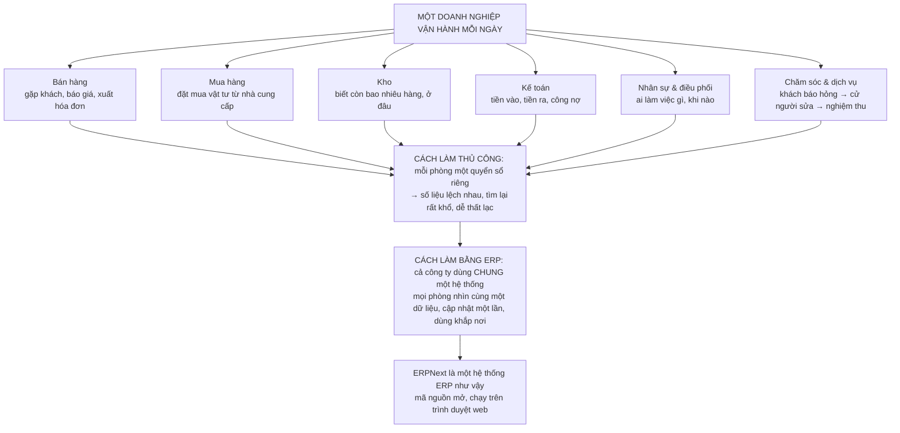
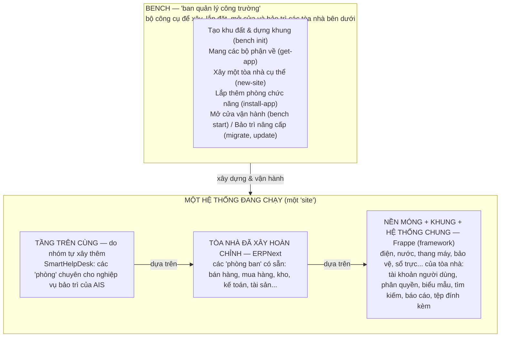
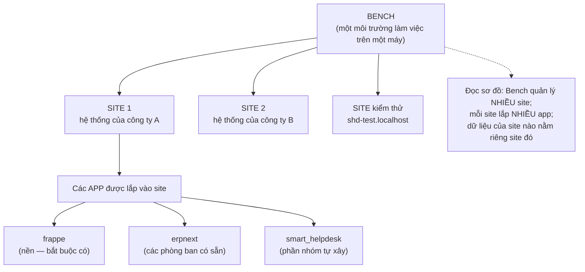
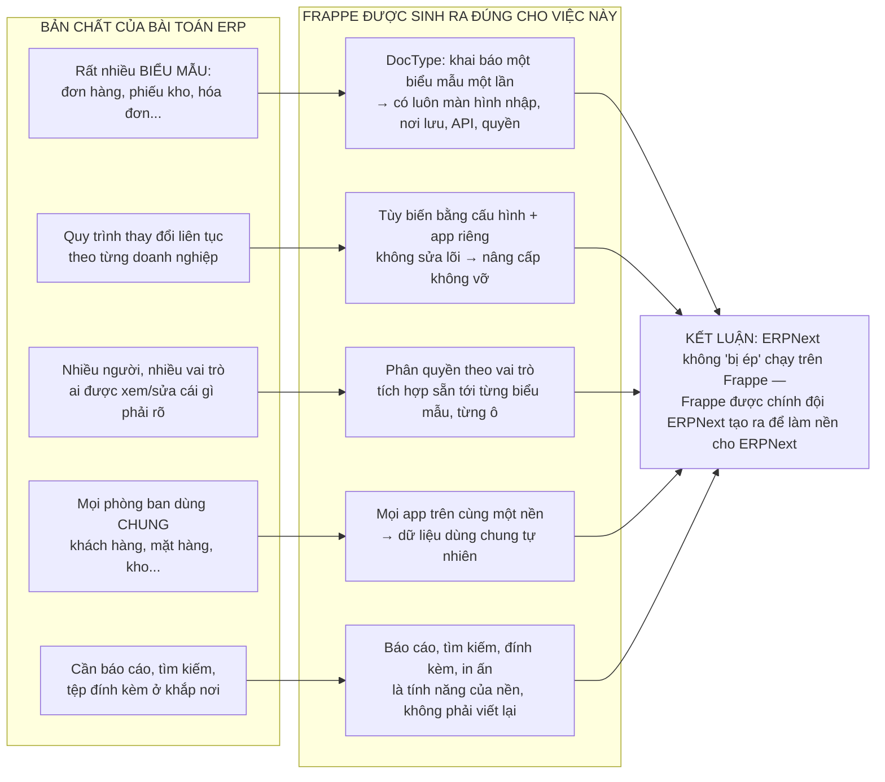
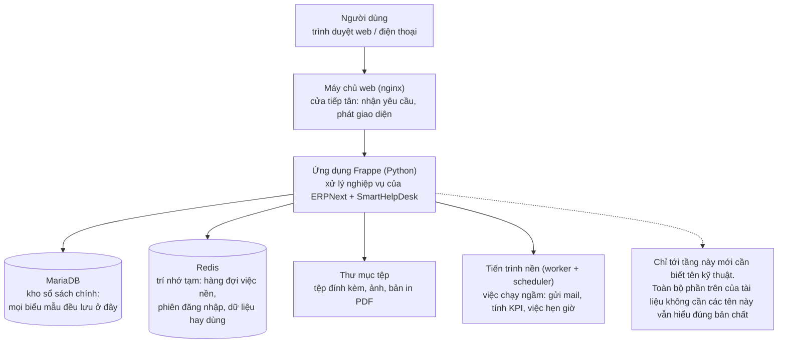

# TÌM HIỂU ERPNEXT TỪ TỔNG QUAN ĐẾN CHI TIẾT
## Frappe là gì, Bench là gì, và vì sao ERPNext được xây trên nền Frappe

*Tài liệu mở đầu của bộ nghiên cứu dự án SmartHelpDesk. Nguyên tắc trình bày theo yêu cầu của giảng viên: đi từ bức tranh tổng quan mà người ít kiến thức phần mềm cũng hiểu được, rồi mới dần xuống chi tiết kỹ thuật. Tên kỹ thuật (cơ sở dữ liệu, máy chủ...) chỉ xuất hiện ở Tầng 4, cuối tài liệu.*

*Thứ tự đọc của cả bộ tài liệu: (1) file này — tổng quan; (2) `Tim-hieu-du-an-SmartHelpDesk-ERPNext-Frappe-Mapping-2026-10-28.md` — dự án dùng ERPNext như thế nào; (3) `Ke-hoach-nghien-cuu-DocType-Module-Mapping-SmartHelpDesk-2026-11-10.md` — nghiên cứu chuyên sâu về DocType và mapping module. Diagram của file này nằm trong thư mục `diagrams-tong-quan-erpnext/` (mỗi diagram có bản `.png` chèn slide, `.svg` chèn báo cáo, `.mmd` để sửa).*

---

# TẦNG 0 — CÂU CHUYỆN ĐỜI THƯỜNG: MỘT DOANH NGHIỆP VÀ NHỮNG QUYỂN SỔ

Hãy quên phần mềm đi một lúc. Một doanh nghiệp — ví dụ công ty bảo trì thiết bị AIS trong dự án của nhóm — mỗi ngày phải lo cùng lúc nhiều việc: gặp khách và xuất hóa đơn (bán hàng), đặt mua vật tư (mua hàng), biết trong kho còn bao nhiêu linh kiện (kho), theo dõi tiền vào tiền ra (kế toán), cử kỹ thuật viên đi sửa máy cho khách (dịch vụ).

Cách làm thủ công ngày xưa: **mỗi phòng ban giữ một quyển sổ riêng**. Phòng kho ghi một kiểu, phòng kế toán ghi một kiểu khác; cùng một mặt hàng nhưng hai nơi ghi hai con số khác nhau, muốn đối chiếu phải đi hỏi từng người. Đó là nỗi đau chung của mọi doanh nghiệp khi lớn lên.

**ERP là lời giải cho nỗi đau đó.** ERP (Enterprise Resource Planning — hoạch định nguồn lực doanh nghiệp) là *một hệ thống phần mềm chung cho cả công ty*: mọi phòng ban làm việc trên cùng một dữ liệu. Kho xuất một linh kiện thì kế toán thấy ngay để tính tiền, người điều phối thấy ngay kho còn bao nhiêu để nhận ca mới. Nhập một lần, dùng khắp nơi, không còn "mỗi nơi một quyển sổ".

**ERPNext là một hệ thống ERP cụ thể** — một sản phẩm có thật, mã nguồn mở (ai cũng xem và dùng được, không phải mua bản quyền đắt đỏ như nhiều ERP lớn), do công ty Frappe Technologies ở Ấn Độ phát triển, và người dùng sử dụng nó qua trình duyệt web giống như dùng một trang web nội bộ của công ty.

> **Chốt Tầng 0:** ERP = một hệ thống chung thay cho nhiều quyển sổ rời rạc. ERPNext = một hệ thống ERP mã nguồn mở cụ thể. Đến đây chưa cần biết nó được làm bằng gì.

---

# TẦNG 1 — BỨC TRANH TOÀN CẢNH: ẨN DỤ VỀ MỘT TÒA NHÀ

Cách dễ nhất để hình dung toàn bộ hệ thống là nghĩ về **một tòa nhà văn phòng**:

- **Frappe là nền móng, khung nhà và các hệ thống dùng chung** — điện, nước, thang máy, bảo vệ, lễ tân. Mọi tòa nhà đều cần những thứ này, và người ta không xây lại chúng cho từng tòa nhà.
- **ERPNext là tòa nhà đã xây hoàn chỉnh trên nền đó** — bên trong đã có sẵn các "phòng ban": phòng bán hàng, phòng mua hàng, phòng kho, phòng kế toán, phòng tài sản... Doanh nghiệp dọn vào là dùng được ngay phần lớn.
- **Phần nhóm tự xây (SmartHelpDesk) là một tầng được xây thêm trên cùng tòa nhà** — các "phòng" chuyên biệt cho nghiệp vụ bảo trì của AIS mà tòa nhà gốc không có, nhưng vẫn dùng chung điện nước, bảo vệ, thang máy của tòa nhà.
- **Bench là ban quản lý công trường** — đội ngũ và bộ công cụ chuyên lo việc *xây dựng và vận hành* tòa nhà: dựng khung, mang vật liệu về, xây từng tòa, lắp thêm phòng, mở cửa cho người vào, bảo trì và nâng cấp. Người làm việc trong tòa nhà (nhân viên AIS) không bao giờ phải gặp "ban quản lý công trường" này — đó là công cụ của đội kỹ thuật.

Bảng đối chiếu ẩn dụ — sự thật, để ghi nhớ lâu dài:

| Ẩn dụ | Tên thật | Là gì trong một câu |
|---|---|---|
| Nền móng + khung + điện nước dùng chung | **Frappe** (framework) | Bộ nền phần mềm cho sẵn mọi thứ mọi hệ thống quản lý đều cần |
| Tòa nhà văn phòng hoàn chỉnh | **ERPNext** | Hệ thống ERP với các phòng ban (module) có sẵn |
| Tầng xây thêm chuyên biệt | **SmartHelpDesk** (app của nhóm) | Phần nghiệp vụ riêng của dự án, xây trên cùng nền |
| Ban quản lý công trường | **Bench** | Bộ công cụ của đội kỹ thuật để tạo, cài đặt, vận hành và nâng cấp hệ thống |
| Một tòa nhà cụ thể đang mở cửa | **Site** | Một hệ thống đang chạy cho một đơn vị, dữ liệu riêng của đơn vị đó |

> **Chốt Tầng 1:** Frappe ở dưới cùng (nền), ERPNext ở giữa (tòa nhà có sẵn), phần của dự án ở trên cùng (xây thêm), và Bench đứng ngoài lo việc xây dựng/vận hành. Mọi chi tiết phía sau chỉ là "mở từng hộp trong sơ đồ này ra xem bên trong có gì".

---

# TẦNG 2 — TỪNG KHÁI NIỆM NÓI BẰNG LỜI THƯỜNG

## 2.1. Framework là gì (nói chung, chưa riêng Frappe)

"Framework" dịch sát là "bộ khung". Trong đời thường, nó giống **khung sườn của một chiếc xe** hoặc **bộ xương của một ngôi nhà**: phần khó và lặp lại đã được làm sẵn, người xây dựng chỉ việc tập trung vào phần riêng của mình (thân xe, nội thất) thay vì chế tạo lại từng con ốc.

Trong phần mềm cũng vậy. Bất kỳ hệ thống quản lý nào — dù là quản lý kho, quản lý trường học hay quản lý bệnh viện — đều cần những việc giống hệt nhau:

- cho người dùng **đăng nhập** và **phân quyền** (ai được xem, ai được sửa);
- có **biểu mẫu** để nhập liệu và **nơi cất dữ liệu** an toàn;
- **tìm kiếm**, **lọc danh sách**, **in ấn**, **xuất báo cáo**;
- gửi **thông báo**, đính kèm **tệp**, ghi lại **ai đã sửa gì, lúc nào**.

Một framework là bộ công cụ làm sẵn tất cả những việc chung đó. Ai xây phần mềm nghiệp vụ trên framework sẽ không viết lại "bánh xe" đăng nhập/phân quyền/biểu mẫu nữa, mà dành sức cho phần nghiệp vụ thật sự khác biệt của mình.

## 2.2. Frappe — bộ khung được làm riêng cho phần mềm quản lý

Frappe là một framework như thế, nhưng có một điểm rất riêng: nó được thiết kế **chuyên cho các phần mềm dạng "quản lý biểu mẫu và quy trình"** — đúng bản chất của ERP. Những gì Frappe cho sẵn, nói bằng lời thường:

- **Tài khoản và phân quyền:** mỗi người một tài khoản, thuộc các vai trò (ví dụ: điều phối viên, kỹ thuật viên, quản lý kho); quyền xem/sửa được quy định rõ tới từng loại biểu mẫu.
- **Khái niệm "biểu mẫu chuẩn" (tên kỹ thuật: DocType):** trong Frappe, mọi thứ doanh nghiệp quản lý — một khách hàng, một hóa đơn, một phiếu kho, một yêu cầu sửa chữa — đều là một "biểu mẫu" có cấu trúc rõ ràng. Chỉ cần *khai báo* biểu mẫu gồm những ô thông tin nào, Frappe tự lo phần còn lại: màn hình nhập liệu, nơi lưu trữ, quyền truy cập, khả năng tìm kiếm. (Cơ chế sâu của DocType được đào riêng trong tài liệu nghiên cứu số 3 — ở tầng tổng quan chỉ cần hiểu ý tưởng "khai báo một lần, dùng được ngay".)
- **Một giao diện làm việc chung (tên kỹ thuật: Desk):** toàn bộ nhân viên làm việc trong cùng một giao diện web thống nhất, thay vì mỗi module một phần mềm riêng.
- **Các tiện ích nền:** đính kèm tệp và ảnh, bình luận, thông báo, việc chạy ngầm theo lịch (ví dụ tự tổng hợp báo cáo mỗi đêm), in biểu mẫu ra giấy/PDF, và khả năng mở rộng bằng các ứng dụng (app) lắp thêm.

Nói ngắn gọn: **Frappe lo "cách một hệ thống quản lý vận hành", để người xây dựng chỉ phải lo "hệ thống của mình quản lý cái gì".**

## 2.3. ERPNext — tòa nhà đã có sẵn các phòng ban

ERPNext là phần mềm ERP được xây trên nền Frappe, gồm sẵn các nhóm phòng ban (module) bao phủ gần hết hoạt động của một doanh nghiệp vừa và nhỏ:

- **Bán hàng:** khách hàng, báo giá, đơn bán, hóa đơn.
- **Mua hàng:** nhà cung cấp, yêu cầu mua, đơn đặt hàng, phiếu nhập.
- **Kho:** mặt hàng, kho, số tồn, phiếu xuất/nhập/chuyển kho.
- **Kế toán:** hóa đơn, thu chi, công nợ, sổ sách.
- **Tài sản:** tài sản của công ty, lịch bảo trì tài sản.
- **Hỗ trợ khách hàng:** tiếp nhận yêu cầu/sự cố, cam kết thời gian xử lý (SLA).
- Ngoài ra còn có sản xuất, dự án, bán lẻ... mà không phải doanh nghiệp nào cũng dùng.

Điểm quan trọng cho dự án: ERPNext cho sẵn **rất nhiều nhưng không phải tất cả**. Nghiệp vụ bảo trì hiện trường của AIS có những phần ERPNext không có sẵn (ví dụ giữ vật tư cho một ca sửa cụ thể, tính SLA theo từng hợp đồng) — vì vậy nhóm mới xây thêm app SmartHelpDesk trên cùng nền, thay vì bỏ ERPNext đi viết lại từ đầu. Việc nào dùng sẵn, việc nào xây thêm, và vì sao, là nội dung của tài liệu số 2 và số 3.

## 2.4. Bench — "ban quản lý công trường" là gì, liên hệ thế nào với Frappe và ERPNext

Đây là khái niệm dễ nhầm nhất với người mới, nên nói chậm:

- **Bench không phải một phần của hệ thống mà người dùng cuối sử dụng.** Khi nhân viên AIS đăng nhập vào ERPNext để làm việc, họ không hề chạm vào Bench.
- **Bench là bộ công cụ dòng lệnh dành cho đội kỹ thuật**, lo toàn bộ vòng đời "xây và vận hành" hệ thống:
  - tạo một môi trường làm việc mới (giống như san một khu đất và dựng khung);
  - mang các app về (giống mang vật liệu/bộ phận đến công trường) — trong đó có app Frappe (nền), app ERPNext (tòa nhà), và app của nhóm;
  - xây một **site** cụ thể (một hệ thống hoàn chỉnh cho một đơn vị dùng);
  - lắp thêm app vào site, mở hệ thống cho người dùng vào (chạy), tắt/bật, sao lưu dữ liệu, và nâng cấp khi có phiên bản mới (giống bảo trì tòa nhà).
- **Quan hệ chứa nhau** — nhớ một dòng này là đủ: **Bench quản lý nhiều Site; mỗi Site lắp nhiều App; app bắt buộc đầu tiên luôn là Frappe, rồi mới tới ERPNext và các app khác.** Dữ liệu của site nào nằm riêng trong site đó, dù các site dùng chung một bộ app.

**Liên hệ với dự án của nhóm (câu hỏi thầy có thể đặt: "sao thầy không thấy bench trong dự án của em?"):** trên máy của nhóm, hệ thống đang chạy bằng **Docker** — có thể hiểu là người ta đã dùng Bench xây sẵn một hệ thống hoàn chỉnh ở nơi khác, đóng gói cả "tòa nhà lẫn ban quản lý" vào một hộp kín, máy của nhóm chỉ việc mở hộp ra chạy. Bench vẫn tồn tại **bên trong** hộp đó; mỗi lần cài app SmartHelpDesk, chương trình cài đặt của nhóm vẫn gọi đúng các lệnh của Bench, chỉ khác là gọi qua cửa của Docker. Nhóm đã có kế hoạch dựng thêm một Bench "lộ thiên" trong môi trường Linux (WSL) để học đúng quy trình chuẩn mà giảng viên đã demo; việc này để làm sau và không thay đổi bản chất hệ thống hiện tại.

## 2.5. Site và App — hai từ cuối cùng của tầng này

- **App (ứng dụng):** một gói chức năng lắp được vào hệ thống. Frappe bản thân nó cũng là một app (app nền), ERPNext là một app lớn, SmartHelpDesk là một app nhỏ do nhóm viết. App có thể lắp vào nhiều site khác nhau.
- **Site (hệ thống đang chạy):** một "tòa nhà đã mở cửa" — nơi có dữ liệu thật của một đơn vị và người dùng đăng nhập làm việc. Dự án có site chính (tên `frontend`) và một site riêng chỉ để kiểm thử (`shd-test.localhost`) — giống như có một căn nhà mẫu để thử nội thất trước khi áp dụng vào nhà thật.

---

# TẦNG 3 — VÌ SAO ERPNEXT LẠI PHÙ HỢP ĐỂ XÂY TRÊN NỀN FRAPPE

Đây là câu hỏi "tại sao" quan trọng nhất của phần tổng quan. Câu trả lời không phải "vì người ta thích thế", mà vì **bản chất của bài toán ERP khớp gần như một-một với những gì Frappe được sinh ra để làm**:

| Bản chất của bài toán ERP | Frappe đáp ứng bằng |
|---|---|
| ERP là hàng trăm **biểu mẫu** khác nhau (đơn hàng, phiếu kho, hóa đơn, yêu cầu...) | Ý tưởng DocType: khai báo biểu mẫu một lần là có đủ màn hình nhập, nơi lưu, quyền và khả năng tìm kiếm — thêm một loại biểu mẫu mới rất nhanh |
| Mỗi doanh nghiệp một **quy trình riêng**, thay đổi liên tục | Tùy biến bằng cấu hình và bằng app lắp thêm **mà không sửa lõi** — khi nâng cấp phiên bản, phần tùy biến không bị phá vỡ |
| Rất nhiều người dùng với **vai trò** khác nhau | Phân quyền theo vai trò là tính năng gốc của nền, áp xuống từng biểu mẫu, thậm chí từng ô dữ liệu |
| Mọi phòng ban phải dùng **chung dữ liệu** (cùng một khách hàng, một mặt hàng) | Vì mọi app đều chạy trên cùng một nền và cùng một kho dữ liệu, việc dùng chung là tự nhiên, không cần "nối" các phần mềm rời |
| Báo cáo, tìm kiếm, đính kèm, thông báo cần ở **khắp nơi** | Những thứ này thuộc về nền Frappe, nên module nào của ERPNext cũng được hưởng sẵn |

Còn một lý do lịch sử đáng biết: Frappe và ERPNext **do cùng một đội phát triển** (Frappe Technologies). Họ làm ERPNext trước, rồi rút kinh nghiệm nhiều năm để tách phần nền dùng chung ra thành framework Frappe. Vì vậy quan hệ đúng không phải "ERPNext tình cờ chọn Frappe", mà là **"Frappe được đúc ra từ chính quá trình làm ERPNext, để làm ERPNext và các hệ thống quản lý tương tự"**. Ngày nay trên cùng nền Frappe còn có các app anh em như HRMS (quản trị nhân sự), Frappe Helpdesk (chăm sóc khách hàng) — tất cả lắp chung vào một site được, đó là bằng chứng hệ sinh thái này hoạt động thật.

Mặt đánh đổi cũng phải nói cho trung thực: dùng framework là **gắn bó với cách làm của framework đó** — muốn làm những thứ quá khác bản chất biểu mẫu/quy trình (ví dụ phần mềm xử lý ảnh, trò chơi) thì Frappe không phải lựa chọn hợp lý. Nhưng với bài toán ERP — vốn là biểu mẫu, quy trình và phân quyền — sự gắn bó đó đổi lại tốc độ xây dựng và khả năng tùy biến mà viết từ con số không không thể có trong thời gian của một môn học hay một doanh nghiệp vừa.

> **Chốt Tầng 3:** ERPNext phù hợp trên nền Frappe vì ERP là bài toán "nhiều biểu mẫu + quy trình thay đổi + phân quyền chặt + dữ liệu dùng chung" — và đó chính xác là bốn việc Frappe làm tốt nhất.

---

# TẦNG 4 — MỞ HỘP KỸ THUẬT (chỉ đọc khi đã nắm các tầng trên)

Tới đây mới là nơi các tên kỹ thuật xuất hiện — và người đọc sẽ thấy chúng chỉ là "tên gọi chính thức" của những thứ đã hiểu ở trên:

Giải thích từng hộp trong sơ đồ, nối với ẩn dụ cũ:

- **Trình duyệt của người dùng** chính là "cửa tòa nhà" — nhân viên AIS mở địa chỉ hệ thống (trong dự án: `localhost:8080`) và làm việc; không cần cài phần mềm riêng.
- **Máy chủ web (nginx)** đóng vai "lễ tân": tiếp nhận mọi yêu cầu từ trình duyệt và chuyển vào đúng nơi xử lý, đồng thời phát các phần giao diện tĩnh.
- **Ứng dụng Frappe (viết bằng Python, giao diện bằng JavaScript)** là "bộ máy vận hành trong tòa nhà": nơi ERPNext và SmartHelpDesk thực thi nghiệp vụ. Đây là tầng mà code của nhóm cư trú.
- **MariaDB** là "kho sổ sách chính" — một hệ quản trị cơ sở dữ liệu, nơi mọi biểu mẫu (DocType) được lưu thành các bảng có cấu trúc. Đến tầng này mới cần biết: mỗi DocType tương ứng một bảng (ví dụ DocType `SHD Work Order` ↔ bảng `tabSHD Work Order`).
- **Redis** là "trí nhớ tạm và hàng đợi": giữ các phiên đăng nhập, dữ liệu hay dùng để trả lời nhanh, và xếp hàng các việc chạy ngầm.
- **Tiến trình nền (worker và scheduler)** là "nhân viên hậu cần làm việc theo ca và theo lịch": gửi thông báo, tổng hợp KPI, chạy các việc hẹn giờ — những việc không cần người dùng ngồi chờ.
- **Thư mục tệp** là "phòng lưu trữ hồ sơ": ảnh thiết bị, tệp đính kèm, bản in PDF.

Và Bench khi mở hộp ra là một thư mục có cấu trúc cố định: `apps/` chứa mã nguồn các app (frappe, erpnext, app của nhóm), `sites/` chứa cấu hình và dữ liệu riêng của từng site, `env/` chứa môi trường Python riêng của bench. Trong cách chạy bằng Docker của dự án, toàn bộ thư mục bench này nằm **bên trong container** tại `/home/frappe/frappe-bench` — cùng một cấu trúc, chỉ khác chỗ đặt.

Từ tầng này trở đi, các câu hỏi thuộc loại "DocType hoạt động sâu như thế nào", "module nào dùng sẵn, module nào xây thêm" đã có tài liệu riêng đào sâu: tài liệu số 2 (tổng quan dự án và mapping) và tài liệu số 3 (kế hoạch nghiên cứu DocType — module — mapping kèm sơ đồ quan hệ DocType trích xuất từ mã nguồn thật).

---

# BẢNG TỔNG KẾT MỘT TRANG

| Khái niệm | Một câu đời thường | Một câu kỹ thuật |
|---|---|---|
| **ERP** | Một hệ thống chung cho cả công ty thay vì mỗi phòng một quyển sổ | Phần mềm tích hợp các quy trình nghiệp vụ trên một cơ sở dữ liệu thống nhất |
| **ERPNext** | Tòa nhà văn phòng đã xây sẵn các phòng ban, dọn vào dùng ngay | Hệ thống ERP mã nguồn mở của Frappe Technologies, chạy dạng web app |
| **Frappe** | Nền móng, khung và hệ thống dùng chung của tòa nhà | Framework web (Python/JavaScript) theo hướng metadata-driven, cung cấp DocType, phân quyền, Desk, API |
| **Bench** | Ban quản lý công trường xây dựng và vận hành tòa nhà | Công cụ dòng lệnh quản lý môi trường Frappe: tạo site, cài app, chạy và nâng cấp hệ thống |
| **Site** | Một tòa nhà cụ thể đã mở cửa cho một đơn vị ở | Một instance đang chạy với cơ sở dữ liệu và cấu hình riêng, lắp một tập hợp app |
| **App** | Một bộ phòng chức năng lắp thêm được vào tòa nhà | Một gói mã nguồn Frappe cài đặt được vào site (frappe, erpnext, smart_helpdesk...) |
| **DocType** | Mẫu biểu mẫu chuẩn của một loại hồ sơ trong công ty | Định nghĩa metadata của một loại document, từ đó Frappe sinh bảng dữ liệu, giao diện, API và quyền |

**Ba câu tự kiểm tra sau khi đọc tài liệu này** (trả lời được là đã nắm tổng quan):

1. Vì sao nói ERPNext "xây trên" Frappe mà không phải ngược lại?
2. Bench khác gì với hệ thống mà nhân viên AIS đăng nhập hằng ngày?
3. Một bench có thể phục vụ hai công ty khác nhau mà dữ liệu không lẫn vào nhau — nhờ khái niệm nào ở giữa?

---

## Kết quả thực hành bench (bổ sung 2026-11-10)

Sau khi tài liệu này được soạn, nhóm đã tự dựng **bench native trong WSL2/Ubuntu**
theo đúng quy trình chuẩn của Frappe và cài dự án lên đó. Kết quả dưới đây đều là
số đo/kiểm chứng thật trên máy, không phải trích dẫn tài liệu:

- **Yêu cầu phiên bản (tự phát hiện qua thực hành):** toàn bộ dòng Frappe v16 đòi
  **Python ≥ 3.14** và **Node ≥ 24** — Ubuntu 24.04 mặc định (Python 3.12, Node 20)
  không đủ; bản Docker chạy được vì image đã đóng sẵn hai thứ này. Bench cuối cùng
  dùng đúng bản của dự án: Frappe **v16.33.1**, ERPNext **v16.34.2**.
- **Cài app chuẩn:** site `shd.localhost` trên bench nhận đủ **28/28 DocType SHD**
  (28 bảng `tabSHD ...` trong MariaDB), workspace **Smart Helpdesk** với 10 lối tắt
  M01–M10, **8 vai trò AIS**, khóa duy nhất tổ hợp trên SHD Work Order, ràng buộc
  CHECK `shd_source_xor` và đủ **5 Custom Field** `custom_shd_*` trên các DocType gốc
  (Stock Entry, Material Request, Purchase Order, Purchase Receipt, Sales Invoice).
- **Bài học về cấu trúc app:** Frappe chỉ quét DocType trong thư mục module
  (`<app>/<module>/doctype/`). Lần cài đầu đặt cây DocType ở cấp package nên Frappe
  **bỏ qua lặng lẽ — app báo đã cài nhưng 0 bảng**; sửa vị trí thư mục (commit
  `d873ff2`) thì cài đủ 28 bảng. Đây là minh chứng thực tế cho phần "cơ chế DocType"
  trong tài liệu này.
- **JavaScript phía Desk:** vì DocType nay là DocType chuẩn (không còn custom),
  `operations.js` được nạp qua hooks `doctype_js` cho cả 28 DocType — không cần
  Client Script tạo bằng code như cách làm cũ.
- **Kiểm thử:** bộ test của app trên bench đạt **5/5** (lịch SLA: giờ trưa, cuối tuần/
  ngày lễ, neo UTC, từ chối policy chồng lấp/thiếu); `bench start` phục vụ site ở
  cổng 8000 (HTTP 200).
- **Docker vẫn dùng được app mới:** tạo site dùng một lần ngay trong container
  frappe_docker bằng app chuẩn cho đủ **28 bảng**, rồi xóa site — Docker giữ vai trò
  môi trường phụ/demo, bench là môi trường phát triển chính.

