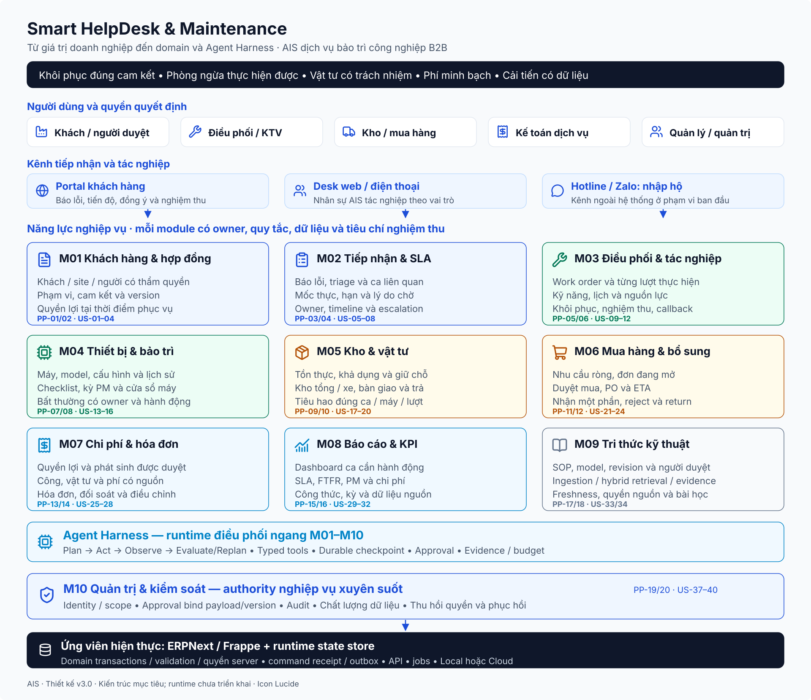
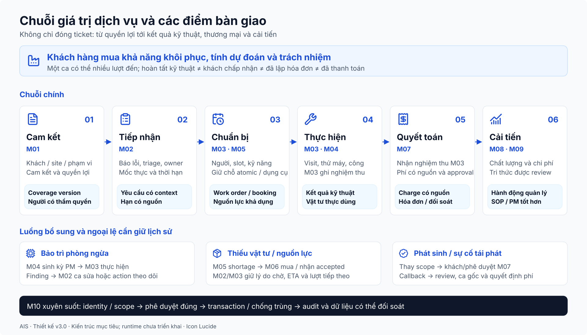
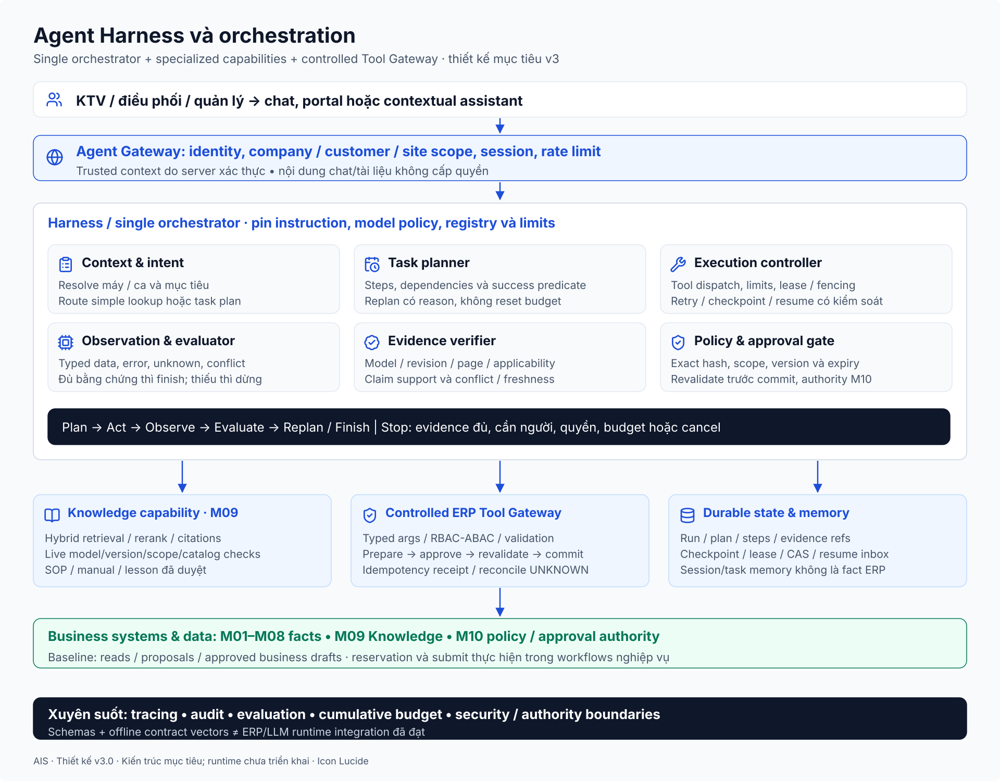

# Giải thích thiết kế đề xuất và so sánh với hệ thống cũ

Ngày biên soạn: 11/10/2026. Phạm vi: Smart HelpDesk & Maintenance cho doanh nghiệp dịch vụ bảo trì công nghiệp B2B AIS.

Tài liệu này giải thích toàn bộ hướng thiết kế đã đề xuất bằng ngôn ngữ dễ hiểu: doanh nghiệp gặp vấn đề gì, hệ thống cần làm gì, mười module phối hợp ra sao, AI tham gia ở đâu và khác gì so với thiết kế ban đầu của bạn.

**Thay đổi lớn nhất là chuyển từ việc liên kết các chứng từ ERPNext quanh một Issue sang quản lý đầy đủ một quá trình cung cấp dịch vụ: yêu cầu → xác định sự cố → tổ chức công việc → từng lần đến hiện trường → vật tư và chi phí → nghiệm thu → đo lường.** Nền tảng ERPNext và những ý tưởng tốt trong thiết kế cũ vẫn được kế thừa.

## 1. Hiểu đúng chữ “cũ” và “đề xuất” trong tài liệu này

Thiết kế cũ được đối chiếu chủ yếu với [báo cáo giữa kỳ](../reports/midterm_report.md), [đặc tả dữ liệu](../specifications/master_data.md), các script trong repository và [pipeline hiện tại](../../run_pipeline.py). Báo cáo có cả phần đã cấu hình và phần định hướng cho giai đoạn sau. Hai phần đó cần phân biệt khi so sánh.

Thiết kế đề xuất là bộ tài liệu phiên bản 3 trong thư mục này. Việc viết ra quy trình, sơ đồ, hợp đồng dữ liệu hay bộ kiểm tra offline chưa có nghĩa quy trình đó đã chạy trên ERPNext.

| Cách gọi | Ý nghĩa |
|---|---|
| Đã có trong thiết kế cũ | Bạn đã mô tả ý tưởng hoặc nghiệp vụ đó trong báo cáo, dù có thể chưa triển khai đầy đủ |
| Có cấu hình/mã hiện tại | Repository có script hoặc cấu hình phục vụ nghiệp vụ; vẫn cần kiểm chứng hành vi trên hệ thống chạy thật |
| Được chuẩn hóa trong đề xuất | Giữ ý tưởng cũ nhưng làm rõ dữ liệu, người quyết định, trạng thái và cách xử lý ngoại lệ |
| Được bổ sung trong đề xuất | Thêm một khái niệm hoặc cơ chế chưa được đặc tả đầy đủ trong tài liệu cũ |
| Chưa triển khai runtime | Mới có thiết kế hoặc mô phỏng kiểm tra; chưa có bằng chứng tích hợp thực với ERP/AI |

AIS là bối cảnh doanh nghiệp giả định bạn đã chọn. Các pain point được suy luận từ đặc điểm doanh nghiệp bảo trì B2B, chưa phải kết quả khảo sát khách hàng thật. Tên Company trong dữ liệu triển khai hiện tại có thể là `SmartHelpDeskBaro`; tên bối cảnh và tên bản ghi ERP không cần đồng nhất.

## 2. Bắt đầu từ doanh nghiệp: vì sao cần thiết kế lại?

AIS nhận bảo trì máy móc cho nhiều nhà máy. Một ca dịch vụ liên quan đến khách hàng, điều phối, kỹ thuật viên, thủ kho, mua hàng, kế toán và quản lý. Khó khăn thường xuất hiện ở chỗ bàn giao giữa những người này.

Ví dụ: điều phối hứa có phụ tùng vì thấy tồn kho là một cái; người khác vừa giữ cái đó cho một ca khác. Kỹ thuật viên đến nơi mới biết thiếu hàng. Khách đồng ý sửa nhưng chưa đồng ý chi phí phát sinh. Kế toán thấy ticket đã đóng nhưng thiếu căn cứ thu tiền. Dashboard vẫn báo hoàn thành dù máy phải sửa lại.

Những vấn đề này không được giải quyết chỉ bằng việc tạo thêm form. Thiết kế phải xác định mỗi quyết định dựa vào dữ liệu nào, ai có quyền quyết định và khi thất bại thì công việc tiếp tục như thế nào.

### 2.1. Từ pain point đến user story và module

Pain point là khó khăn đang làm doanh nghiệp mất thời gian, tiền hoặc chất lượng. User story diễn đạt nhu cầu theo vai trò: “Là ai, tôi muốn làm gì, để đạt kết quả gì”. Module là nhóm năng lực cùng phục vụ một trách nhiệm nghiệp vụ.

| Khó khăn suy luận | Nhu cầu của người dùng | Năng lực được thiết kế |
|---|---|---|
| Không biết hợp đồng có bao gồm máy hoặc chi phí này không | Nhân viên dịch vụ muốn kiểm tra quyền lợi trước khi hứa với khách | Khách hàng, địa điểm, phạm vi hợp đồng và phiên bản quyền lợi |
| Khách báo sớm nhưng ticket được nhập muộn | Điều phối muốn ghi đúng thời điểm báo và theo dõi hạn xử lý | Tiếp nhận đa kênh, timeline và chính sách SLA |
| Gán đúng chuyên môn nhưng người đó đang bận | Điều phối muốn chọn người có năng lực và khả năng nhận việc | Điều phối theo điều kiện đủ, lịch làm việc và công việc hiện có |
| Một ca cần nhiều chuyến nhưng chỉ có một trạng thái ticket | Trưởng nhóm muốn biết mỗi lần đi đã làm gì, còn vướng gì | Lệnh công việc và từng lần tác nghiệp |
| Máy được kiểm tra định kỳ nhưng lỗi phát hiện bị bỏ trong ghi chú | Kỹ thuật viên muốn chuyển phát hiện thành hành động có người theo dõi | Kỳ bảo trì, phát hiện và liên kết ca xử lý |
| Tồn kho có nhưng hàng đã hứa cho ca khác | Thủ kho muốn giữ chỗ có kiểm soát trước khi cấp hàng | Tồn khả dụng, giữ chỗ và cấp/dùng/trả vật tư |
| Hai người cùng đề nghị mua cho một nhu cầu thiếu | Mua hàng muốn biết hàng đang đặt trước khi đặt thêm | Nhu cầu ròng và theo dõi đơn mua/nhận hàng |
| Khách không chấp nhận khoản phí cuối ca | Kế toán muốn có báo giá và sự chấp thuận đúng phiên bản | Ước tính, duyệt phát sinh, nguồn chi phí và hóa đơn |
| Dashboard đẹp nhưng không giải thích được số liệu | Quản lý muốn xem công thức và các ca tạo nên chỉ tiêu | KPI có nguồn, kỳ tính và dữ liệu thiếu được thể hiện rõ |
| AI tìm được tài liệu nhưng chưa chắc đúng máy hoặc được phép dùng | Kỹ thuật viên muốn câu trả lời có nguồn và phù hợp thiết bị | Tri thức đã duyệt, lọc phạm vi và kiểm chứng bằng chứng |
| Người dùng hoặc AI có thể thao tác vượt phạm vi | Quản trị muốn quyền và phê duyệt áp dụng trên mọi đường truy cập | Kiểm soát tại máy chủ, phạm vi dữ liệu và nhật ký thao tác |

Các ví dụ này là cách đọc ngắn của [bản phân tích doanh nghiệp](01_phan_tich_doanh_nghiep_va_yeu_cau.md), nơi đã phân rã thành 20 giả thuyết pain point và 48 user story. Không cần thuộc mã để hiểu hệ thống; mã giúp truy ngược một tính năng về nhu cầu và tiêu chí nghiệm thu của nó.

### 2.2. Điều khác trong cách tiếp cận

Thiết kế cũ tập trung nhiều vào câu hỏi: “ERPNext có DocType nào và cần thêm trường nào để kết nối chúng?”. Đây là nền tảng triển khai hữu ích.

Thiết kế đề xuất bắt đầu bằng câu hỏi: “AIS cần hoàn thành dịch vụ như thế nào và điều gì có thể khiến dịch vụ thất bại?”. Sau đó mới chọn DocType sẵn có, Custom Field, workflow hoặc phần mở rộng phù hợp. Vì vậy tên và ranh giới nghiệp vụ không bị giới hạn bởi cấu trúc hiện tại của `Issue`.

## 3. Tổng quan hệ thống đề xuất

Đọc sơ đồ từ người tham gia đến nhóm năng lực, rồi đến dữ liệu và nền tảng. Mười module là mười nhóm trách nhiệm nghiệp vụ; không bắt buộc triển khai thành mười ứng dụng hoặc mười dịch vụ độc lập.

| Nhóm công việc | Module | Câu hỏi chính |
|---|---|---|
| Hiểu cam kết với khách | M01 — Khách hàng và hợp đồng | Phục vụ ai, ở đâu, máy nào, được hưởng gì và ai được duyệt? |
| Nhận và theo dõi yêu cầu | M02 — Tiếp nhận và SLA | Yêu cầu nào, mức khẩn cấp nào, hạn nào, còn vướng gì? |
| Thực hiện dịch vụ | M03 — Điều phối và tác nghiệp | Ai làm, làm việc gì, đi mấy lần, kết quả và nghiệm thu ra sao? |
| Quản lý đối tượng bảo trì | M04 — Thiết bị và bảo trì | Máy có lịch sử gì, đến kỳ nào, phát hiện gì cần xử lý? |
| Bảo đảm vật tư | M05 — Kho và vật tư | Hàng ở đâu, khả dụng bao nhiêu, đã giữ/cấp/dùng/trả cho ca nào? |
| Bổ sung vật tư | M06 — Mua hàng và bổ sung | Thực sự thiếu bao nhiêu, đang mua bao nhiêu, khi nào nhận được? |
| Quyết toán dịch vụ | M07 — Chi phí và hóa đơn | Chi phí từ đâu, ai trả, đã được duyệt chưa và đã lập hóa đơn chưa? |
| Đo lường hiệu quả | M08 — Báo cáo và KPI | Số liệu có đúng không, vì sao trễ hoặc tái phát, cần hành động gì? |
| Cung cấp tri thức | M09 — Tri thức kỹ thuật | Tài liệu nào được phép dùng, đúng máy và còn hiệu lực không? |
| Kiểm soát toàn hệ thống | M10 — Quản trị và kiểm soát | Ai được thấy/làm/duyệt, có dấu vết và có khôi phục được không? |

AI hỗ trợ các module này thông qua một lớp điều hành riêng gọi là **Agent Harness**. M09 quản lý tri thức; Harness quản lý cách AI thực hiện nhiệm vụ. Hai trách nhiệm này được tách rõ trong phiên bản 3.

## 4. Một ca thực tế để hiểu toàn bộ thiết kế

Ví dụ dưới đây là tình huống giả định để giải thích quy trình, không phải số liệu doanh nghiệp hoặc hướng dẫn sửa chữa của nhà sản xuất.

Nhà máy Tân Á gọi lúc 08:00 báo máy nén dừng. Điều phối nhập hệ thống lúc 08:15. Một người khác gửi email về cùng chiếc máy. Kỹ thuật viên An đến kiểm tra; cần thay một phụ tùng ngoài phạm vi phí trọn gói. Khách duyệt chi phí. Hàng phải điều chuyển từ kho trung tâm nên An đến lần thứ hai. Máy chạy lại, khách nghiệm thu, kế toán lập hóa đơn.

| Bước | Hệ thống cần ghi nhận | Module chính | Điểm cần hiểu |
|---|---|---|---|
| 1. Nhận cuộc gọi | Người báo, máy, địa điểm, thời điểm 08:00 và thời điểm nhập 08:15 | M01, M02 | Thời điểm tạo bản ghi không thay thế thời điểm khách báo |
| 2. Nhận email cùng lỗi | Liên hệ mới gắn vào sự cố đang xử lý sau khi xác minh | M02 | Hai lần liên hệ không nhất thiết là hai sự cố độc lập |
| 3. Kiểm tra quyền lợi | Hợp đồng và chính sách đang hiệu lực cho máy này | M01, M02 | Không lấy hợp đồng mới sửa để thay đổi lịch sử cam kết của ca cũ |
| 4. Tổ chức công việc | Phạm vi sửa, người chịu trách nhiệm và lần đến đầu tiên | M03 | Phân công một người chưa mô tả đủ việc người đó phải làm |
| 5. Ghi kết quả kiểm tra | Kết quả khảo sát, bằng chứng và nhu cầu phụ tùng | M03, M04 | Chưa được coi là khôi phục chỉ vì kỹ thuật viên đã đến |
| 6. Kiểm tra vật tư | Đúng mã tương thích, lượng tồn và lượng đang bị giữ | M05, M09 | Tồn một cái không có nghĩa có thể cấp ngay một cái |
| 7. Xin duyệt phát sinh | Phạm vi, vật tư, số tiền, phiên bản và người có quyền duyệt | M01, M07, M10 | Sửa nội dung đã duyệt thì phải kiểm tra/duyệt lại theo chính sách |
| 8. Cấp và điều chuyển | Giữ chỗ, phiếu chuyển kho, người nhận và ca sử dụng | M05 | Đưa hàng lên xe chưa đồng nghĩa đã tiêu hao |
| 9. Đến lần thứ hai | Vật tư thực dùng, thời gian công và kết quả sửa | M03, M05 | Hai chuyến thuộc cùng quá trình, không mất lịch sử chuyến đầu |
| 10. Xác nhận máy chạy | Mốc khôi phục kỹ thuật và bằng chứng | M03, M02 | Đây là kết quả kỹ thuật, khác việc khách nghiệm thu |
| 11. Khách nghiệm thu | Người xác nhận, phạm vi chấp nhận và thời điểm | M03, M01 | Người báo lỗi chưa chắc là người được duyệt/nhận bàn giao |
| 12. Quyết toán | Phần được bảo hành, phần khách trả, hóa đơn và tình trạng thanh toán | M07 | Máy đã sửa xong không có nghĩa đã thu tiền |
| 13. Tổng hợp chỉ tiêu | Mốc phản hồi/khôi phục, số chuyến, công, vật tư và callback | M08 | KPI được tính từ dữ liệu thật của ca, có thể truy ngược |

AI có thể tìm tài liệu, tổng hợp lịch sử, kiểm tra kho và chuẩn bị đề xuất trong ca này. Các hành động nghiệp vụ thật như xuất kho, giữ chỗ thực hoặc submit hóa đơn vẫn đi qua workflow có thẩm quyền; chúng chưa được mở cho agent trong phạm vi baseline đề xuất.

## 5. Vì sao cần tách yêu cầu, sự cố, lệnh công việc và lần tác nghiệp?

Đây là thay đổi dữ liệu quan trọng nhất so với việc tập trung nhiều trách nhiệm vào `Issue`.

| Khái niệm | Cách hiểu đơn giản | Trong ví dụ |
|---|---|---|
| ServiceRequest — Yêu cầu dịch vụ | Điều khách yêu cầu AIS hỗ trợ, có thông tin tiếp nhận và theo dõi | Cuộc gọi và email yêu cầu xử lý máy |
| Incident — Sự cố | Vấn đề kỹ thuật cần khôi phục | Một lần máy nén dừng đang được xử lý |
| WorkOrder — Lệnh công việc | Gói việc cụ thể giao cho người/đội thực hiện | Kiểm tra và sửa máy nén theo phạm vi đã xác định |
| Visit — Lần tác nghiệp | Một lần đi hiện trường hoặc thực hiện công việc được ghi nhận | Lần đầu khảo sát; lần sau lắp phụ tùng và thử máy |
| PMOccurrence — Kỳ bảo trì | Một lần bảo trì đến hạn của một kế hoạch | Lần kiểm tra máy nén tháng này |
| Finding — Phát hiện | Một điểm bất thường hoặc kết quả cần phân loại trong kỳ kiểm tra | Một dấu hiệu hư hỏng cần mở ca sửa |

Không ép mọi yêu cầu thành sự cố. Khách hỏi tư vấn có thể chỉ cần yêu cầu dịch vụ và công việc tư vấn. Bảo trì định kỳ không có lỗi vẫn cần một kỳ kiểm tra và kết quả rõ ràng.

Thiết kế có `WorkSource`, hiểu là **nguồn sinh công việc**: từ sự cố, từ yêu cầu không có sự cố hoặc từ kỳ bảo trì. Mỗi nguồn phải chỉ rõ thuộc loại nào. Quy tắc chống trùng giúp một sự kiện gửi lại không tạo thêm cùng một gói việc.

Đây là mô hình nghiệp vụ mục tiêu. Cách ánh xạ sang DocType ERPNext hoặc DocType mở rộng còn cần lựa chọn và triển khai; tài liệu không khẳng định các thực thể này đã tồn tại trên site hiện tại.

### 5.1. Tách các mốc hoàn thành để tránh hiểu sai

“Kỹ thuật viên hoàn thành việc”, “máy đã khôi phục”, “khách đã nghiệm thu”, “yêu cầu đã đóng”, “đã lập hóa đơn” và “đã thanh toán” là các mốc khác nhau. Không dùng một nút đóng ticket để đại diện cho tất cả.

M03 ghi nhận sự thật tác nghiệp và nghiệm thu. M02 dùng những sự thật đó để cập nhật tiến độ yêu cầu và xét điều kiện đóng. M07 ghi nhận sự thật tài chính. Cách này tránh hai module tự đặt trạng thái trái nhau về cùng một kết quả.

## 6. Giải thích chi tiết từng module và khác biệt với thiết kế cũ

### 6.1. M01 — Khách hàng và hợp đồng

**Thiết kế cũ:** Đã có Customer, liên kết máy với khách và hai hạng SLA VIP/Standard. Đây là phần được giữ lại.

**Đề xuất:** Quản lý thêm địa điểm phục vụ, người liên hệ, người được phép duyệt, phạm vi máy được bao phủ, lịch hỗ trợ, điều kiện bảo hành và phần phí khách phải trả. Hợp đồng có phiên bản và ngày hiệu lực. Khi mở ca, hệ thống lưu lại quyền lợi áp dụng cho ca đó.

“Lưu lại quyền lợi” giống việc chụp bản điều khoản tại thời điểm tiếp nhận. Tháng sau hợp đồng thay đổi thì vẫn giải thích được tại sao ca tháng này có hạn phản hồi hoặc giá dịch vụ như vậy.

**Ví dụ:** Một khách có hai nhà máy, nhưng chỉ nhà máy A và danh sách máy nhất định thuộc gói VIP. Chọn đúng Customer chưa đủ để áp đúng quyền lợi. Người trực máy được báo lỗi nhưng không tự động có quyền duyệt khoản phát sinh.

**Giá trị nâng cấp:** Giảm hứa sai cam kết và tranh chấp phí. Phần site, thẩm quyền và quyền lợi theo phiên bản chưa được chứng minh đầy đủ trong cấu hình hiện tại.

Chi tiết: [Khách hàng và hợp đồng](modules/m01_khach_hang_va_hop_dong.md).

### 6.2. M02 — Tiếp nhận và SLA

**Thiết kế cũ:** Đã có `Issue`, priority, ma trận SLA hai chiều và `custom_incident_time`. Báo cáo đã phân tích rõ độ trễ nhập liệu; đề xuất mới kế thừa phân tích này.

**Đề xuất:** Có timeline tiếp nhận, phân loại dựa trên tác động, kiểm tra trùng, bổ sung dữ liệu thiếu, thời hạn và lý do chờ. Phân biệt các mốc báo lỗi, nhập liệu, phản hồi, khôi phục và đóng yêu cầu. Quy tắc tính SLA phải chỉ rõ mốc bắt đầu, lịch hỗ trợ và điều kiện dừng/tiếp tục nếu hợp đồng cho phép.

**Ví dụ:** Khách gọi 08:00, nhập 08:15, phản hồi 08:20. Độ trễ ghi nhận là 15 phút; thời gian phản hồi tính từ mốc được hợp đồng quy định. Chỉ thêm trường 08:00 chưa bảo đảm bộ máy tính hạn thực sự sử dụng trường đó.

**Giá trị nâng cấp:** Biến ý tưởng True SLA thành quy tắc có thể kiểm chứng, tránh nhập muộn làm đẹp chỉ tiêu. Không tự coi mọi trạng thái chờ là được tạm dừng SLA; đây là quyết định chính sách cần xác nhận.

Chi tiết: [Tiếp nhận và SLA](modules/m02_tiep_nhan_va_sla.md).

### 6.3. M03 — Điều phối và tác nghiệp

**Thiết kế cũ:** Báo cáo đã đề xuất skill-based routing và xử lý nghỉ phép. Script hiện tại có rule theo nhóm thiết bị; không nên mô tả toàn bộ hiện trạng là chỉ chia việc Round Robin.

**Đề xuất:** Giữ điều phối theo chuyên môn nhưng xét thêm khả năng nhận việc, lịch, phạm vi và việc đang làm. Tách WorkOrder/Visit để ghi nhận từng chuyến, kết quả, thời gian công, nguyên nhân gốc, bàn giao và nghiệm thu. Có quy tắc ưu tiên người đang ở hiện trường hoặc đã làm ca gốc khi phù hợp.

**Ví dụ:** An đủ kỹ năng nhưng đang xử lý ca khác. Hệ thống cần biết điều đó trước khi gán. Khi An đi hai lần, phải thấy lần đầu thiếu vật tư và lần sau khôi phục, thay vì chỉ thấy tên An trên ticket.

**Callback:** Ý tưởng liên kết ca tái phát đã có trong thiết kế cũ. Đề xuất làm rõ điều kiện, cửa sổ thời gian, nguyên nhân, chi phí và ảnh hưởng KPI. Không kết luận mọi lỗi mới trên cùng máy đều là lỗi tay nghề.

**Giá trị nâng cấp:** Theo dõi công việc thực và chất lượng bàn giao. Kịch bản mẫu tự gán kỹ thuật viên sau khi tạo Issue không đủ chứng minh động cơ tự điều phối hoạt động đúng.

Chi tiết: [Điều phối và tác nghiệp](modules/m03_dieu_phoi_va_tac_nghiep.md).

### 6.4. M04 — Thiết bị và bảo trì

**Thiết kế cũ:** Có Asset, địa điểm, QR, kế hoạch/log bảo trì, công cụ hiệu chuẩn và ý tưởng chuyển lỗi phát hiện trong PM thành Issue. Các nội dung này được kế thừa.

**Đề xuất:** Tách hồ sơ thiết bị khách hàng với tài sản nội bộ về ý nghĩa kế toán. Chuẩn hóa kế hoạch có phiên bản, từng kỳ đến hạn, checklist, số đo và nhiều phát hiện. Mỗi phát hiện được phân loại: cần xử lý ngay, theo dõi, lập công việc hoặc không có lỗi.

**Ví dụ:** Hoàn thành kiểm tra định kỳ nhưng phát hiện hai điểm bất thường. Kỳ kiểm tra có thể đã hoàn thành; hai hành động khắc phục vẫn đang mở. Không đóng chúng chỉ vì log PM đã được đánh dấu xong.

Nếu hoãn lịch, giữ được ngày đến hạn gốc và lý do hoãn để đo tuân thủ. Tạo lại lịch không được sinh trùng kỳ kiểm tra hoặc công việc.

**Giá trị nâng cấp:** Hồ sơ kỹ thuật liên tục và bảo trì có khả năng theo dõi kết quả. Phạm vi đồ án vẫn có thể nhập số đo thủ công; không mặc định phải xây IoT hoặc dự báo hỏng bằng AI.

Chi tiết: [Thiết bị và bảo trì](modules/m04_thiet_bi_va_bao_tri.md).

### 6.5. M05 — Kho và vật tư

**Thiết kế cũ:** Đã có kho trung tâm, kho xe, kho thu hồi, phiếu chuyển/xuất và ý tưởng giữ trước vật tư cho PM. Vì vậy giữ chỗ và van stock không phải ý tưởng hoàn toàn mới.

**Đề xuất:** Làm rõ tồn thực tế, lượng giữ chỗ và lượng khả dụng. Giữ chỗ phải được kiểm tra và ghi nhận trong một giao dịch không bị hai yêu cầu đồng thời vượt tồn. Có thời hạn, giải phóng và liên kết với công việc. Phân biệt cấp cho kỹ thuật viên, chuyển kho, sử dụng thực, trả hàng chưa dùng và thu hồi linh kiện hỏng.

**Ví dụ tranh chấp:** Kho còn một phụ tùng, hai ca cùng muốn dùng. Cả hai có thể đọc thấy tồn một, nhưng chỉ một ca được giữ thành công. Ca kia phải nhận kết quả thiếu hàng, không được tiếp tục hứa rằng đã có vật tư.

Đề nghị mua vật tư không tự bảo đảm hàng đã được giữ. Cần một cơ chế reservation có quy tắc và bằng chứng riêng; việc ánh xạ sang chức năng ERPNext nào phải được kiểm chứng trên phiên bản triển khai.

**Giá trị nâng cấp:** Ngăn hứa trùng vật tư và ghi sai tiêu hao. Giữ chỗ an toàn là yêu cầu nền tảng P1 của luồng lõi, không chỉ là tính năng mở rộng về sau.

Chi tiết: [Kho và vật tư](modules/m05_kho_va_vat_tu.md).

### 6.6. M06 — Mua hàng và bổ sung

**Thiết kế cũ:** Có reorder level và luồng mẫu Material Request → Purchase Order → Purchase Receipt → chuyển kho xe.

**Đề xuất:** Tính nhu cầu thiếu sau khi xét lượng khả dụng, lượng đã giữ và nguồn cung đang mở. Liên kết nhu cầu với ca/PM. Theo dõi duyệt mua, ngày dự kiến nhận, nhận một phần, hàng không đạt và phần còn thiếu. Gửi lại cùng nhu cầu không sinh đề nghị mua trùng.

**Ví dụ:** Ca cần ba cái, có thể cấp một và đơn mua đang chờ nhận đã bao phủ một. Chỉ đề nghị phần thiếu còn lại khi các điều kiện thời hạn và phân bổ phù hợp. Không mua thêm ba cái vì chỉ nhìn tồn tại một thời điểm.

**Giá trị nâng cấp:** Mua theo nhu cầu có căn cứ và cho điều phối thấy thời điểm có hàng. Luồng mua mẫu hiện tại chưa chứng minh toàn bộ nhánh nhận thiếu, reject hoặc ngăn mua lặp.

Chi tiết: [Mua hàng và bổ sung](modules/m06_mua_hang_va_bo_sung.md).

### 6.7. M07 — Chi phí và hóa đơn

**Thiết kế cũ:** Có ba trường hợp warranty, billable, goodwill; liên kết Issue/vật tư/hóa đơn và script tài chính mẫu.

**Đề xuất:** Mỗi khoản công, vật tư, di chuyển hoặc phí khác có nguồn phát sinh rõ. Phân định phần AIS chịu, phần bảo hành và phần khách trả. Có ước tính và duyệt phát sinh trước khi thực hiện phần cần chấp thuận. Đối soát với công và vật tư thực tế trước khi lập hóa đơn; điều chỉnh phải có lý do và dấu vết.

**Ví dụ:** Khách duyệt một phụ tùng và hai giờ công. Nếu đề xuất đổi sang hai phụ tùng hoặc tăng giá, bản duyệt cũ không tự cho phép nội dung mới. Phê duyệt tối thiểu gắn với đúng phạm vi, phiên bản, người duyệt và thời hạn ngay từ P1. Luồng nhiều cấp duyệt có thể mở rộng ở P2.

**Giá trị nâng cấp:** Thu đúng, giải thích được và không thu hai lần cùng một nguồn chi phí. Các ID Issue, giá và giờ công mẫu trong script hiện tại chưa tạo thành cơ chế quyết toán tổng quát.

Chi tiết: [Chi phí và hóa đơn](modules/m07_chi_phi_va_hoa_don.md).

### 6.8. M08 — Báo cáo và KPI

**Thiết kế cũ:** Đã đề xuất True SLA, độ trễ ghi nhận, FTFR và các chỉ tiêu bảo trì. Script dashboard có đọc dữ liệu nhưng một số tỷ lệ, số quá hạn và chi phí công vẫn được gán cố định.

**Đề xuất:** Mỗi chỉ tiêu có định nghĩa, tập ca được tính, công thức, kỳ, phạm vi và nguồn chi tiết. Không có dữ liệu thì báo thiếu hoặc chưa tính được. Có thể bấm xuống danh sách ca để giải thích một tỷ lệ.

**Ví dụ:** “Sửa đúng lần đầu” cần xét số lần tác nghiệp và cửa sổ theo dõi tái phát được chọn. Ca vừa đóng chưa đủ thời gian theo dõi có thể chưa kết luận. Không suy ra 100% chỉ vì dữ liệu demo chưa có callback.

Nếu kỹ thuật viên nhập kết quả muộn hoặc sửa thời điểm sai, báo cáo có bản cập nhật và thời điểm chốt dữ liệu. Giữ cả thời điểm sự kiện xảy ra và thời điểm nhập hệ thống; không lặng lẽ xóa lịch sử số đã công bố.

**Giá trị nâng cấp:** Quản lý ra quyết định từ dữ liệu có thể kiểm tra. Những con số trong snapshot demo không được coi là hiệu quả vận hành của một doanh nghiệp thật.

Chi tiết: [Báo cáo và KPI](modules/m08_bao_cao_va_kpi.md).

### 6.9. M09 — Tri thức kỹ thuật

**Thiết kế cũ:** Đã phân biệt dữ liệu ERP có cấu trúc với tài liệu kỹ thuật; đã đề xuất chunking, embeddings, vector search và Hybrid Retrieval.

**Đề xuất:** Quản lý vòng đời tài liệu: nguồn, máy/model áp dụng, phiên bản, ngày hiệu lực, người duyệt và quyền truy cập. Xử lý nội dung PDF/OCR/bảng, tìm theo từ khóa và ngữ nghĩa, xếp hạng rồi kiểm tra tính phù hợp. Câu trả lời phải gắn nhận định với bằng chứng tài liệu.

**Ví dụ:** Hai tài liệu nói khác nhau về cùng mã lỗi nhưng dành cho hai model máy. Không chọn tài liệu có độ giống cao hơn rồi trả lời ngay. Phải đối chiếu model, phiên bản và nguồn; thiếu thông tin thì hỏi thêm hoặc ghi chưa đủ căn cứ.

Tài liệu bị thu hồi không được tiếp tục xuất hiện chỉ vì vector index chưa cập nhật. Lịch sử sửa thành công có thể trở thành bài học sau review, không tự động trở thành hướng dẫn chuẩn cho mọi máy.

**Giá trị nâng cấp:** Tri thức có trách nhiệm và có thể truy nguồn. M09 cung cấp khả năng retrieval; nhiệm vụ chạy nhiều bước, chờ duyệt và tiếp tục thuộc Agent Harness ở phần 8.

Chi tiết: [Tri thức kỹ thuật](modules/m09_tri_thuc_va_tro_ly_ai.md). Tên file giữ từ phiên bản trước để liên kết không bị gãy.

### 6.10. M10 — Quản trị và kiểm soát

**Thiết kế cũ:** Có Role, User Permission và cấu hình quyền theo persona/khách hàng.

**Đề xuất:** Kiểm tra quyền thực tế theo Company, khách, site, công việc và kho; bao gồm trường dữ liệu, tệp, export và API. Xác định ai được lập, ai được duyệt, ai được thực hiện; lưu dấu vết và có kế hoạch sao lưu/khôi phục.

**Ví dụ:** Kỹ thuật viên được xem ca được giao và kho xe phù hợp, không mặc định xem mọi hợp đồng và doanh thu. Khách hàng không được đọc tệp đính kèm của khách khác qua URL/API dù giao diện đã ẩn chúng.

Kiểm soát phải nằm ở máy chủ. Nút giao diện bị ẩn hoặc trường bắt buộc trong Client Script không đủ bảo vệ một thao tác gửi trực tiếp qua API. AI cũng chịu các phạm vi này, không dùng quyền quản trị để thay người dùng.

**Giá trị nâng cấp:** Biến cấu hình quyền thành yêu cầu kiểm chứng trên mọi đường truy cập. Cần thử từng persona và các trường hợp bị từ chối trước khi kết luận phân quyền đạt.

Chi tiết: [Quản trị và kiểm soát](modules/m10_quan_tri_va_kiem_soat.md).

## 7. Những quy tắc chung giúp các module không mâu thuẫn

### 7.1. Một sự thật có một nơi chịu trách nhiệm ghi nhận

| Sự thật | Nơi chịu trách nhiệm | Các module khác sử dụng để làm gì? |
|---|---|---|
| Quyền lợi áp dụng và người có quyền đại diện khách | M01 | SLA, phí và phê duyệt |
| Nội dung tiếp nhận và tiến độ yêu cầu | M02 | Điều phối và theo dõi cam kết |
| Kết quả lần tác nghiệp, khôi phục và khách nghiệm thu | M03 | Đóng yêu cầu, tính thời gian và đối soát |
| Kỳ PM và phân loại phát hiện | M04 | Sinh/theo dõi công việc và đo tuân thủ |
| Giữ chỗ và giao dịch vật tư | M05 | Khả năng cấp, mua bổ sung và tính chi phí |
| Nguồn cung đang mua/đã nhận | M06 cùng chứng từ liên quan | Tính thiếu và dự kiến thời gian có hàng |
| Chấp thuận chi phí, khoản thu và hóa đơn | M07 | Báo cáo tài chính và kết thúc quyết toán |
| Quyền truy cập và chính sách kiểm soát | M10 | Cho phép/từ chối thao tác trên các module |

M08 tổng hợp các sự thật đó; AI đọc hoặc đề xuất dựa trên chúng. Không để dashboard hoặc lời AI tự trở thành bằng chứng rằng hàng đã xuất hoặc khách đã duyệt.

### 7.2. Gửi lại không được tạo thêm kết quả

Mạng chậm khiến người dùng nhấn hai lần; tác vụ nền hoặc AI cũng có thể gửi lại sau timeout. Mỗi lệnh thay đổi dữ liệu cần một mã nhận diện ổn định. Cùng mã và cùng nội dung thì hệ thống trả kết quả đã có. Cùng mã nhưng nội dung khác thì phải từ chối xung đột.

Cơ chế này gọi là **idempotency**, hiểu đơn giản là “thử lại không làm phát sinh thêm một giao dịch giống hệt”. Nó áp dụng cho sinh kỳ PM, công việc, đề nghị và các lệnh có tác dụng lên dữ liệu, không chỉ AI.

### 7.3. Dữ liệu thay đổi thì phải xét lại quyết định

Một báo giá được duyệt lúc 09:00 không bảo đảm điều kiện lúc 10:00 còn nguyên. Trước khi thực hiện phải kiểm tra phiên bản, quyền, hiệu lực và các dữ liệu quan trọng. Thay đổi đáng kể thì yêu cầu quyết định lại theo chính sách.

Những quy tắc này được đặc tả ở [hợp đồng domain và workflow](05_domain_workflow_contracts.md). Tài liệu đó là chuẩn để các bản module và các adapter triển khai cùng hiểu một quy trình.

## 8. AI được nâng cấp như thế nào so với hướng AI cũ?

### 8.1. Phần đã có trong thiết kế cũ

Báo cáo của bạn đã có Intent Router phân loại câu hỏi, RAG tìm tài liệu, API lấy số liệu ERP và LLM tổng hợp. Đã nêu ERP là nguồn chính thức cho tồn kho và LLM không được tự bịa số lượng. Đây là định hướng được giữ lại.

Luồng cũ minh họa rất tốt một câu hỏi kết hợp: tìm giải pháp kỹ thuật rồi kiểm tra phụ tùng. Tuy nhiên sơ đồ chưa đặc tả đầy đủ cách xử lý thiếu thông tin, bằng chứng mâu thuẫn, chờ duyệt, thao tác ghi không rõ kết quả và khôi phục sau tiến trình bị dừng. Nhãn “chính xác 100%” trong sơ đồ cũ được thay bằng yêu cầu đo và kiểm chứng; chưa có bằng chứng để cam kết mức đó.

### 8.2. Agent Harness là gì?

Agent Harness là bộ phận điều hành quanh mô hình AI: nhận nhiệm vụ, xác định người dùng và quyền, chia bước, gọi công cụ, đánh giá kết quả, lưu tiến độ, xin duyệt và quyết định khi nào dừng.

LLM đưa ra suy luận và đề xuất bước tiếp theo. Harness kiểm tra việc đó có được phép không, có đủ bằng chứng không và có vượt giới hạn không. ERP vẫn giữ các sự thật nghiệp vụ.

Baseline là một bộ điều phối với các khả năng chuyên biệt, không phải mỗi module phải có một agent riêng. Câu hỏi đơn giản có thể chỉ cần một lần tra cứu; không bắt mọi câu hỏi chạy qua kế hoạch nhiều bước.

### 8.3. Luồng nhiệm vụ có kiểm chứng

| Bước | Cách hiểu | Ví dụ |
|---|---|---|
| Nhận và xác định phạm vi | Biết ai hỏi, cho khách/site nào và có quyền gì | Kỹ thuật viên đang xử lý ca được giao |
| Làm rõ mục tiêu | Xác định cần trả lời hay chuẩn bị một đề xuất | “Tìm căn cứ và xem có vật tư phù hợp không” |
| Lập kế hoạch | Chia thành bước có đầu vào và điều kiện | Kiểm tra máy → tài liệu → tương thích → tồn khả dụng |
| Thực hiện | Gọi các công cụ đã đăng ký | Đọc lịch sử, tìm tài liệu, hỏi ERP |
| Quan sát và đánh giá | Kiểm tra kết quả thật, thiếu gì, có mâu thuẫn không | Model tài liệu chưa khớp máy, cần bổ sung |
| Điều chỉnh hoặc hỏi thêm | Sửa kế hoạch theo kết quả | Xin serial/model thay vì đoán |
| Xin duyệt nếu cần | Chờ quyết định có thẩm quyền với nội dung cụ thể | Duyệt một đề xuất dự thảo được phép |
| Kiểm chứng và kết thúc | Nêu phần xác nhận được, nguồn và phần còn vướng | Có căn cứ tài liệu nhưng chưa xác nhận được kho |

Vòng lặp là lập kế hoạch → hành động → quan sát → đánh giá → điều chỉnh/kết thúc. Có giới hạn số bước, lần gọi, thời gian và ngân sách. Không để AI thử vô hạn cho đến khi tự tạo ra một câu trả lời có vẻ hợp lý.

### 8.4. Chờ duyệt và tiếp tục sau gián đoạn

Khi cần khách hoặc người phụ trách duyệt, nhiệm vụ lưu **checkpoint** — bản tiến độ gồm các bước đã làm, dữ liệu cần thiết và điểm đang chờ. Nó giải phóng tiến trình đang chạy thay vì giữ một kết nối AI mở suốt nhiều giờ.

Khi có quyết định, hệ thống kiểm tra sự kiện, quyền và dữ liệu hiện tại rồi tiếp tục từ checkpoint. Sự kiện gửi lặp không được làm nhiệm vụ chạy hai lần. Hệ thống khởi động lại vẫn phải nhận ra công việc đang chờ.

“Bộ nhớ AI” ở đây giúp giữ ngữ cảnh, không thay thế truy vấn ERP cho dữ liệu thay đổi như tồn kho. Không lưu toàn bộ chuỗi suy nghĩ nội bộ; lưu tóm tắt quyết định, kết quả công cụ và tham chiếu bằng chứng cần kiểm tra.

### 8.5. Công cụ và quyền ghi dữ liệu

Registry hiện có 15 hợp đồng công cụ: tra thiết bị, quyền lợi, lịch sử, tài liệu, tương thích, tồn khả dụng, nguồn cung, nhân sự, PM, phí, rủi ro; cùng chuẩn bị đề xuất, ghi dự thảo đã duyệt và tra kết quả lệnh.

Đây là đặc tả đầu vào/đầu ra và kiểm soát, chưa phải 15 công cụ đã nối ERP và chạy thật. Danh tính và phạm vi được gateway xác nhận, không cho mô hình tự truyền cờ quản trị để vượt quyền.

Phạm vi baseline cho phép đọc, tìm tri thức, chuẩn bị đề xuất và có thiết kế cho **dự thảo nghiệp vụ đã được duyệt**. Những hành động tác động mạnh như giữ chỗ thực, xuất kho, submit đơn mua/hóa đơn, ép phân công hoặc đóng ca chưa được bật cho agent. Người có thẩm quyền vẫn thực hiện chúng qua workflow nghiệp vụ.

### 8.6. Phê duyệt chính xác nội dung và ghi dữ liệu an toàn

Luồng thiết kế là: chuẩn bị nội dung cố định → người có quyền duyệt → kiểm tra lại điều kiện → ghi dự thảo được phép → lưu biên nhận kết quả.

Bản duyệt gắn với phiên bản và mã kiểm tra nội dung, có thể hiểu như “dấu vân tay” của đề xuất. Đổi vật tư, số tiền hoặc phạm vi thì dấu này đổi; không dùng quyết định cũ cho nội dung mới.

Khi ghi dự thảo, thay đổi dữ liệu, sử dụng quyết định duyệt và lưu biên nhận phải cùng thành công trong giao dịch ERP. Tránh trường hợp đã ghi dữ liệu nhưng hệ thống vẫn cho dùng lại cùng quyết định để ghi thêm lần nữa.

**Ví dụ mất mạng:** ERP đã tạo dự thảo nhưng AI chưa nhận được phản hồi. Agent tra biên nhận theo cùng mã lệnh. Nếu đã thành công thì lấy lại kết quả; không đổi sang mã mới rồi tạo thêm dự thảo. Nếu chưa xác định được kết quả, ghi trạng thái chưa rõ và tiếp tục đối soát, không tuyên bố thất bại hoặc thành công tùy ý.

### 8.7. Các tình huống AI phải xử lý được

| Tình huống | Hành vi đề xuất |
|---|---|
| API kho timeout | Báo chưa xác nhận được tồn; không suy ra tồn bằng 0 và không tự đề nghị mua vì timeout |
| Tìm được tài liệu nhưng chưa biết đúng model | Yêu cầu làm rõ hoặc giới hạn kết luận; chưa đưa khẳng định kỹ thuật chắc chắn |
| Hai nguồn phù hợp mâu thuẫn | Nêu mâu thuẫn và chuyển xác minh theo quy tắc nguồn |
| Người dùng hỏi dữ liệu khách khác | Từ chối theo quyền; không đọc rồi mới cố che câu trả lời |
| Tài liệu bị thu hồi | Loại theo trạng thái nguồn hiện tại dù index/cache còn nội dung |
| Quyết định duyệt hết hạn hoặc dữ liệu đổi | Kiểm tra lại và yêu cầu duyệt mới khi cần |
| Chỉ hoàn thành một phần | Trả phần đã xác nhận, phần chưa làm và lý do |
| Hết giới hạn bước/thời gian | Dừng có trạng thái và tiến độ rõ ràng |
| Hủy sau khi dữ liệu đã ghi | Giữ đúng kết quả đã ghi; hủy không tự đảo ngược giao dịch |

### 8.8. Chín bản thiết kế AI giải quyết những gì?

| Tài liệu | Nội dung dễ hiểu |
|---|---|
| [01 — Kiến trúc Harness](ai_architecture/01_agent_harness_architecture.md) | Các bộ phận điều hành AI và ranh giới với mười module |
| [02 — Điều phối nhiệm vụ](ai_architecture/02_agent_orchestration_workflow.md) | Vòng đời nhiệm vụ, nhánh chờ, kết thúc và tiếp tục |
| [03 — Trạng thái và bộ nhớ](ai_architecture/03_agent_state_and_memory.md) | Lưu tiến độ gì, dùng ngữ cảnh gì và khôi phục ra sao |
| [04 — Nạp và tìm tri thức](ai_architecture/04_rag_ingestion_and_retrieval.md) | Từ tài liệu được duyệt đến kết quả tìm kiếm có nguồn |
| [05 — Công cụ và hợp đồng](ai_architecture/05_tool_registry_and_contracts.md) | AI được gọi gì, tham số nào, lỗi nào và quy tắc thử lại |
| [06 — Lập kế hoạch và thực hiện](ai_architecture/06_reasoning_planning_execution.md) | Chia nhiệm vụ, xét kết quả và điều chỉnh có giới hạn |
| [07 — Bảo mật và người duyệt](ai_architecture/07_security_and_human_approval.md) | Quyền, ranh giới hành động và phê duyệt đúng nội dung |
| [08 — Theo dõi và đánh giá](ai_architecture/08_observability_and_evaluation.md) | Xem vì sao nhiệm vụ thành/bại và đo chất lượng trước pilot |
| [09 — Kịch bản xuyên suốt](ai_architecture/09_end_to_end_agent_scenarios.md) | Triage, hỗ trợ kỹ thuật, vật tư, PM, phí và quản trị trong tình huống cụ thể |

## 9. Bảng đối chiếu tổng hợp với hệ thống cũ

“Chưa đầy đủ” trong bảng nghĩa là chưa thấy đặc tả hoặc bằng chứng đủ trong repository được đối chiếu, không khẳng định ERPNext nói chung không có khả năng đó.

| Hạng mục | Thiết kế/mã cũ | Thiết kế đề xuất | Loại thay đổi |
|---|---|---|---|
| Nền tảng | ERPNext/Frappe, script REST API, Issue native | Tiếp tục dùng nền tảng, bổ sung phần thiếu theo nghiệp vụ | Giữ lại |
| Cách phân rã | DocType và Custom Field làm trọng tâm | Chuỗi giá trị, pain point/story rồi đến module và dữ liệu | Thay cách tổ chức thiết kế |
| Hợp đồng | Customer, VIP/Standard và SLA | Site, coverage, người duyệt, phiên bản và quyền lợi của từng ca | Mở rộng |
| Thời gian sự cố | Đã có incident_time và phân tích logging latency | Timeline đầy đủ và quy tắc clock/deadline cần nghiệm thu | Chuẩn hóa |
| Điều phối | Đã đề xuất kỹ năng/nghỉ phép; có rules hiện tại | Điều kiện nhận việc, công việc/lần tác nghiệp và bằng chứng routing | Kế thừa và mở rộng |
| Đơn vị theo dõi | Issue liên kết Asset, log, stock và người được gán | Request, Incident, WorkOrder, Visit có trách nhiệm riêng | Bổ sung mô hình |
| Bảo trì định kỳ | Kế hoạch/log và hướng phát hiện lỗi → Issue | Kỳ PM, nhiều finding, ngày hạn gốc và nguồn công việc chống trùng | Chuẩn hóa và mở rộng |
| Máy khách hàng | Dùng Asset với trường phân biệt | Ranh giới hồ sơ kỹ thuật/kế toán cần được chứng minh | Làm rõ kiểm soát |
| Kho xe/thu hồi | Đã có cấu trúc kho và luồng native | Theo dõi giữ/cấp/dùng/trả/thu hồi và trách nhiệm vật tư | Kế thừa và mở rộng |
| Giữ chỗ | Đã nêu reserved stock theo PM | Reservation giao dịch an toàn, khả dụng và xử lý cạnh tranh ở P1 | Nâng mức đặc tả |
| Mua hàng | Luồng chứng từ mẫu và reorder | Nhu cầu ròng, nguồn cung mở, nhận thiếu/reject và chống lặp | Mở rộng |
| Tài chính | Warranty/billable/goodwill, hóa đơn mẫu | Duyệt phạm vi/chi phí, nguồn charge, phân bổ và đối soát | Mở rộng |
| Hoàn thành | Trạng thái Issue cùng các thao tác đóng | Khôi phục, nghiệm thu, đóng yêu cầu, hóa đơn, thanh toán riêng | Chuẩn hóa |
| Callback | Đã có liên kết Issue gốc và cờ callback | Điều kiện phân loại, cửa sổ theo dõi và tác động KPI/chi phí | Kế thừa và làm rõ |
| KPI | Công thức trong báo cáo; có số cố định trong script | Công thức thực thi, nguồn, phạm vi, kỳ và bản sửa dữ liệu | Nâng yêu cầu kiểm chứng |
| RAG và API | Đã có Hybrid Retrieval/Intent Router | Giữ kết hợp nguồn, thêm governance/phiên bản/evidence/freshness | Kế thừa và mở rộng |
| Điều hành AI | Luồng hỏi → nguồn → tổng hợp | Plan/act/observe/evaluate, durable state, chờ/tiếp tục, giới hạn | Bổ sung Harness |
| Ghi bằng AI | Chưa đặc tả giao dịch/khôi phục đầy đủ | Dự thảo được duyệt, exact binding, receipt và đối soát unknown write | Bổ sung hợp đồng |
| Phân quyền | Role/User Permission và giao diện | Effective scope, API/file/export, quyền duyệt và máy chủ | Nâng kiểm soát |
| Kiểm thử | Kịch bản mẫu/snapshot và báo cáo minh chứng | AC, nhánh lỗi, contract vectors rồi kiểm thử tích hợp thực | Mở rộng phương pháp |

Thiết kế đề xuất không phủ nhận báo cáo cũ. Nhiều ý tưởng đã đúng hướng; phần nâng cấp làm chúng đủ rõ để triển khai, kiểm tra và giải thích khi một ca không đi theo đường thuận lợi.

## 10. Những phần thực sự đã làm và những phần mới là thiết kế

### 10.1. Đầu ra đã có của lần thiết kế này

- Bộ tổng quan, phân tích doanh nghiệp, kiến trúc, lộ trình và hợp đồng workflow.
- Mười bản thiết kế module; chín bản phân rã kiến trúc AI.
- Sơ đồ SVG/Draw.io và [trình xem sơ đồ](diagrams/index.html), có thể mở và chỉnh sửa.
- Mười JSON Schema, registry 15 công cụ, ví dụ và 26 tình huống kiểm tra giao thức offline cho AI.

[Kết quả conformance](ai_architecture/contracts/conformance_results.json) ghi 26 tình huống offline đạt. Đây là kiểm tra schema và mô hình giao thức mô phỏng, không gọi ERP hoặc LLM thực. Nó kiểm tra một số quy tắc như nội dung duyệt, mã lệnh và thử lại trong mô hình; không chứng minh giao dịch ERP hoặc đồng thời thật đã an toàn.

### 10.2. Chưa được chứng minh là triển khai hoàn chỉnh

- Các thực thể mục tiêu và migration dữ liệu trên site ERP.
- Bộ tính SLA mới, workflow PM/finding, reservation đồng thời và quyết toán tổng quát.
- Orchestrator, kho trạng thái bền vững, adapter LLM và gateway công cụ thực.
- Giao dịch ERP ghi dự thảo kèm approval/receipt/outbox.
- Khôi phục sau crash/mất mạng, quyền API/file và hai tác vụ cùng thao tác trên dữ liệu thật.
- Chất lượng retrieval và câu trả lời AI trên tập tài liệu đã được chuyên gia xác nhận.

Đọc mã và snapshot có thể chỉ ra nơi cần kiểm chứng, nhưng không thay thế kết quả chạy thật. Một số hạn chế đáng chú ý hiện tại là gán người trực tiếp trong kịch bản, tỷ lệ KPI cố định, giờ công/giá mẫu, các ID Issue cố định và validation chủ yếu tại giao diện.

## 11. Triển khai theo thứ tự nào để đồ án có thể hoàn thành?

### 11.1. Lát cắt ưu tiên: một ca sửa chữa xuyên suốt

Chọn một khách, một máy và một loại ca để triển khai từ tiếp nhận đến nghiệm thu và quyết toán. Không cần làm mọi màn hình cùng lúc, nhưng lát cắt này phải xử lý được trường hợp thiếu vật tư và phát sinh cần duyệt.

| Thứ tự | Công việc | Bằng chứng cần có |
|---|---|---|
| 1 | Xác nhận giả thuyết doanh nghiệp và chính sách tối thiểu | Ai có quyền, cam kết nào, cách tính thời gian/phí/callback |
| 2 | Chuẩn hóa khách/site/máy và quyền tại máy chủ | Người dùng đúng phạm vi; người sai bị từ chối |
| 3 | Tiếp nhận, nguồn công việc, lệnh việc và lần tác nghiệp | Một ca có nhiều liên hệ/lần đến mà không mất hoặc nhân đôi dữ liệu |
| 4 | Giữ chỗ và duyệt phát sinh tối thiểu | Hai ca không cùng giữ vượt tồn; thay nội dung không dùng duyệt cũ |
| 5 | Khôi phục, nghiệm thu và đối soát | Mốc độc lập; công/vật tư truy về đúng nguồn |
| 6 | PM và mua bổ sung | Phát hiện không bị mất; nhận một phần vẫn biết phần thiếu |
| 7 | Báo cáo thật | Có ca đúng hạn, trễ, thiếu mốc và tái phát; số truy ngược được |
| 8 | Tri thức và AI đọc dữ liệu | Đúng nguồn/model/phạm vi; lỗi API không bị chuyển thành số liệu bịa |
| 9 | AI chuẩn bị và ghi dự thảo đã duyệt | Kiểm thử tích hợp, thử lại, crash và đối soát trước pilot |

P1 ở đây là phần nền tảng phải có trong lát cắt được triển khai, không có nghĩa mọi khả năng doanh nghiệp đều phải làm ngay. Cơ chế duyệt tối thiểu và reservation an toàn thuộc nền tảng đó; nhiều cấp duyệt hoặc tối ưu lịch nâng cao có thể làm sau.

### 11.2. Chi phí và đánh đổi của thiết kế đề xuất

Thiết kế rõ hơn sẽ cần thêm thực thể, trạng thái, giao dịch và ca kiểm thử. Nhân viên phải ghi nhận đủ mốc và nguồn; nếu form quá nặng có thể gây nhập liệu muộn. Vì vậy giao diện nên gom thao tác theo vai trò và tự điền từ dữ liệu đã có, trong khi máy chủ vẫn kiểm tra quy tắc.

ERPNext vẫn xử lý chứng từ phù hợp; không cần viết lại toàn bộ ERP. Cần chọn kỹ phần mở rộng theo version và khả năng site mục tiêu. Mô hình nghiệp vụ chi tiết không bắt buộc microservices, multi-agent, ứng dụng di động mới hoặc IoT.

AI chỉ nên được đưa vào sau khi dữ liệu, quyền và tài liệu nguồn đủ đáng tin. Một trợ lý đọc và giải thích tốt có thể tạo giá trị trước khi mở hành động ghi. Các giá trị ngân sách thử nghiệm trong bản Harness là cấu hình cần đo lại, không phải cam kết SLA doanh nghiệp.

## 12. Cách trình bày với thầy cho dễ hiểu

Có thể đi theo thứ tự: vấn đề doanh nghiệp → sơ đồ tổng quan → một ca minh họa → dữ liệu được tách → khác biệt so với cũ → AI → phạm vi đã làm.

Một đoạn diễn giải có thể dùng:

> “Hệ thống cũ của nhóm đã dùng ERPNext để kết nối ticket, máy, bảo trì, kho và hóa đơn; đồng thời đã có định hướng SLA thực, điều phối theo kỹ năng và AI kết hợp tài liệu với dữ liệu ERP. Thiết kế mới kế thừa nền tảng đó và xuất phát rõ hơn từ khó khăn của doanh nghiệp bảo trì B2B. Chúng em phân rã thành mười nhóm năng lực và mô tả toàn bộ một ca dịch vụ, kể cả thiếu vật tư, nhiều lần đi hiện trường và phát sinh chi phí.
>
> Điểm thay đổi dữ liệu chính là tách yêu cầu của khách, sự cố kỹ thuật, lệnh công việc và từng lần tác nghiệp. Nhờ vậy có thể phân biệt máy đã chạy lại với khách đã nghiệm thu hoặc kế toán đã lập hóa đơn. Vật tư có giữ chỗ an toàn; chi phí có phê duyệt đúng phạm vi; KPI có nguồn để đối chiếu.
>
> Với AI, nhóm giữ hướng RAG kết hợp API nhưng bổ sung bộ điều hành nhiệm vụ: lập kế hoạch, gọi công cụ trong quyền, kiểm tra kết quả, chờ duyệt và tiếp tục sau gián đoạn. Hiện phần này đã có thiết kế và kiểm tra giao thức offline; các workflow và tích hợp ERP/LLM mới vẫn cần triển khai và nghiệm thu thực tế.”

Khi trình bày, mở [sơ đồ tổng quan](diagrams/01_tong_quan_he_thong.svg) trước, [chuỗi giá trị](diagrams/02_chuoi_gia_tri.svg) sau và chỉ mở [Harness](diagrams/05_agent_harness.svg) khi giải thích AI. PDF Microsoft Teams là tài liệu tham khảo cách phân lớp và thể hiện sơ đồ; không phải yêu cầu xây hệ thống trên Teams hoặc Azure.

## 13. Nguồn để đọc sâu và đối chiếu

| Muốn tìm hiểu | Tài liệu |
|---|---|
| Thiết kế ban đầu của bạn | [Báo cáo giữa kỳ](../reports/midterm_report.md), đặc biệt các chương về FSM, fit-gap và hướng AI |
| Dữ liệu và cấu hình cũ | [Master data](../specifications/master_data.md), [setup](../../scripts/setup), [scenarios](../../scripts/scenarios) |
| Script báo cáo hiện tại | [Generate KPI dashboard](../../scripts/reports/generate_kpi_dashboard.py) |
| Bức tranh doanh nghiệp mục tiêu | [Tổng quan](00_tong_quan_he_thong.md) và [pain point/user story](01_phan_tich_doanh_nghiep_va_yeu_cau.md) |
| Dữ liệu và trao đổi giữa module | [Kiến trúc logic](02_kien_truc_logic_va_du_lieu.md) và [workflow contracts](05_domain_workflow_contracts.md) |
| Khoảng cách triển khai chi tiết | [Lộ trình và đối chiếu](03_lo_trinh_va_doi_chieu.md) |
| Danh mục toàn bộ bản thiết kế | [Mục lục thiết kế](readme.md) |
| AI và bằng chứng offline | [Mục lục AI](ai_architecture/readme.md) và [conformance report](ai_architecture/contracts/conformance_results.json) |

Khi thay đổi chính sách hoặc triển khai một phần mới, cần cập nhật các bản module/contract liên quan và trạng thái kiểm chứng. Bản giải thích này giúp đọc hiểu; các bản phân rã là nơi tra quy tắc, dữ liệu và tiêu chí nghiệm thu cụ thể.
