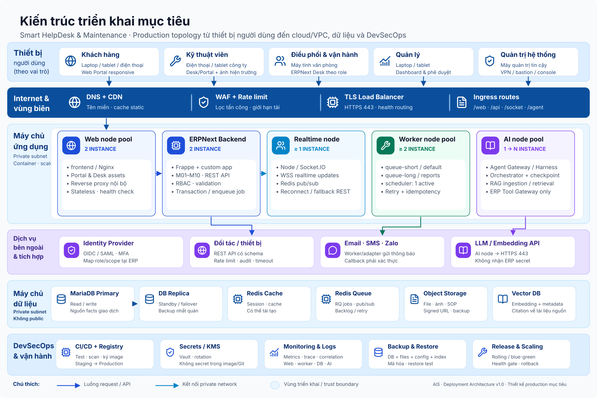

# Kiến trúc triển khai mục tiêu Smart HelpDesk & Maintenance

Phiên bản 1.0 · 12/10/2026 · Thiết kế triển khai production từ đầu cho AIS.



## 1. Mục đích

Kiến trúc triển khai mô tả **hệ thống được cài trên thiết bị/máy chủ nào, mỗi thành phần phần mềm nằm ở đâu và các thành phần giao tiếp với nhau như thế nào**. Tài liệu này là thiết kế mục tiêu để xây dựng hệ thống, không phải báo cáo những gì repository hoặc máy hiện tại đang chạy.

Thiết kế sử dụng ERPNext/Frappe làm nền tảng nghiệp vụ tích hợp cho M01–M10, đồng thời dành một cụm AI riêng cho Agent Harness và RAG. Các module nghiệp vụ là ranh giới trách nhiệm trong cùng ERP, không triển khai thành mười máy chủ hoặc mười microservice.

## 2. Kiến trúc tổng thể

Production được triển khai trong một cloud/VPC hoặc hạ tầng private cloud tương đương, chia thành bốn vùng:

1. **Vùng công khai (public edge):** DNS, WAF/CDN, TLS load balancer và ingress. Đây là lớp duy nhất nhận kết nối từ Internet.
2. **Vùng ứng dụng riêng (private application subnet):** các node chạy frontend, Frappe backend, WebSocket, worker, scheduler và Agent Harness/RAG.
3. **Vùng dữ liệu riêng (private data subnet):** MariaDB, Redis, object storage và vector database. Không thành phần nào ở đây được công bố trực tiếp ra Internet.
4. **Vùng quản trị/vận hành:** CI/CD, container registry, secrets, monitoring, log, backup và công cụ quản trị. Chỉ truy cập qua VPN/bastion hoặc kênh quản trị được kiểm soát.

Người dùng chỉ biết một tên miền, ví dụ `helpdesk.ais.vn`. Load balancer định tuyến web/API tới Frappe và kết nối realtime tới WebSocket. Backend/worker truy cập dữ liệu qua private network. Agent Harness chỉ gọi nghiệp vụ qua Controlled ERP Tool Gateway, không truy cập thẳng MariaDB.

## 3. Thiết bị người dùng

| Nhóm | Thiết bị | Phần mềm phía người dùng | Kết nối |
|---|---|---|---|
| Khách hàng | Laptop, máy tính bảng hoặc điện thoại | Web Portal responsive | HTTPS 443 |
| Kỹ thuật viên | Điện thoại/máy tính bảng công ty | ERPNext Desk/Portal responsive, camera để đính kèm bằng chứng | HTTPS 443, WebSocket qua TLS |
| Điều phối, kho, mua hàng, kế toán | Máy tính văn phòng | Trình duyệt chạy ERPNext Desk | HTTPS 443, WebSocket qua TLS |
| Quản lý | Laptop/máy tính bảng | Dashboard và báo cáo theo vai trò | HTTPS 443 |
| Quản trị hệ thống | Máy quản trị được kiểm soát | Browser, CLI triển khai và công cụ quan sát | VPN/bastion + HTTPS/SSH quản trị |

Không yêu cầu cài desktop client. Thiết kế mobile là responsive web trước; native mobile app chỉ là client khác dùng cùng API khi được phát triển sau.

## 4. Vùng công khai và lớp bảo vệ biên

### 4.1. DNS, CDN và WAF

- DNS ánh xạ tên miền production tới public load balancer.
- CDN có thể cache static assets, không cache response chứa dữ liệu nghiệp vụ riêng tư.
- WAF chặn mẫu tấn công phổ biến, áp rate limit và giới hạn kích thước request/upload.
- Chứng thư TLS được quản lý tập trung và tự động gia hạn.

### 4.2. Load balancer / ingress

Ingress nhận HTTPS 443, thêm correlation/request ID và định tuyến:

- `/assets/*` và static content tới frontend;
- request web và `/api/*` tới Frappe backend pool;
- kết nối realtime tới WebSocket pool;
- `/agent/*` tới Agent Gateway nếu chức năng AI được bật.

Load balancer kiểm tra health endpoint và ngừng gửi traffic tới instance lỗi. HTTP 80 chỉ dùng để redirect sang HTTPS.

## 5. Vùng máy chủ ứng dụng

Các thành phần được đóng gói thành container image có version bất biến. Production khởi đầu với nhiều replica cho đường request chính; số replica được điều chỉnh theo tải đo được.

### 5.1. Web node pool — 2 instance

Mỗi instance chạy frontend Nginx của Frappe:

- phục vụ assets của Portal/Desk;
- reverse proxy request động tới backend;
- chuyển route realtime tới WebSocket;
- áp giới hạn upload, timeout và header bảo mật.

Hai instance nằm sau load balancer để một node có thể dừng mà người dùng vẫn truy cập được.

### 5.2. ERPNext backend node pool — 2 instance

Mỗi instance chạy cùng một image Frappe/ERPNext và custom app Smart HelpDesk:

- DocType, ORM và transaction cho M01–M10;
- REST API và session authentication;
- RBAC/User Permission, validation và audit server-side;
- Portal, Desk controller và các endpoint của Tool Gateway;
- enqueue tác vụ nền vào Redis Queue.

Backend là stateless ở cấp process; session/cache dùng Redis và dữ liệu bền vững nằm ở MariaDB/object storage. Vì vậy có thể tăng/giảm replica mà không sao chép database vào từng node.

### 5.3. Realtime node pool — tối thiểu 1 instance

Chạy Node/Socket.IO để gửi notification, tiến độ job và cập nhật Desk. Realtime dùng Redis pub/sub. Mất WebSocket không được làm hỏng transaction; client có thể reconnect hoặc đọc trạng thái lại qua REST.

### 5.4. Worker node pool — tối thiểu 2 instance

- Worker `short/default` xử lý email, notification và job nhanh.
- Worker `long` xử lý báo cáo, import/export hoặc tác vụ dài.
- Job mang source/correlation/idempotency key khi có khả năng ghi dữ liệu.
- Retry không được tạo lại phiếu kho, hóa đơn, work order hoặc hành động đã commit.

Scheduler chạy dạng **single active instance** để enqueue SLA, kỳ PM, cảnh báo tồn kho và tác vụ định kỳ. Tính duy nhất của scheduler không thay thế idempotency ở job/transaction.

### 5.5. AI node pool — 1 instance ban đầu, có thể mở rộng ngang

Node AI chạy các container tách khỏi ERP web process:

- Agent Gateway: xác thực context, rate limit và scope;
- Orchestrator/worker: plan, tool call, checkpoint, resume và evaluation;
- RAG ingestion worker: parse/chunk/embed tài liệu kỹ thuật;
- Retrieval/reranking: truy vấn vector database và trả evidence có citation;
- Controlled ERP Tool Gateway client: chỉ gọi API được khai báo, không kết nối DB trực tiếp.

Agent service gửi prompt tới LLM provider qua outbound HTTPS. ERP API key hoặc database credential không bao giờ được gửi vào prompt/model provider. Nếu AI lỗi, Portal/Desk và toàn bộ nghiệp vụ ERP vẫn hoạt động.

## 6. Vùng dữ liệu

### 6.1. MariaDB primary và replica

MariaDB là nguồn sự thật giao dịch cho khách hàng, thiết bị, yêu cầu, SLA, work order, kho, mua hàng, chi phí, hóa đơn, quyền và audit.

- Primary nhận read/write từ Frappe backend và worker.
- Replica phục vụ standby/failover và tác vụ đọc phù hợp sau khi kiểm soát độ trễ.
- Chỉ security group của application/worker mới mở TCP 3306.
- Migration schema chạy một lần trong deployment pipeline, không chạy đồng thời trên mọi replica ứng dụng.

### 6.2. Redis Cache và Redis Queue

- Redis Cache lưu cache/session và dữ liệu runtime có thể tái tạo.
- Redis Queue lưu RQ jobs và pub/sub cho realtime.
- Hai vai trò được tách logic; không dùng Redis làm nguồn sự thật nghiệp vụ.
- Chỉ application subnet truy cập TCP 6379.

### 6.3. Object storage

Lưu file đính kèm, ảnh hiện trường, SOP/manual, export lớn và bản backup. Private file dùng signed URL hoặc được stream qua lớp kiểm quyền; không dùng URL public vĩnh viễn cho tài liệu nhạy cảm.

### 6.4. Vector database

Lưu embedding và metadata phục vụ M09/RAG: document ID, revision, model/equipment scope, quyền nguồn và trạng thái hiệu lực. Vector DB không thay object storage; chunk luôn trỏ về tài liệu nguồn để tạo citation.

## 7. Dịch vụ bên ngoài

| Dịch vụ | Luồng | Mục đích | Kiểm soát |
|---|---|---|---|
| LLM/embedding provider | AI node → HTTPS 443 | Reasoning, generation và embedding nếu dùng managed model | Egress allowlist, secret vault, redaction và budget |
| Email/SMS/Zalo gateway | Worker/adapter → HTTPS/SMTP | Gửi thông báo, nhắc SLA và approval link | Không coi notification là phê duyệt; callback phải xác thực |
| Identity provider | Client/Ingress ↔ OIDC/SAML | SSO và MFA cho nhân sự | Mapping role/scope tại ERP; revoke được |
| Đối tác/thiết bị | Integration API ↔ HTTPS | Nhận/gửi dữ liệu đã cho phép | API key riêng, rate limit, schema validation, audit |

Mọi kết nối ngoài đi qua Integration Gateway/adapter có timeout, retry policy, circuit breaker và log correlation. Dữ liệu chưa xác nhận không được tự biến thành giao dịch ERP đã duyệt.

## 8. Ánh xạ phần mềm lên node triển khai

| Artifact/container | Node/pool | Replica khởi đầu | State | Giao tiếp chính |
|---|---|---:|---|---|
| `frontend` (Nginx) | Web node pool | 2 | Stateless | Ingress HTTPS; backend HTTP private; WebSocket route |
| `backend` (Frappe/ERPNext + custom app) | Backend node pool | 2 | Stateless process | MariaDB, Redis, object storage, REST |
| `websocket` | Realtime node pool | 1 | Ephemeral | Ingress WSS, Redis pub/sub |
| `queue-short/default` | Worker node pool | 2 | Job state qua Redis/DB | Redis Queue, MariaDB, object storage |
| `queue-long` | Worker node pool | 1 | Job state qua Redis/DB | Redis Queue, MariaDB, object storage |
| `scheduler` | Worker/control node | 1 active | Schedule metadata | Redis Queue, MariaDB |
| `agent-api` / `orchestrator` | AI node pool | 1 | Run/checkpoint ngoài process | ERP Tool Gateway, state store, LLM API |
| `rag-worker` / `retrieval` | AI node pool | 1 | Index ngoài process | Object storage, vector DB, embedding API |
| MariaDB | Managed DB/data nodes | Primary + replica | Persistent | TCP 3306 private |
| Redis Cache / Queue | Managed cache/data nodes | Theo HA policy | Cache/queue | TCP 6379 private |
| Object storage | Managed storage | Multi-AZ theo dịch vụ | Persistent | HTTPS private endpoint |
| Vector DB | Data node/managed service | 1 + backup ban đầu | Persistent | Private endpoint |

Replica là topology khởi đầu, không phải sizing cuối. CPU/RAM và autoscaling threshold phải chốt sau load test theo lượng người dùng, job, file và truy vấn báo cáo thực tế.

## 9. Luồng giao tiếp chính

### 9.1. Request web/API

1. Thiết bị người dùng phân giải DNS và kết nối HTTPS tới WAF/load balancer.
2. Ingress định tuyến request tới Web/Backend instance còn khỏe.
3. Backend xác thực user/session/token và kiểm role/scope.
4. Backend đọc/ghi MariaDB trong transaction; cache/session qua Redis; file qua object storage.
5. Response trả về client; event realtime được publish qua Redis tới WebSocket khi cần.

### 9.2. Tác vụ nền

1. Backend hoặc scheduler enqueue job vào Redis Queue.
2. Worker phù hợp nhận job và thực hiện logic Frappe.
3. Worker ghi kết quả authoritative vào MariaDB/object storage.
4. Trạng thái được gửi tới client qua WebSocket hoặc notification adapter.
5. Job lỗi được retry theo policy; cùng idempotency key không tạo side effect mới.

### 9.3. Agent/RAG

1. Client gọi Agent Gateway qua HTTPS với identity đã xác thực.
2. Orchestrator lấy context nghiệp vụ bằng typed read API và evidence kỹ thuật từ retrieval.
3. LLM chỉ nhận context tối thiểu đã lọc; kết quả được evaluator kiểm tra.
4. Thao tác ghi được prepare thành draft và chờ approval nếu policy yêu cầu.
5. Tool Gateway revalidate quyền, payload/version và commit trong authority ERP.
6. Receipt, evidence và audit được lưu; timeout write phải reconcile trước khi retry.

## 10. Triển khai phần mềm từ source đến production

```text
Git repository
    → CI: lint + unit/integration/security tests
    → Build image bất biến cho ERP custom app và AI services
    → Scan image + ký artifact
    → Push container registry
    → Deploy Staging
    → Migration + smoke/E2E + permission test
    → Phê duyệt phát hành
    → Rolling/blue-green deploy Production
    → Health check + metric/log verification
    → Rollback image và restore checkpoint nếu release gate thất bại
```

Quy trình triển khai production:

1. Provision network, security group, DNS, TLS, database, Redis và storage bằng Infrastructure as Code.
2. Tạo secrets trong vault/KMS; không đóng gói secret vào image hoặc Git.
3. Deploy data services và kiểm tra backup/replication.
4. Deploy backend/worker một phiên bản; chạy migration có khóa điều phối.
5. Deploy frontend, WebSocket và AI services; đăng ký health check.
6. Chạy smoke test: login, CRUD theo quyền, upload private file, enqueue worker, realtime và một luồng E2E.
7. Chuyển traffic dần; theo dõi error rate/latency/queue/DB trước khi hoàn tất.
8. Gắn release version vào log, evidence và migration record.

## 11. Môi trường Dev, Staging và Production

| Môi trường | Mục đích | Cách triển khai |
|---|---|---|
| Development | Lập trình và test nhanh | Docker local trên máy phát triển; một instance mỗi service; dữ liệu giả |
| Staging | Kiểm tra migration, tích hợp, quyền và release candidate | Topology thu nhỏ nhưng cùng loại service với production; domain/secret/data riêng |
| Production | Phục vụ người dùng thật | Topology trong sơ đồ; HA cho đường request/data; backup, monitoring và change control |

Ba môi trường không dùng chung database, Redis, object bucket, vector index hoặc API credential. Artifact được promote qua môi trường; không sửa code thủ công trên production.

## 12. Bảo mật, quan sát và phục hồi

- Chỉ load balancer có public IP; application/data nodes dùng private IP.
- Security group chỉ mở đúng cặp nguồn–đích và cổng trong bảng giao tiếp.
- MFA cho quản trị; RBAC/User Permission áp dụng đồng nhất cho UI, REST, report, export và file.
- Secrets nằm trong vault/KMS, có rotation và audit; log phải redaction token/password/prompt nhạy cảm.
- Monitoring tối thiểu: availability, latency, HTTP 4xx/5xx, worker health, scheduler heartbeat, queue backlog, DB connections/replication lag, disk/object errors, LLM latency/cost và backup result.
- Log tập trung mang timestamp, release version, actor/service, correlation ID, source và outcome.
- Backup gồm MariaDB, private/public files, site config, custom app version, vector metadata và policy/config cần thiết.
- Backup mã hóa, lưu ngoài failure domain và có restore test định kỳ. RPO/RTO/retention do AIS phê duyệt theo mức quan trọng nghiệp vụ.
- ERP cốt lõi tiếp tục hoạt động khi LLM, vector DB, notification gateway hoặc realtime tạm thời lỗi.

## 13. Tiêu chí nghiệm thu deployment

| Mã | Tiêu chí |
|---|---|
| DA-01 | Không client nào kết nối trực tiếp MariaDB, Redis hoặc vector DB |
| DA-02 | Tắt một web/backend replica nhưng request mới vẫn phục vụ được |
| DA-03 | Scheduler chỉ có một active leader; retry job không tạo chứng từ trùng |
| DA-04 | Private file không đọc được bằng URL công khai không xác thực |
| DA-05 | Role khách/KTV/kho/kế toán/quản lý bị chặn đúng khi gọi UI và REST ngoài scope |
| DA-06 | Queue backlog, worker chết, scheduler dừng, DB lag và backup lỗi đều sinh cảnh báo |
| DA-07 | Khôi phục database + files + config vào môi trường cô lập và chạy được luồng E2E |
| DA-08 | AI bị ngắt vẫn dùng được Portal/Desk và quy trình nghiệp vụ cốt lõi |
| DA-09 | LLM không nhận ERP secret và không có network path trực tiếp tới database |
| DA-10 | Release có image version, migration record, smoke test, rollback target và người duyệt |

## 14. Quyết định kiến trúc

### ADR-DEP-01: ERP tích hợp, không tách M01–M10 thành microservice

Các module chia ownership nghiệp vụ nhưng cùng cần transaction, quyền và chứng từ ERP. Một Frappe custom app/site giảm distributed transaction và chi phí vận hành. Chỉ tách service khi có nhu cầu scale, security hoặc lifecycle thực sự độc lập.

### ADR-DEP-02: tách AI khỏi ERP web process

Agent/RAG có tải, dependency, state và failure mode khác request ERP. Tách AI node cho phép scale/disable độc lập, trong khi mọi authority ghi vẫn thuộc ERP Tool Gateway.

### ADR-DEP-03: dữ liệu nằm trong private subnet

Database/cache/index không public. Tất cả truy cập đi từ service identity được cấp phép; người dùng và LLM không có đường kết nối trực tiếp.

### ADR-DEP-04: container image bất biến và triển khai qua CI/CD

Cùng một artifact được promote từ Staging sang Production. Điều này cho phép truy vết, rollback và tránh sai lệch do sửa thủ công trên server.

## 15. Nguồn kỹ thuật tham khảo

- [Frappe Docker — cấu trúc service](https://github.com/frappe/frappe_docker/blob/main/docs/02-setup/01-overview.md)
- [Frappe Docker — production compose và phương thức triển khai](https://github.com/frappe/frappe_docker/blob/main/docs/01-getting-started/01-choosing-a-deployment-method.md)
- [Frappe Framework — production processes](https://docs.frappe.io/framework-git/administration/production-setup)

Các nguồn xác nhận vai trò frontend, backend, WebSocket, scheduler, worker và Redis. Việc chia subnet, replica, AI node, storage, CI/CD và kiểm soát vận hành trong tài liệu này là quyết định thiết kế mục tiêu của Smart HelpDesk & Maintenance.
