# Bộ brief và prompt vẽ toàn bộ sơ đồ trên GPT web

Ngày rà soát: 11/10/2026. Phạm vi: **27 sơ đồ nội dung** trong `docs/design/diagrams`: 5 sơ đồ tổng quan/dữ liệu/Harness, 10 workflow module và 12 sơ đồ AI chi tiết. PNG là bản xem của SVG; hai file Draw.io chứa các trang trùng nội dung, không phải hai kiến trúc khác. `index.html`, contact sheet và icon là công cụ xem/tài nguyên, không tính thành diagram nghiệp vụ mới.

File này tự chứa bối cảnh, các quy tắc chuẩn, brief từng hình, nhãn và nguồn graph. GPT web không cần truy cập các đường dẫn local để hiểu nội dung. Link local chỉ phục vụ bạn đối chiếu. Mỗi mục là một ảnh riêng; không ghép cả 27 hình thành một ảnh chứa chữ quá nhỏ.

## 1. Kết quả kiểm tra và sửa sơ đồ

Đã đối chiếu nguồn sơ đồ với tổng quan, kiến trúc logic, hợp đồng domain/workflow, mười bản module và chín bản AI. Mermaid trong tài liệu là nguồn chuẩn cho 23 hình kỹ thuật; generator là nguồn của bốn hình trình bày. Đã render lại để kiểm tra cú pháp và kiểm tra các bản trình bày bằng trình duyệt. Kết quả này xác nhận mức tài liệu/biểu diễn; không nghiệm thu nghiệp vụ chạy trên ERPNext hoặc LLM.

| Vấn đề trước rà soát | Điều đã chỉnh |
|---|---|
| Chuỗi giá trị đặt chữ nghiệm thu trong bước M07, dễ hiểu sai owner | M03 ghi nghiệm thu; M07 nhận fact để đối soát |
| Hình quan hệ module là một tập đường chính, thiếu một số handoff | Thêm bảng handoff chính thức và dải Harness; giữ đủ các quan hệ chuẩn |
| ER khiến mỗi ChargeLine bắt buộc liên kết đồng thời Consumption và TimeLog | Hai liên kết optional theo loại nguồn; thêm ràng buộc đúng một loại nguồn phí |
| M02 nối liên hệ trùng rồi không thể hiện theo dõi tiếp; owner facts chưa rõ | Nối lại timeline, nhận khôi phục/nghiệm thu từ M03, xét điều kiện đóng |
| M03 ghi khách chưa chấp nhận rồi vẫn đi thẳng tới hoàn thành | Tách accepted với pending/rejected và nhánh theo dõi/xử lý lại |
| M04 chưa nêu rõ trạng thái finding độc lập kỳ PM | Thêm note giữ findings mở sau hoàn PM và nguồn work PMOccurrence |
| M05 đọc đủ rồi coi giữ chỗ luôn thành công | Thêm transaction recheck/lock/CAS/key và decision hold thành công/xung đột |
| M06 chưa có nhánh nhu cầu ròng bằng 0 | Thêm không tạo MR, chống trùng, nhận thiếu/reject và phần còn mở |
| M07 thiếu gate hiệu lực approval trước thực hiện | Thêm scope/hash/version/expiry, receipt facts nghiệm thu từ M03 |
| M08 chưa thể hiện event muộn/correction | Thêm dedup/as_of/watermark/revision và giữ bản báo cáo cũ |
| M10 không vẽ nhánh permission bị từ chối | Thêm explicit permission gate và approval binding tối thiểu |
| Tool graph chưa tách key conflict, stale và unknown | Thêm zero-effect rejection; APPLIED trả receipt, UNKNOWN mới reconcile |
| E2E AI dễ coi decision event là đủ authority | Thêm đọc quyết định nguồn, dedup/CAS/revalidate |
| Lifecycle thiếu hủy trước dispatch/đang resume/verify | Thêm transition CANCELLED cho các state đó; không tự rollback effect |
| Văn bản phân kỳ M03 còn đặt reservation ở P2 | Sửa theo chuẩn M05: atomic reservation tối thiểu P1; M10 cũng nêu approval gate P1 |

Một số workflow chỉ là lát cắt chính, không liệt kê mọi ngoại lệ hoặc FK. Phần “Quy tắc bắt buộc” dưới mỗi hình bổ sung điều không thể diễn đạt hết trong graph. Không vì một đường không xuất hiện ở hình rút gọn mà bỏ quy tắc trong thiết kế.

## 2. Bối cảnh và từ điển để GPT web hiểu đúng

AIS là doanh nghiệp giả định cung cấp dịch vụ bảo trì công nghiệp B2B cho nhiều nhà máy. Doanh nghiệp cần nhận yêu cầu, thực hiện đúng cam kết, phòng ngừa hỏng, chuẩn bị vật tư, kiểm soát chi phí và cải tiến chất lượng. Các pain point là giả thuyết cần khảo sát, không ghi lên ảnh rằng đã được xác nhận hoặc đã cải thiện hiệu suất.

| Mã | Nhãn chuẩn | Trách nhiệm |
|---|---|---|
| M01 | Khách hàng và hợp đồng | Customer/site/authority/coverage/version/snapshot |
| M02 | Tiếp nhận và SLA | Request/triage/clock/timeline/projection/closure |
| M03 | Điều phối và tác nghiệp | WorkOrder/Visit/time log/restoration/acceptance/callback |
| M04 | Thiết bị và bảo trì | Equipment/plan version/PMOccurrence/checklist/Finding |
| M05 | Kho và vật tư | Actual/held/available/reservation/custody/consumption/return |
| M06 | Mua hàng và bổ sung | Net demand/MR/PO/ETA/accepted receipt/shortfall |
| M07 | Chi phí và hóa đơn | Estimate approval/charges/allocation/invoice/reconciliation |
| M08 | Báo cáo và KPI | Source/formula/as_of/watermark/revision/drill-down |
| M09 | Tri thức kỹ thuật | Document lifecycle/ingestion/hybrid retrieval/evidence/freshness |
| M10 | Quản trị và kiểm soát | Identity/scope/policy/authority/audit/restore |

Request là yêu cầu/liên hệ của khách; Incident là sự cố cần khôi phục; WorkOrder là gói việc được giao; Visit là từng lần thực hiện. PMPlanVersion là kế hoạch có phiên bản; PMOccurrence là kỳ cụ thể; Finding là phát hiện có người theo dõi. Snapshot lưu chính sách áp dụng tại thời điểm giao dịch. Reservation giữ hàng, Consumption ghi hàng thực dùng; chuyển kho không là tiêu hao.

Harness là runtime điều hành AI ngang các module, không là module M11. M09 cung cấp tri thức, không sở hữu run/plan. M10/ERP giữ authority phê duyệt. ERPNext/Frappe là ứng viên hiện thực, không phải lý do giới hạn bài toán doanh nghiệp trong một Issue.

## 3. Quy tắc nội dung áp dụng cho mọi ảnh

1. Giữ tên module, mã, chiều mũi tên, nhánh decision và số lượng/optional của ER theo nguồn. Có thể dịch nhãn tiếng Anh sang tiếng Việt ngắn gọn nhưng không thay nghĩa. Giữ nguyên tên state và technical ID khi chúng là hợp đồng dữ liệu.
2. Khôi phục kỹ thuật, khách nghiệm thu, đóng yêu cầu, lập hóa đơn và thanh toán là các mốc riêng. M03 ghi facts kỹ thuật/nghiệm thu; M02 phản chiếu/đóng theo policy; M07 giữ facts tài chính.
3. WorkSource chỉ có đúng một nguồn Incident, Request không gắn Incident hoặc PMOccurrence. Một nguồn nhiều gói việc; retry cùng source/package/version không sinh thêm.
4. PM xong không tự đóng mọi finding. Callback cần phân loại, không phải cứ cùng máy là callback.
5. Giữ chỗ an toàn và approval phát sinh tối thiểu thuộc P1. Tồn actual không là available; hold phải kiểm tra lại trong transaction.
6. Phê duyệt gắn đúng nội dung/hash/version/authority/expiry; đổi scope/giá phải xét/duyệt lại. UI không thay server validation.
7. Dữ liệu ERP là nguồn facts, tài liệu được duyệt là nguồn bằng chứng kỹ thuật. LLM không bịa số kho, điều khoản, mã phụ tùng hoặc quy trình nhà sản xuất.
8. AI baseline: scoped reads, proposal và approved business draft. Không vẽ agent tự giữ hàng thực, submit kho/PO/invoice, ép phân công hoặc đóng ca.
9. Notification không là approval authority. Chờ có checkpoint bền vững; resume xác thực/dedup/CAS/lease/revalidate; counters không reset.
10. Same command key+hash trả receipt đã có; khác hash conflict. Unknown write tra kết quả authoritative cùng key trước retry. Draft/consume approval/receipt/outbox cùng ERP transaction. Hủy run không tự undo effect đã ghi.
11. KPI có công thức/nguồn/kỳ; dữ liệu muộn/correction tạo revision có dấu vết. Không vẽ số cải thiện hoặc accuracy 100% chưa đo.
12. Sơ đồ là **thiết kế mục tiêu**. Không trình bày contracts offline đã đạt như production/ERP/LLM integration đã hoàn thành. Không thêm Azure/Teams/IoT/mobile app/microservices/multi-agent chưa được thiết kế.

## 4. Phong cách và prompt dùng chung

Áp dụng thiết kế sáng, trang nhã cho báo cáo kiến trúc doanh nghiệp. Nền #F8FAFC, thẻ #FFFFFF, tiêu đề #0F172A, nét phân chia #E2E8F0. Xanh #1D4ED8 cho cam kết/tiếp nhận; xanh lá #047857 cho tác nghiệp/thiết bị; amber #B45309 cho kho/mua; cyan #0284C7 cho tài chính/báo cáo; slate cho M09; đỏ #DC2626 chỉ cho lỗi/từ chối. Font Inter hoặc tương đương hỗ trợ đầy đủ dấu tiếng Việt; tiêu đề sentence case, không viết hoa toàn bộ. Mã kỹ thuật dùng monospace nếu cần.

Icon outline kiểu Lucide: nhà máy/khách, tài liệu/hợp đồng, clipboard/yêu cầu, cờ lê/tác nghiệp, máy/thiết bị, kiện hàng/kho, xe đẩy/mua, hóa đơn/phí, biểu đồ/KPI, sách/tri thức, khiên/quản trị, database/state. Icon phụ trợ, luôn có nhãn; không thay box bằng ảnh lớn gây nhiễu.

Connector vuông góc, đầu mũi tên rõ, nhãn nằm trên nền trắng có khoảng hở. Process là rectangle, decision là diamond, state machine dùng rounded state, ER dùng entity/cardinality, sequence dùng lifeline/activation/ALT/loop. Không dùng tranh phối cảnh 3D cho sơ đồ cần đọc quan hệ. Khoảng cách đều; ưu tiên cỡ ảnh cao nhất công cụ cho phép. Nếu chữ quá dày, dùng poster lớn hoặc chia thành panel trong **cùng sơ đồ**, giữ đầy đủ node/edge.

### Prompt khởi đầu — dán cùng file này

```text
Bạn là người thiết kế infographic kiến trúc hệ thống doanh nghiệp. Tôi gửi một brief tự chứa 27 sơ đồ của Smart HelpDesk & Maintenance cho AIS, doanh nghiệp bảo trì công nghiệp B2B. Hãy dùng file này làm nguồn nội dung chính thức.

Trước khi vẽ, xác định mã sơ đồ tôi chọn, liệt kê node/edge/branch và các quy tắc bắt buộc của mục đó. Sau đó tạo một ảnh đẹp, dễ đọc, chính xác theo loại diagram và phong cách chung trong brief. Không tự thêm công nghệ, nghiệp vụ, số liệu hoặc nhãn “đã triển khai”. Nhãn tiếng Việt phải có dấu và sentence case; giữ mã module/state/ID kỹ thuật.

Tôn trọng chiều mũi tên, owner, transaction boundary, các nhánh lỗi/chờ/từ chối và cardinality. Icon chỉ minh họa. Nếu sơ đồ dày, dùng poster lớn hoặc panel rõ ràng thay vì xóa node/edge. Đặt footer: “AIS · Thiết kế mục tiêu v3 · Runtime mới cần triển khai và kiểm chứng”. Không nhét toàn bộ 27 diagram vào một ảnh.
```

### Prompt chọn một hình — thay mã bằng mục cần vẽ

```text
Hãy vẽ sơ đồ mã [mã sơ đồ] trong file brief. Dùng đúng “Mục tiêu”, “Bố cục”, “Quy tắc bắt buộc” và nguồn nhãn/graph của mục này. Trước khi tạo ảnh, kiểm tra đủ node, chiều nối và nhánh. Tạo một ảnh duy nhất với icon outline, bố cục thoáng và chữ tiếng Việt dễ đọc. Giữ chú thích về giới hạn/authority ngay trong hình khi chúng quyết định cách hiểu diagram.
```

### Prompt sửa ảnh sau khi xem

```text
Đối chiếu ảnh vừa tạo với graph và quy tắc của sơ đồ đã chọn. Liệt kê nhãn sai, node thiếu, chiều nối sai, nhánh thiếu và phần chữ khó đọc. Sửa đúng các điểm đó, giữ phong cách hiện tại, giãn bố cục khi cần; không đơn giản hóa bằng cách xóa quan hệ nghiệp vụ. Kiểm tra dấu tiếng Việt, owner khôi phục/nghiệm thu, giới hạn hành động AI và transaction boundary.
```

Ảnh raster cần kiểm tra lại chữ và connector sau sinh. Nếu cần bản kỹ thuật chính xác để bảo vệ hoặc chỉnh sửa, ưu tiên nguồn Mermaid/SVG/Draw.io hiện có; ảnh GPT dùng làm bản trình bày sau khi đối chiếu. Không cần cài plugin mới chỉ để dùng brief này.

## 5. Danh mục đầy đủ

| STT | Mã sơ đồ | Tên |
|---|---|---|
| 01 | `01_tong_quan_he_thong` | Tổng quan năng lực doanh nghiệp |
| 02 | `02_chuoi_gia_tri` | Chuỗi giá trị và điểm bàn giao |
| 03 | `03_quan_he_module` | Quan hệ và hợp đồng bàn giao module |
| 04 | `04_mo_hinh_du_lieu` | Mô hình dữ liệu nghiệp vụ khái niệm |
| 05 | `05_agent_harness` | Tổng quan Agent Harness có icon |
| 06 | `m01_luong_nghiep_vu` | M01 — Khách hàng và hợp đồng |
| 07 | `m02_luong_nghiep_vu` | M02 — Tiếp nhận và SLA |
| 08 | `m03_luong_nghiep_vu` | M03 — Điều phối và tác nghiệp |
| 09 | `m04_luong_nghiep_vu` | M04 — Thiết bị, kỳ PM và findings |
| 10 | `m05_luong_nghiep_vu` | M05 — Giữ chỗ, cấp, dùng và trả vật tư |
| 11 | `m06_luong_nghiep_vu` | M06 — Nhu cầu ròng và mua bổ sung |
| 12 | `m07_luong_nghiep_vu` | M07 — Duyệt phát sinh và quyết toán |
| 13 | `m08_luong_nghiep_vu` | M08 — KPI có nguồn và phiên bản |
| 14 | `m09_luong_nghiep_vu` | M09 — Vòng đời tri thức và retrieval |
| 15 | `m10_luong_nghiep_vu` | M10 — Quyền, approval và audit |
| 16 | `ai_01_agent_harness_architecture_01` | AI — Kiến trúc thành phần |
| 17 | `ai_02_agent_orchestration_workflow_01` | AI — Vòng đời nhiệm vụ |
| 18 | `ai_02_agent_orchestration_workflow_02` | AI — Sequence thực thi có giới hạn |
| 19 | `ai_02_agent_orchestration_workflow_03` | AI — Sequence prepare, approve và commit |
| 20 | `ai_03_agent_state_and_memory_01` | AI — Dữ liệu runtime và authority |
| 21 | `ai_04_rag_ingestion_and_retrieval_01` | AI — Nạp và công bố tri thức |
| 22 | `ai_04_rag_ingestion_and_retrieval_02` | AI — Tìm kiếm và kiểm chứng nguồn |
| 23 | `ai_05_tool_registry_and_contracts_01` | AI — Gate công cụ và giao dịch |
| 24 | `ai_06_reasoning_planning_execution_01` | AI — Vòng lặp lập kế hoạch và đánh giá |
| 25 | `ai_07_security_and_human_approval_01` | AI — Human approval và tiếp tục |
| 26 | `ai_08_observability_and_evaluation_01` | AI — Các cổng đánh giá và phát hành |
| 27 | `ai_09_end_to_end_agent_scenarios_01` | AI — Kịch bản kỹ thuật và vật tư xuyên suốt |

## 6. Brief chi tiết cho từng ảnh

### 01. Tổng quan năng lực doanh nghiệp

**Mã:** `01_tong_quan_he_thong`. **Ảnh đối chiếu:** [01_tong_quan_he_thong.svg](01_tong_quan_he_thong.svg). **Tài liệu chuẩn:** [00_tong_quan_he_thong.md](../00_tong_quan_he_thong.md).

**Mục tiêu:** Cho người xem thấy AIS cung cấp dịch vụ bảo trì B2B, ai sử dụng và hệ thống được chia thành những trách nhiệm nào.

**Bố cục:** Poster ngang 16:10; actor ở trên, kênh bên dưới, lưới 3×3 M01–M09, hai dải ngang Harness/M10 và nền tảng ở đáy.

**Quy tắc bắt buộc:** Đủ M01–M10 đúng tên. Harness là runtime ngang, không là M11. M10 giữ quyền/policy/approval. Hotline/Zalo là nhập hộ ở phạm vi ban đầu. ERPNext/Frappe là ứng viên hiện thực; không vẽ thành nhiều microservices. Nhóm người dùng không hàm ý mọi người thấy mọi dữ liệu.

**Nhãn nguyên bản theo từng khối:** Giữ đầy đủ nội dung sau; có thể xuống dòng/thu gọn câu mà không đổi nghĩa. Tọa độ không phải yêu cầu cho GPT; bố cục ở trên là hướng dẫn.

- `title`: Smart HelpDesk & Maintenance
- `subtitle`: Từ giá trị doanh nghiệp đến domain và Agent Harness · AIS dịch vụ bảo trì công nghiệp B2B
- `value-text`: Khôi phục đúng cam kết  •  Phòng ngừa thực hiện được  •  Vật tư có trách nhiệm  •  Phí minh bạch  •  Cải tiến có dữ liệu
- `actors-label`: Người dùng và quyền quyết định
- `actor-text0`: Khách / người duyệt
- `actor-text1`: Điều phối / KTV
- `actor-text2`: Kho / mua hàng
- `actor-text3`: Kế toán dịch vụ
- `actor-text4`: Quản lý / quản trị
- `channels-label`: Kênh tiếp nhận và tác nghiệp
- `channel-title0`: Portal khách hàng
- `channel-body0`: Báo lỗi, tiến độ, đồng ý và nghiệm thu
- `channel-title1`: Desk web / điện thoại
- `channel-body1`: Nhân sự AIS tác nghiệp theo vai trò
- `channel-title2`: Hotline / Zalo: nhập hộ
- `channel-body2`: Kênh ngoài hệ thống ở phạm vi ban đầu
- `modules-label`: Năng lực nghiệp vụ · mỗi module có owner, quy tắc, dữ liệu và tiêu chí nghiệm thu
- `M01-title`: M01  Khách hàng & hợp đồng
- `M01-body`: Khách / site / người có thẩm quyền · Phạm vi, cam kết và version · Quyền lợi tại thời điểm phục vụ
- `M01-trace`: PP-01/02 · US-01–04
- `M02-title`: M02  Tiếp nhận & SLA
- `M02-body`: Báo lỗi, triage và ca liên quan · Mốc thực, hạn và lý do chờ · Owner, timeline và escalation
- `M02-trace`: PP-03/04 · US-05–08
- `M03-title`: M03  Điều phối & tác nghiệp
- `M03-body`: Work order và từng lượt thực hiện · Kỹ năng, lịch và nguồn lực · Khôi phục, nghiệm thu, callback
- `M03-trace`: PP-05/06 · US-09–12
- `M04-title`: M04  Thiết bị & bảo trì
- `M04-body`: Máy, model, cấu hình và lịch sử · Checklist, kỳ PM và cửa sổ máy · Bất thường có owner và hành động
- `M04-trace`: PP-07/08 · US-13–16
- `M05-title`: M05  Kho & vật tư
- `M05-body`: Tồn thực, khả dụng và giữ chỗ · Kho tổng / xe, bàn giao và trả · Tiêu hao đúng ca / máy / lượt
- `M05-trace`: PP-09/10 · US-17–20
- `M06-title`: M06  Mua hàng & bổ sung
- `M06-body`: Nhu cầu ròng, đơn đang mở · Duyệt mua, PO và ETA · Nhận một phần, reject và return
- `M06-trace`: PP-11/12 · US-21–24
- `M07-title`: M07  Chi phí & hóa đơn
- `M07-body`: Quyền lợi và phát sinh được duyệt · Công, vật tư và phí có nguồn · Hóa đơn, đối soát và điều chỉnh
- `M07-trace`: PP-13/14 · US-25–28
- `M08-title`: M08  Báo cáo & KPI
- `M08-body`: Dashboard ca cần hành động · SLA, FTFR, PM và chi phí · Công thức, kỳ và dữ liệu nguồn
- `M08-trace`: PP-15/16 · US-29–32
- `M09-title`: M09  Tri thức kỹ thuật
- `M09-body`: SOP, model, revision và người duyệt · Ingestion / hybrid retrieval / evidence · Freshness, quyền nguồn và bài học
- `M09-trace`: PP-17/18 · US-33/34
- `harness-title`: Agent Harness — runtime điều phối ngang M01–M10
- `harness-body`: Plan → Act → Observe → Evaluate/Replan  •  Typed tools  •  Durable checkpoint  •  Approval  •  Evidence / budget
- `M10-title`: M10  Quản trị & kiểm soát — authority nghiệp vụ xuyên suốt
- `M10-body`: Identity / scope  •  Approval bind payload/version  •  Audit  •  Chất lượng dữ liệu  •  Thu hồi quyền và phục hồi
- `M10-trace`: PP-19/20 · US-37–40
- `platform-title`: Ứng viên hiện thực: ERPNext / Frappe + runtime state store
- `platform-body`: Domain transactions / validation / quyền server • command receipt / outbox • API • jobs • Local hoặc Cloud
- `footer`: AIS · Thiết kế v3.0 · Kiến trúc mục tiêu; runtime chưa triển khai · Icon Lucide

**Ý nghĩa đường nối:**

- Kênh tiếp nhận dẫn vào lớp nghiệp vụ; M10 và Harness là hai lớp xuyên suốt. Nền tảng hiện thực nằm dưới, không gán mỗi module cho một server riêng. Các đường kênh là minh họa phân lớp, không là một luồng API cụ thể.

**Lệnh sử dụng:** “Vẽ sơ đồ `01_tong_quan_he_thong` theo brief này, giữ đủ quan hệ và quy tắc; chọn bố cục đề xuất, chữ có dấu, icon outline và footer thiết kế mục tiêu.”

### 02. Chuỗi giá trị và điểm bàn giao

**Mã:** `02_chuoi_gia_tri`. **Ảnh đối chiếu:** [02_chuoi_gia_tri.svg](02_chuoi_gia_tri.svg). **Tài liệu chuẩn:** [00_tong_quan_he_thong.md](../00_tong_quan_he_thong.md).

**Mục tiêu:** Giải thích dịch vụ tạo giá trị qua cam kết, tiếp nhận, chuẩn bị, thực hiện, quyết toán và cải tiến.

**Bố cục:** Ngang 16:9; sáu thẻ bước đều nhau; ba thẻ ngoại lệ dưới chuỗi; dải kiểm soát ở đáy.

**Quy tắc bắt buộc:** M03 ghi khôi phục và nghiệm thu; M07 nhận bằng chứng để đối soát phí. Phát sinh cần duyệt trước khi làm phần vượt phạm vi. Giữ chỗ atomic ở M05. PM xong không tự đóng finding. Chuỗi chính không có nghĩa mọi ca chỉ đi một lần hoặc luôn tuần tự. Khôi phục ≠ nghiệm thu ≠ hóa đơn ≠ thanh toán.

**Nhãn nguyên bản theo từng khối:** Giữ đầy đủ nội dung sau; có thể xuống dòng/thu gọn câu mà không đổi nghĩa. Tọa độ không phải yêu cầu cho GPT; bố cục ở trên là hướng dẫn.

- `title`: Chuỗi giá trị dịch vụ và các điểm bàn giao
- `subtitle`: Không chỉ đóng ticket: từ quyền lợi tới kết quả kỹ thuật, thương mại và cải tiến
- `ribbon-title`: Khách hàng mua khả năng khôi phục, tính dự đoán và trách nhiệm
- `ribbon-body`: Một ca có thể nhiều lượt đến; hoàn tất kỹ thuật ≠ khách chấp nhận ≠ đã lập hóa đơn ≠ đã thanh toán
- `chain-label`: Chuỗi chính
- `step-number0`: 01
- `step-title0`: Cam kết
- `step-module0`: M01
- `step-action0`: Khách / site / phạm vi · Cam kết và quyền lợi
- `step-output-text0`: Coverage version · Người có thẩm quyền
- `step-number1`: 02
- `step-title1`: Tiếp nhận
- `step-module1`: M02
- `step-action1`: Báo lỗi, triage, owner · Mốc thực và thời hạn
- `step-output-text1`: Yêu cầu có context · Hạn có nguồn
- `step-number2`: 03
- `step-title2`: Chuẩn bị
- `step-module2`: M03 · M05
- `step-action2`: Người, slot, kỹ năng · Giữ chỗ atomic / dụng cụ
- `step-output-text2`: Work order / booking · Nguồn lực khả dụng
- `step-number3`: 04
- `step-title3`: Thực hiện
- `step-module3`: M03 · M04
- `step-action3`: Visit, thử máy, công · M03 ghi nghiệm thu
- `step-output-text3`: Kết quả kỹ thuật · Vật tư thực dùng
- `step-number4`: 05
- `step-title4`: Quyết toán
- `step-module4`: M07
- `step-action4`: Nhận nghiệm thu M03 · Phí có nguồn và approval
- `step-output-text4`: Charge có nguồn · Hóa đơn / đối soát
- `step-number5`: 06
- `step-title5`: Cải tiến
- `step-module5`: M08 · M09
- `step-action5`: Chất lượng và chi phí · Tri thức được review
- `step-output-text5`: Hành động quản lý · SOP / PM tốt hơn
- `branch-label`: Luồng bổ sung và ngoại lệ cần giữ lịch sử
- `branch-title0`: Bảo trì phòng ngừa
- `branch-body0`: M04 sinh kỳ PM → M03 thực hiện · Finding → M02 ca sửa hoặc action theo dõi
- `branch-title1`: Thiếu vật tư / nguồn lực
- `branch-body1`: M05 shortage → M06 mua / nhận accepted · M02/M03 giữ lý do chờ, ETA và lượt tiếp theo
- `branch-title2`: Phát sinh / sự cố tái phát
- `branch-body2`: Thay scope → khách/phê duyệt M07 · Callback → review, ca gốc và quyết định phí
- `controls-text`: M10 xuyên suốt: identity / scope → phê duyệt đúng → transaction / chống trùng → audit và dữ liệu có thể đối soát
- `footer`: AIS · Thiết kế v3.0 · Kiến trúc mục tiêu; runtime chưa triển khai · Icon Lucide

**Ý nghĩa đường nối:**

- Cam kết → tiếp nhận → chuẩn bị → thực hiện → quyết toán → cải tiến. Ba nhánh PM, thiếu nguồn lực và phát sinh/callback bổ sung chuỗi; không xóa lịch sử để quay lại bước trước. Approval phát sinh xảy ra trước phần thực hiện vượt phạm vi, không đợi quyết toán mới duyệt.

**Lệnh sử dụng:** “Vẽ sơ đồ `02_chuoi_gia_tri` theo brief này, giữ đủ quan hệ và quy tắc; chọn bố cục đề xuất, chữ có dấu, icon outline và footer thiết kế mục tiêu.”

### 03. Quan hệ và hợp đồng bàn giao module

**Mã:** `03_quan_he_module`. **Ảnh đối chiếu:** [03_quan_he_module.svg](03_quan_he_module.svg). **Tài liệu chuẩn:** [02_kien_truc_logic_va_du_lieu.md](../02_kien_truc_logic_va_du_lieu.md).

**Mục tiêu:** Thể hiện nguồn và đích của dữ liệu/sự kiện, thay vì chỉ đặt các module cạnh nhau.

**Bố cục:** Poster 4:5 hoặc 16:15 rộng; lưới module theo nguồn nguồn lực/tài chính; connector vuông góc; bảng bàn giao bổ sung dưới hình; M10/Harness ngang ở đáy.

**Quy tắc bắt buộc:** Giữ tất cả mũi tên và các dòng bàn giao bổ sung. M03→M02 là facts, M02 chỉ phản chiếu. M04→M03 có kỳ PM/checklist. M01→M07 có quyền lợi theo snapshot. M03/M04→M09 là lesson sau review. M09→Harness/M03 là evidence. M01–M07→M08 theo kỳ/quyền. Harness đi qua gateway, không ghi trực tiếp database. Các đường là quan hệ logic, không xác định giao thức mạng.

**Nhãn nguyên bản theo từng khối:** Giữ đầy đủ nội dung sau; có thể xuống dòng/thu gọn câu mà không đổi nghĩa. Tọa độ không phải yêu cầu cho GPT; bố cục ở trên là hướng dẫn.

- `title`: Quan hệ giữa các module nghiệp vụ
- `subtitle`: Luồng chính trên hình + bảng bàn giao bổ sung · không suy ra microservices
- `coverage-label`: Quyền lợi
- `work-label`: Giao việc
- `result-label`: Kết quả
- `finding-label`: Máy / finding
- `material-demand-label`: Nhu cầu / visit
- `technical-cost-label`: Công / nghiệm thu
- `approved-scope-label`: Duyệt scope/phí
- `valuation-label`: Tiêu hao
- `shortage-label`: Nhu cầu thiếu
- `accepted-receipt-label`: Hàng nhận đạt
- `knowledge-label`: SOP / model
- `financial-source-label`: Phí / chứng từ
- `M01-title`: M01  Khách hàng & hợp đồng
- `M01-body`: Khách / site / người có thẩm quyền · Phạm vi, cam kết và version
- `M02-title`: M02  Tiếp nhận & SLA
- `M02-body`: Báo lỗi, triage và ca liên quan · Mốc thực, hạn và lý do chờ
- `M03-title`: M03  Điều phối & tác nghiệp
- `M03-body`: Work order và từng lượt thực hiện · Kỹ năng, lịch và nguồn lực
- `M04-title`: M04  Thiết bị & bảo trì
- `M04-body`: Máy, model, cấu hình và lịch sử · Checklist, kỳ PM và cửa sổ máy
- `M05-title`: M05  Kho & vật tư
- `M05-body`: Tồn thực, khả dụng và giữ chỗ · Kho tổng / xe, bàn giao và trả
- `M07-title`: M07  Chi phí & hóa đơn
- `M07-body`: Quyền lợi và phát sinh được duyệt · Công, vật tư và phí có nguồn
- `M09-title`: M09  Tri thức kỹ thuật
- `M09-body`: SOP, model, revision và người duyệt · Ingestion / hybrid retrieval / evidence
- `M06-title`: M06  Mua hàng & bổ sung
- `M06-body`: Nhu cầu ròng, đơn đang mở · Duyệt mua, PO và ETA
- `M08-title`: M08  Báo cáo & KPI
- `M08-body`: Dashboard ca cần hành động · SLA, FTFR, PM và chi phí
- `analytics-note`: M08 còn đọc M01–M06 theo kỳ và quyền
- `handoffs-title`: Bàn giao bổ sung theo hợp đồng logic
- `handoffs-left`: M01 → M07: coverage snapshot / quyền lợi tính phí · M04 → M03: kỳ PM / checklist / nguồn công việc · M07 → M02: approval / pending / dispute · M03 / M04 → M09: bài học qua quality review
- `handoffs-right`: M09 → Harness / M03: tri thức có nguồn và scope · M01–M07 → M08: facts theo kỳ / quyền / watermark · M03 → M02: khôi phục / nghiệm thu do M03 ghi · M10 ↔ mọi module: quyền / policy / approval / audit
- `handoffs-note`: Bảng là phần của sơ đồ: giữ các quan hệ này khi dựng lại; không thêm đường chéo qua khối và nhãn.
- `M10-title`: M10  Identity / scope • approval • audit • chất lượng dữ liệu và vận hành — áp dụng cho tất cả module
- `harness-relations-text`: Harness ↔ M01–M10 qua capabilities / gateway: reads, proposals, approved drafts; authority vẫn thuộc domain
- `footer`: AIS · Thiết kế v3.0 · Kiến trúc mục tiêu; runtime chưa triển khai · Icon Lucide

**Ý nghĩa đường nối:**

- M01 → M02: quyền lợi
- M02 → M03: giao việc
- M03 → M02: kết quả/khôi phục/nghiệm thu
- M04 → M02: máy/finding
- M03 → M05: nhu cầu/visit
- M03 → M07: công/nghiệm thu
- M07 → M03: duyệt scope/phí
- M05 → M07: tiêu hao
- M05 → M06: nhu cầu thiếu
- M06 → M05: hàng nhận đạt
- M09 → M04: SOP/model
- M07 → M08: phí/chứng từ
- Các quan hệ trong bảng “Bàn giao bổ sung” và hai dải M10/Harness cũng là nội dung bắt buộc, được liệt kê nguyên bản ở trên. Có thể dùng hai panel chính/bổ sung để tránh dây chéo.

**Lệnh sử dụng:** “Vẽ sơ đồ `03_quan_he_module` theo brief này, giữ đủ quan hệ và quy tắc; chọn bố cục đề xuất, chữ có dấu, icon outline và footer thiết kế mục tiêu.”

### 04. Mô hình dữ liệu nghiệp vụ khái niệm

**Mã:** `04_mo_hinh_du_lieu`. **Ảnh đối chiếu:** [04_mo_hinh_du_lieu.svg](04_mo_hinh_du_lieu.svg). **Tài liệu chuẩn:** [02_kien_truc_logic_va_du_lieu.md](../02_kien_truc_logic_va_du_lieu.md).

**Mục tiêu:** Phân biệt các đối tượng thường bị gộp vào một Issue và giữ đúng quan hệ một/nhiều/optional.

**Bố cục:** Poster ngang 3:2; bốn vùng: khách/cam kết, nguồn công việc, PM/tác nghiệp, nguồn phí/hóa đơn. Crow’s foot rõ, thêm hộp constraints.

**Quy tắc bắt buộc:** WorkSource XOR: đúng một FK Incident, ServiceRequest không có Incident hoặc PMOccurrence. UNIQUE nguồn và UNIQUE(source_id,package_key,generation_version). Kỳ PM UNIQUE(plan_version_id,equipment_id,period_key). Không đọc ba đường optional thành cho phép ba nguồn cùng lúc. ChargeLine có đúng một loại nguồn phí; Consumption/TimeLog optional theo loại, không bắt mọi dòng phí có cả hai. Đây là lát cắt conceptual, không phải schema/DDL đầy đủ.

**Nguồn graph chính xác:** Các node/edge/transition/cardinality dưới đây là hợp đồng nội dung. GPT dựng lại bằng hình đẹp, không in nguyên mã lên ảnh.

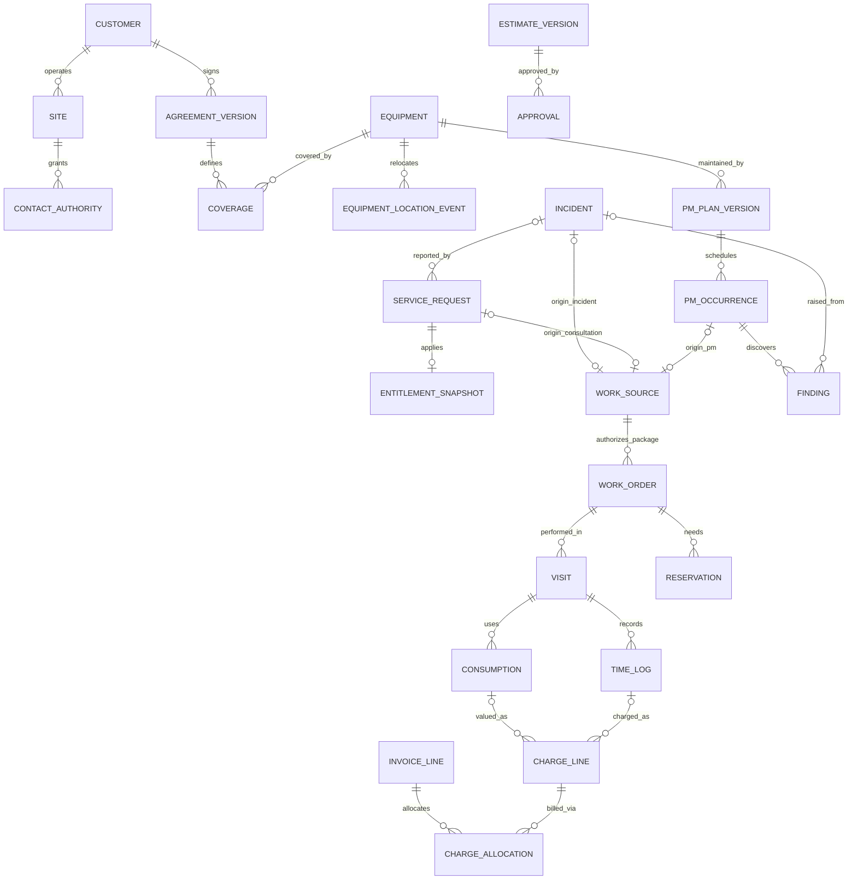

**Lệnh sử dụng:** “Vẽ sơ đồ `04_mo_hinh_du_lieu` theo brief này, giữ đủ quan hệ và quy tắc; chọn bố cục đề xuất, chữ có dấu, icon outline và footer thiết kế mục tiêu.”

### 05. Tổng quan Agent Harness có icon

**Mã:** `05_agent_harness`. **Ảnh đối chiếu:** [05_agent_harness.svg](05_agent_harness.svg). **Tài liệu chuẩn:** [ai_architecture/01_agent_harness_architecture.md](../ai_architecture/01_agent_harness_architecture.md).

**Mục tiêu:** Giải thích cách bộ điều hành giúp AI thực hiện nhiệm vụ nhiều bước trong quyền và có tiến độ bền vững.

**Bố cục:** Poster ngang 4:3; gateway trên, khung single orchestrator ở giữa, sáu thẻ capabilities trong khung, loop riêng, ba cột M09/gateway/state bên dưới, domain và observability ở đáy.

**Quy tắc bắt buộc:** Có context/intent, planner, controller, observation/evaluator, evidence verifier, policy gate; state/checkpoint và final result. Đọc/proposal/draft được duyệt thuộc baseline, không giữ hàng thực/submit/override/close. M09 không sở hữu run; M10/ERP là authority approval. Checkpoint không thay transaction ERP. Offline contract PASS không là ERP/LLM integration PASS.

**Nhãn nguyên bản theo từng khối:** Giữ đầy đủ nội dung sau; có thể xuống dòng/thu gọn câu mà không đổi nghĩa. Tọa độ không phải yêu cầu cho GPT; bố cục ở trên là hướng dẫn.

- `title`: Agent Harness và orchestration
- `subtitle`: Single orchestrator + specialized capabilities + controlled Tool Gateway · thiết kế mục tiêu v3
- `channel-title`: KTV / điều phối / quản lý → chat, portal hoặc contextual assistant
- `gateway-title`: Agent Gateway: identity, company / customer / site scope, session, rate limit
- `gateway-body`: Trusted context do server xác thực • nội dung chat/tài liệu không cấp quyền
- `controller-label`: Harness / single orchestrator · pin instruction, model policy, registry và limits
- `component-title0`: Context & intent
- `component-body0`: Resolve máy / ca và mục tiêu · Route simple lookup hoặc task plan
- `component-title1`: Task planner
- `component-body1`: Steps, dependencies và success predicate · Replan có reason, không reset budget
- `component-title2`: Execution controller
- `component-body2`: Tool dispatch, limits, lease / fencing · Retry / checkpoint / resume có kiểm soát
- `component-title3`: Observation & evaluator
- `component-body3`: Typed data, error, unknown, conflict · Đủ bằng chứng thì finish; thiếu thì dừng
- `component-title4`: Evidence verifier
- `component-body4`: Model / revision / page / applicability · Claim support và conflict / freshness
- `component-title5`: Policy & approval gate
- `component-body5`: Exact hash, scope, version và expiry · Revalidate trước commit, authority M10
- `loop-title`: Plan → Act → Observe → Evaluate → Replan / Finish   |   Stop: evidence đủ, cần người, quyền, budget hoặc cancel
- `support-title0`: Knowledge capability · M09
- `support-body0`: Hybrid retrieval / rerank / citations · Live model/version/scope/catalog checks · SOP / manual / lesson đã duyệt
- `support-title1`: Controlled ERP Tool Gateway
- `support-body1`: Typed args / RBAC-ABAC / validation · Prepare → approve → revalidate → commit · Idempotency receipt / reconcile UNKNOWN
- `support-title2`: Durable state & memory
- `support-body2`: Run / plan / steps / evidence refs · Checkpoint / lease / CAS / resume inbox · Session/task memory không là fact ERP
- `business-title`: Business systems & data: M01–M08 facts • M09 Knowledge • M10 policy / approval authority
- `business-body`: Baseline: reads / proposals / approved business drafts · reservation và submit thực hiện trong workflows nghiệp vụ
- `observability-title`: Xuyên suốt: tracing • audit • evaluation • cumulative budget • security / authority boundaries
- `observability-body`: Schemas + offline contract vectors ≠ ERP/LLM runtime integration đã đạt
- `footer`: AIS · Thiết kế v3.0 · Kiến trúc mục tiêu; runtime chưa triển khai · Icon Lucide

**Ý nghĩa đường nối:**

- Người dùng → Agent Gateway → Harness. Harness sử dụng M09 retrieval, ERP Tool Gateway và durable state; gateway đi đến domain authority. Trace/audit/budget/evaluation áp dụng toàn luồng. Vòng Plan → Act → Observe → Evaluate → Replan/Finish là vòng điều khiển, không là giao dịch ERP.

**Lệnh sử dụng:** “Vẽ sơ đồ `05_agent_harness` theo brief này, giữ đủ quan hệ và quy tắc; chọn bố cục đề xuất, chữ có dấu, icon outline và footer thiết kế mục tiêu.”

### 06. M01 — Khách hàng và hợp đồng

**Mã:** `m01_luong_nghiep_vu`. **Ảnh đối chiếu:** [m01_luong_nghiep_vu.svg](m01_luong_nghiep_vu.svg). **Tài liệu chuẩn:** [modules/m01_khach_hang_va_hop_dong.md](../modules/m01_khach_hang_va_hop_dong.md).

**Mục tiêu:** Đi từ thông tin khách/site/người liên hệ đến điều khoản hiệu lực và snapshot dùng cho từng ca.

**Bố cục:** Ngang 16:9; sáu bước chính; nhánh phụ lục/gia hạn đi xuống rồi hiển thị version mới, không ghi đè version cũ.

**Quy tắc bắt buộc:** Người liên hệ khác người có quyền duyệt. Coverage áp theo thiết bị/site/ngày hiệu lực. Snapshot của ca giữ version; thay hợp đồng không hồi tố. Nhánh version mới không tự sửa snapshot cũ. Chưa đủ authority/coverage thì cần xác minh, không tự coi toàn bộ Customer là VIP.

**Nguồn graph chính xác:** Các node/edge/transition/cardinality dưới đây là hợp đồng nội dung. GPT dựng lại bằng hình đẹp, không in nguyên mã lên ảnh.

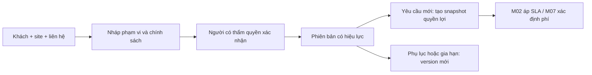

**Lệnh sử dụng:** “Vẽ sơ đồ `m01_luong_nghiep_vu` theo brief này, giữ đủ quan hệ và quy tắc; chọn bố cục đề xuất, chữ có dấu, icon outline và footer thiết kế mục tiêu.”

### 07. M02 — Tiếp nhận và SLA

**Mã:** `m02_luong_nghiep_vu`. **Ảnh đối chiếu:** [m02_luong_nghiep_vu.svg](m02_luong_nghiep_vu.svg). **Tài liệu chuẩn:** [modules/m02_tiep_nhan_va_sla.md](../modules/m02_tiep_nhan_va_sla.md).

**Mục tiêu:** Nhận báo lỗi, tránh trùng, xác định cam kết và theo dõi đến khi có đủ facts để đóng yêu cầu.

**Bố cục:** Dọc 4:5; hình thoi trùng ca, hai nhánh nhập lại ở timeline; hình thoi điều kiện đóng ở cuối.

**Quy tắc bắt buộc:** Mốc thực khác creation. Liên hệ trùng nối ca chủ và tiếp tục nhận cập nhật. WorkSource không nhân đôi theo tin báo cùng incident. Khôi phục/nghiệm thu do M03 ghi; M02 nhận facts, không tự tạo bằng chứng. Chờ không tự động pause SLA; policy/lịch phải xác định. Chưa đủ điều kiện đóng quay lại theo dõi.

**Nguồn graph chính xác:** Các node/edge/transition/cardinality dưới đây là hợp đồng nội dung. GPT dựng lại bằng hình đẹp, không in nguyên mã lên ảnh.

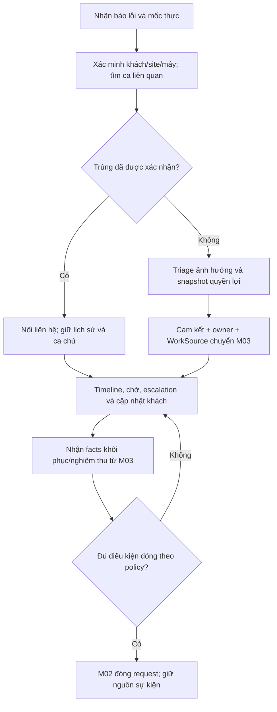

**Lệnh sử dụng:** “Vẽ sơ đồ `m02_luong_nghiep_vu` theo brief này, giữ đủ quan hệ và quy tắc; chọn bố cục đề xuất, chữ có dấu, icon outline và footer thiết kế mục tiêu.”

### 08. M03 — Điều phối và tác nghiệp

**Mã:** `m03_luong_nghiep_vu`. **Ảnh đối chiếu:** [m03_luong_nghiep_vu.svg](m03_luong_nghiep_vu.svg). **Tài liệu chuẩn:** [modules/m03_dieu_phoi_va_tac_nghiep.md](../modules/m03_dieu_phoi_va_tac_nghiep.md).

**Mục tiêu:** Một lệnh việc có nhiều lần thực hiện, có kết quả khôi phục và người đúng quyền nghiệm thu.

**Bố cục:** Dọc 4:5 hoặc ngang 3:2 hai lane; lane tác nghiệp chính và lane facts chuyển M02/M07; nhánh chờ/visit tiếp theo và pending acceptance dễ thấy.

**Quy tắc bắt buộc:** Visit không ghi đè lượt trước. Scope/fee đổi phải duyệt version mới. Chưa đủ nguồn lực chưa đi tiếp. Accepted là điều kiện hoàn theo flow; pending/rejected giữ lý do và action. Khôi phục có tiêu chí thử máy. M03 phát facts, không tự đóng request hay sửa SLA. Quality review sâu có thể mở rộng sau nhưng không bỏ nghiệm thu cơ bản.

**Nguồn graph chính xác:** Các node/edge/transition/cardinality dưới đây là hợp đồng nội dung. GPT dựng lại bằng hình đẹp, không in nguyên mã lên ảnh.

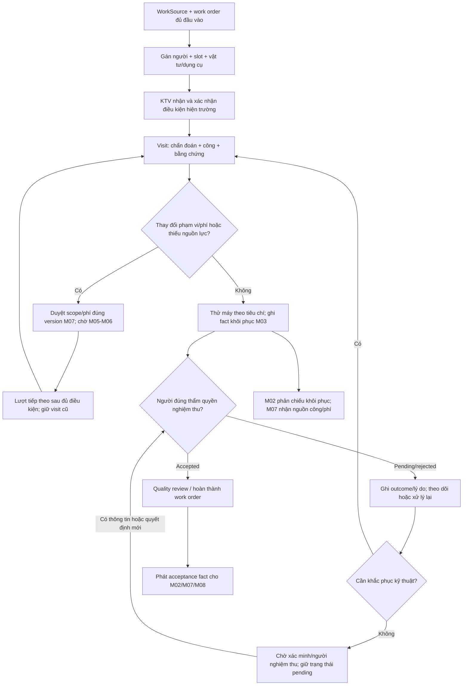

**Lệnh sử dụng:** “Vẽ sơ đồ `m03_luong_nghiep_vu` theo brief này, giữ đủ quan hệ và quy tắc; chọn bố cục đề xuất, chữ có dấu, icon outline và footer thiết kế mục tiêu.”

### 09. M04 — Thiết bị, kỳ PM và findings

**Mã:** `m04_luong_nghiep_vu`. **Ảnh đối chiếu:** [m04_luong_nghiep_vu.svg](m04_luong_nghiep_vu.svg). **Tài liệu chuẩn:** [modules/m04_thiet_bi_va_bao_tri.md](../modules/m04_thiet_bi_va_bao_tri.md).

**Mục tiêu:** Tách kế hoạch tổng, từng kỳ đến hạn, kết quả kiểm tra và các việc phát sinh.

**Bố cục:** Dọc 4:5; một chuỗi plan→occurrence→checklist, nhánh không lỗi/có lỗi và mỗi finding phân loại; hộp finding còn mở dưới kết thúc PM.

**Quy tắc bắt buộc:** Nguồn work order là PMOccurrence, không phải toàn bộ plan. Checklist/version và ngày hạn gốc được giữ. Một kỳ có nhiều finding. PM hoàn thành sau đủ checklist/phân loại nhưng không tự đóng findings. Tạo/liên kết Incident từ finding chống trùng khi retry. Equipment khách không tự trở thành vốn của AIS; số đo có thể nhập tay, không tự thêm IoT.

**Nguồn graph chính xác:** Các node/edge/transition/cardinality dưới đây là hợp đồng nội dung. GPT dựng lại bằng hình đẹp, không in nguyên mã lên ảnh.

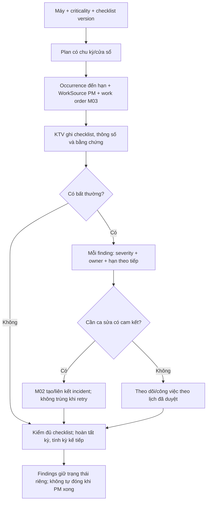

**Lệnh sử dụng:** “Vẽ sơ đồ `m04_luong_nghiep_vu` theo brief này, giữ đủ quan hệ và quy tắc; chọn bố cục đề xuất, chữ có dấu, icon outline và footer thiết kế mục tiêu.”

### 10. M05 — Giữ chỗ, cấp, dùng và trả vật tư

**Mã:** `m05_luong_nghiep_vu`. **Ảnh đối chiếu:** [m05_luong_nghiep_vu.svg](m05_luong_nghiep_vu.svg). **Tài liệu chuẩn:** [modules/m05_kho_va_vat_tu.md](../modules/m05_kho_va_vat_tu.md).

**Mục tiêu:** Ngăn hai ca cùng hứa một vật tư và theo dõi đúng vật tư thực dùng.

**Bố cục:** Dọc 4:5 hoặc ngang 3:2; transaction hold là khối nổi bật; nhánh thiếu/xung đột quay lại kiểm tra; cấp/dùng/trả chia lane.

**Quy tắc bắt buộc:** Đọc thấy đủ chưa là hold thành công. Transaction recheck+lock/CAS+idempotency. Hai hold không vượt available. Transfer/cấp khác tiêu hao; dùng rồi đối soát phần hold, trả/thu hồi có nguồn. Direct issue từ kho tổng có thể dùng, không bắt mọi ca đi qua xe. Timeout đọc kho là chưa biết, không là shortage; hold runtime phải do workflow nghiệp vụ.

**Nguồn graph chính xác:** Các node/edge/transition/cardinality dưới đây là hợp đồng nội dung. GPT dựng lại bằng hình đẹp, không in nguyên mã lên ảnh.

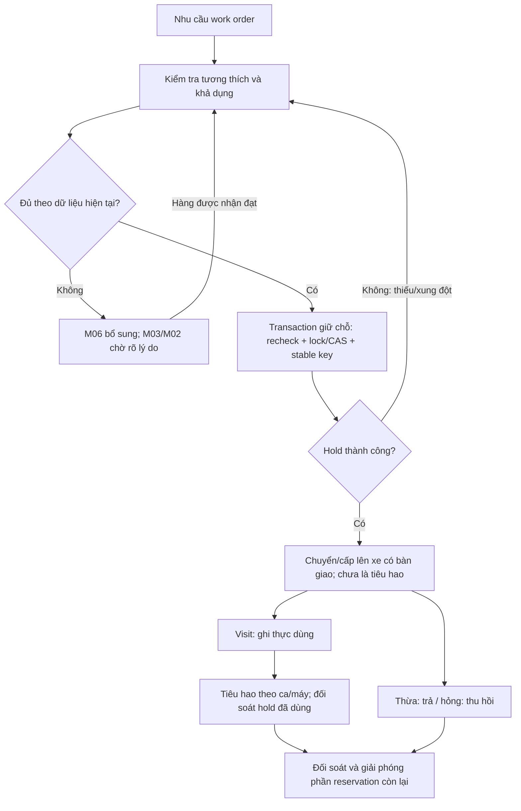

**Lệnh sử dụng:** “Vẽ sơ đồ `m05_luong_nghiep_vu` theo brief này, giữ đủ quan hệ và quy tắc; chọn bố cục đề xuất, chữ có dấu, icon outline và footer thiết kế mục tiêu.”

### 11. M06 — Nhu cầu ròng và mua bổ sung

**Mã:** `m06_luong_nghiep_vu`. **Ảnh đối chiếu:** [m06_luong_nghiep_vu.svg](m06_luong_nghiep_vu.svg). **Tài liệu chuẩn:** [modules/m06_mua_hang_va_bo_sung.md](../modules/m06_mua_hang_va_bo_sung.md).

**Mục tiêu:** Mua phần thực sự thiếu, nhận từng phần và cập nhật ca chờ.

**Bố cục:** Dọc 4:5; decision cần mua ở trên, branch không tạo MR kết thúc riêng; nhận hàng accepted/rejected song song; phần còn thiếu ở đáy.

**Quy tắc bắt buộc:** Tính available và nguồn cung mở để tránh mua lặp. MR/PO có nguồn và chống trùng. Accepted làm tăng lượng dùng được; quarantine/reject không tăng khả dụng dù có thể có sổ kho riêng. Nhận một phần giữ phần chưa đáp ứng, ETA và nguồn thay thế có thẩm quyền. Không tự coi PO đã đặt là hàng đã có.

**Nguồn graph chính xác:** Các node/edge/transition/cardinality dưới đây là hợp đồng nội dung. GPT dựng lại bằng hình đẹp, không in nguyên mã lên ảnh.

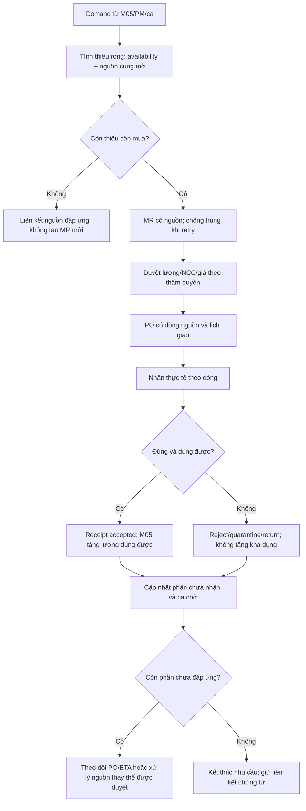

**Lệnh sử dụng:** “Vẽ sơ đồ `m06_luong_nghiep_vu` theo brief này, giữ đủ quan hệ và quy tắc; chọn bố cục đề xuất, chữ có dấu, icon outline và footer thiết kế mục tiêu.”

### 12. M07 — Duyệt phát sinh và quyết toán

**Mã:** `m07_luong_nghiep_vu`. **Ảnh đối chiếu:** [m07_luong_nghiep_vu.svg](m07_luong_nghiep_vu.svg). **Tài liệu chuẩn:** [modules/m07_chi_phi_va_hoa_don.md](../modules/m07_chi_phi_va_hoa_don.md).

**Mục tiêu:** Khách chấp thuận đúng phạm vi trước thực hiện và hóa đơn truy về nguồn công/vật tư.

**Bố cục:** Dọc 4:5; coverage/estimate/approval ở trên, gate hiện tại trước M03 thực hiện, đối soát và pending/invoice ở dưới.

**Quy tắc bắt buộc:** Approval đúng actor/scope/hash/version/expiry. Thay nội dung phải duyệt lại. M03 sở hữu acceptance, M07 sử dụng fact. Phân biệt AIS chịu/bảo hành/khách trả. Charge có nguồn không thu lặp. Nháp→duyệt→submit là workflow con người có quyền, không là permission để agent submit hóa đơn. Nghiệm thu không đồng nghĩa đã thanh toán.

**Nguồn graph chính xác:** Các node/edge/transition/cardinality dưới đây là hợp đồng nội dung. GPT dựng lại bằng hình đẹp, không in nguyên mã lên ảnh.

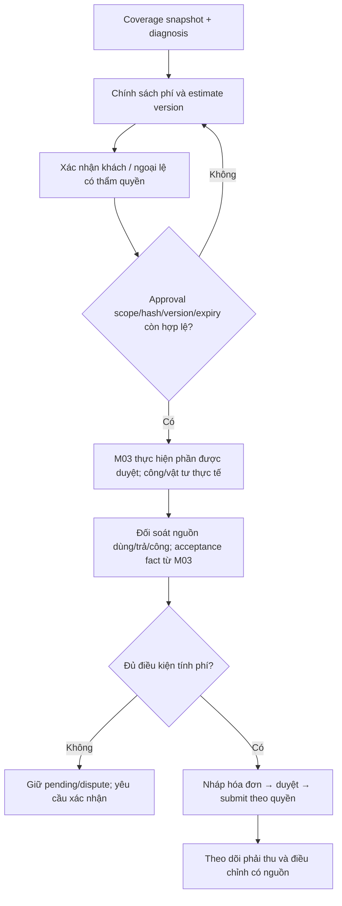

**Lệnh sử dụng:** “Vẽ sơ đồ `m07_luong_nghiep_vu` theo brief này, giữ đủ quan hệ và quy tắc; chọn bố cục đề xuất, chữ có dấu, icon outline và footer thiết kế mục tiêu.”

### 13. M08 — KPI có nguồn và phiên bản

**Mã:** `m08_luong_nghiep_vu`. **Ảnh đối chiếu:** [m08_luong_nghiep_vu.svg](m08_luong_nghiep_vu.svg). **Tài liệu chuẩn:** [modules/m08_bao_cao_va_kpi.md](../modules/m08_bao_cao_va_kpi.md).

**Mục tiêu:** Tính báo cáo từ dữ liệu đủ, có thể drill-down và giữ lịch sử khi số liệu thay đổi.

**Bố cục:** Ngang 16:9; pipeline dữ liệu có lane sự kiện đến muộn/correction quay lại nguồn; snapshot cũ/mới minh họa ở đáy.

**Quy tắc bắt buộc:** Có scope/kỳ/as_of/watermark/formula/policy version. Dedup event và supersedes correction tránh cộng đôi. Dữ liệu thiếu/chưa đủ cửa sổ FTFR không bị coi đạt. Late callback có thể sửa kỳ ca gốc bằng revision mới, giữ bản công bố cũ. Không thêm tỷ lệ 100% hoặc số cải thiện chưa đo.

**Nguồn graph chính xác:** Các node/edge/transition/cardinality dưới đây là hợp đồng nội dung. GPT dựng lại bằng hình đẹp, không in nguyên mã lên ảnh.

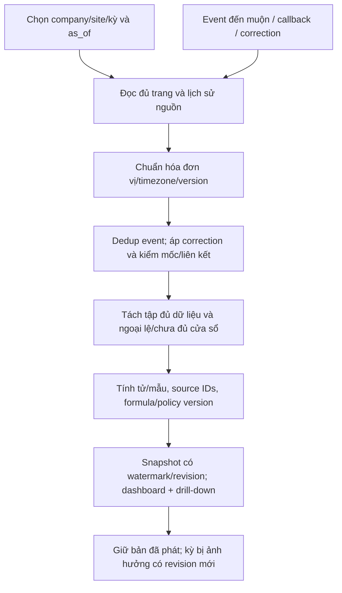

**Lệnh sử dụng:** “Vẽ sơ đồ `m08_luong_nghiep_vu` theo brief này, giữ đủ quan hệ và quy tắc; chọn bố cục đề xuất, chữ có dấu, icon outline và footer thiết kế mục tiêu.”

### 14. M09 — Vòng đời tri thức và retrieval

**Mã:** `m09_luong_nghiep_vu`. **Ảnh đối chiếu:** [m09_luong_nghiep_vu.svg](m09_luong_nghiep_vu.svg). **Tài liệu chuẩn:** [modules/m09_tri_thuc_va_tro_ly_ai.md](../modules/m09_tri_thuc_va_tro_ly_ai.md).

**Mục tiêu:** Nguồn tri thức được quản lý trước khi trở thành bằng chứng cho người dùng hoặc Harness.

**Bố cục:** Ngang 3:2 với hai lane: ingestion/publish và query/retrieval; live catalog nối cả hai.

**Quy tắc bắt buộc:** Parse giữ page/bảng/đơn vị. Metadata thiếu đi quarantine. Staging không là published. Trusted scope/model/status/effective trước retrieval, recheck nguồn hiện tại sau rerank. Evidence có page/version/conflict. M09 không lập kế hoạch nhiệm vụ và không ghi chứng từ ERP.

**Nguồn graph chính xác:** Các node/edge/transition/cardinality dưới đây là hợp đồng nội dung. GPT dựng lại bằng hình đẹp, không in nguyên mã lên ảnh.

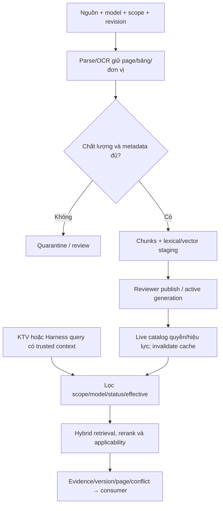

**Lệnh sử dụng:** “Vẽ sơ đồ `m09_luong_nghiep_vu` theo brief này, giữ đủ quan hệ và quy tắc; chọn bố cục đề xuất, chữ có dấu, icon outline và footer thiết kế mục tiêu.”

### 15. M10 — Quyền, approval và audit

**Mã:** `m10_luong_nghiep_vu`. **Ảnh đối chiếu:** [m10_luong_nghiep_vu.svg](m10_luong_nghiep_vu.svg). **Tài liệu chuẩn:** [modules/m10_quan_tri_va_kiem_soat.md](../modules/m10_quan_tri_va_kiem_soat.md).

**Mục tiêu:** Mọi kênh thao tác phải đi qua quyền và kiểm soát nghiệp vụ tại máy chủ.

**Bố cục:** Dọc 4:5; permission gate và approval gate riêng; đỏ cho từ chối, xanh cho thành công, audit ở cuối.

**Quy tắc bắt buộc:** Không được phép đi thẳng tới reject và audit phù hợp quyền. Có quyền đọc không có nghĩa có quyền duyệt/ghi. Approval tối thiểu là P1, matrix nhiều cấp là mở rộng. Gate xét field/file/API/export. Valid approval vẫn cần business validation; retry không tạo effect trùng. Ẩn nút UI không thay server permission.

**Nguồn graph chính xác:** Các node/edge/transition/cardinality dưới đây là hợp đồng nội dung. GPT dựng lại bằng hình đẹp, không in nguyên mã lên ảnh.

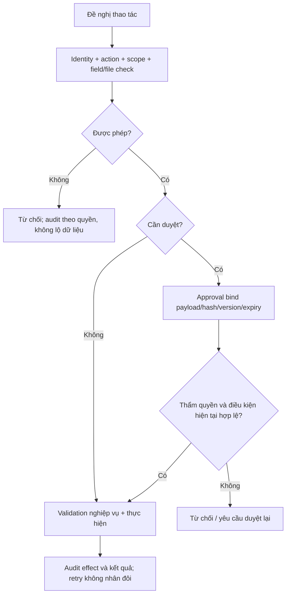

**Lệnh sử dụng:** “Vẽ sơ đồ `m10_luong_nghiep_vu` theo brief này, giữ đủ quan hệ và quy tắc; chọn bố cục đề xuất, chữ có dấu, icon outline và footer thiết kế mục tiêu.”

### 16. AI — Kiến trúc thành phần

**Mã:** `ai_01_agent_harness_architecture_01`. **Ảnh đối chiếu:** [ai_01_agent_harness_architecture_01.svg](ai_01_agent_harness_architecture_01.svg). **Tài liệu chuẩn:** [ai_architecture/01_agent_harness_architecture.md](../ai_architecture/01_agent_harness_architecture.md).

**Mục tiêu:** Bản kỹ thuật của kiến trúc Harness, thể hiện đường đi giữa các thành phần.

**Bố cục:** Ngang 16:9; gateway ở trái/trên, orchestrator giữa, thành phần controller quanh tâm, hai capability M09/ERP bên phải, state/observability dưới.

**Quy tắc bắt buộc:** Một orchestrator có các capabilities, không mặc định nhiều agents. Policy gate kiểm tool trước ERP. Durable state hai chiều với Harness. M09 là capability truy tri thức riêng. Business authority ở M01–M08/M10. Không vẽ LLM kết nối trực tiếp bảng nghiệp vụ.

**Nguồn graph chính xác:** Các node/edge/transition/cardinality dưới đây là hợp đồng nội dung. GPT dựng lại bằng hình đẹp, không in nguyên mã lên ảnh.

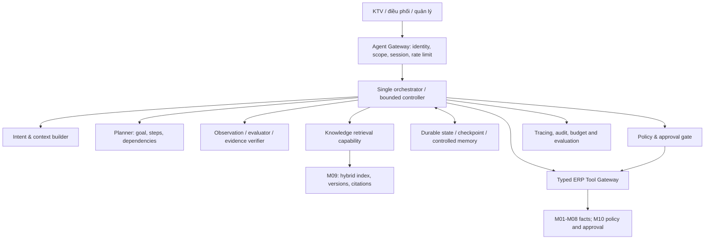

**Lệnh sử dụng:** “Vẽ sơ đồ `ai_01_agent_harness_architecture_01` theo brief này, giữ đủ quan hệ và quy tắc; chọn bố cục đề xuất, chữ có dấu, icon outline và footer thiết kế mục tiêu.”

### 17. AI — Vòng đời nhiệm vụ

**Mã:** `ai_02_agent_orchestration_workflow_01`. **Ảnh đối chiếu:** [ai_02_agent_orchestration_workflow_01.svg](ai_02_agent_orchestration_workflow_01.svg). **Tài liệu chuẩn:** [ai_architecture/02_agent_orchestration_workflow.md](../ai_architecture/02_agent_orchestration_workflow.md).

**Mục tiêu:** Phân biệt chạy, chờ, tiếp tục, xác minh và các loại kết thúc.

**Bố cục:** Ngang 3:2; trạng thái thực thi ở giữa, WAITING ở trên, terminal ở dưới; label transition rõ.

**Quy tắc bắt buộc:** Giữ tên state machine nguyên văn. WAITING lưu checkpoint/release worker/HTTP/LLM. Resume cần auth event, dedup/CAS/lease/revalidate. COMPLETED chỉ đạt objective, có thể là draft. PARTIAL có facts đã xác nhận; BLOCKED khác FAILED. Terminal không tự mở lại; continuation tạo run mới. CANCELLED không tự rollback effect đã APPLIED.

**Nguồn graph chính xác:** Các node/edge/transition/cardinality dưới đây là hợp đồng nội dung. GPT dựng lại bằng hình đẹp, không in nguyên mã lên ảnh.

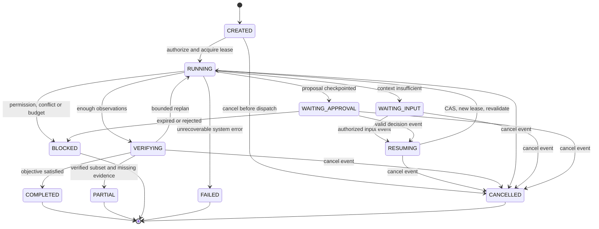

**Lệnh sử dụng:** “Vẽ sơ đồ `ai_02_agent_orchestration_workflow_01` theo brief này, giữ đủ quan hệ và quy tắc; chọn bố cục đề xuất, chữ có dấu, icon outline và footer thiết kế mục tiêu.”

### 18. AI — Sequence thực thi có giới hạn

**Mã:** `ai_02_agent_orchestration_workflow_02`. **Ảnh đối chiếu:** [ai_02_agent_orchestration_workflow_02.svg](ai_02_agent_orchestration_workflow_02.svg). **Tài liệu chuẩn:** [ai_architecture/02_agent_orchestration_workflow.md](../ai_architecture/02_agent_orchestration_workflow.md).

**Mục tiêu:** Thấy thứ tự đọc facts, lưu plan và thực hiện ready steps có checkpoint.

**Bố cục:** Ngang 16:9; năm lifeline User/Harness/State store/Tool gateway/ERP-M09; loop nằm trong khung.

**Quy tắc bắt buộc:** Trusted session tại đầu vào. Data có versions/observed_at. Lưu step/counter/checkpoint mỗi bước. Loop bounded, không reset budget khi replan. Reads độc lập có thể parallel theo limit; dependencies model/scope phải giữ thứ tự. Gateway là mặt logic; retrieval M09 không được coi là ghi ERP. Final có verified/partial/waiting.

**Nguồn graph chính xác:** Các node/edge/transition/cardinality dưới đây là hợp đồng nội dung. GPT dựng lại bằng hình đẹp, không in nguyên mã lên ảnh.

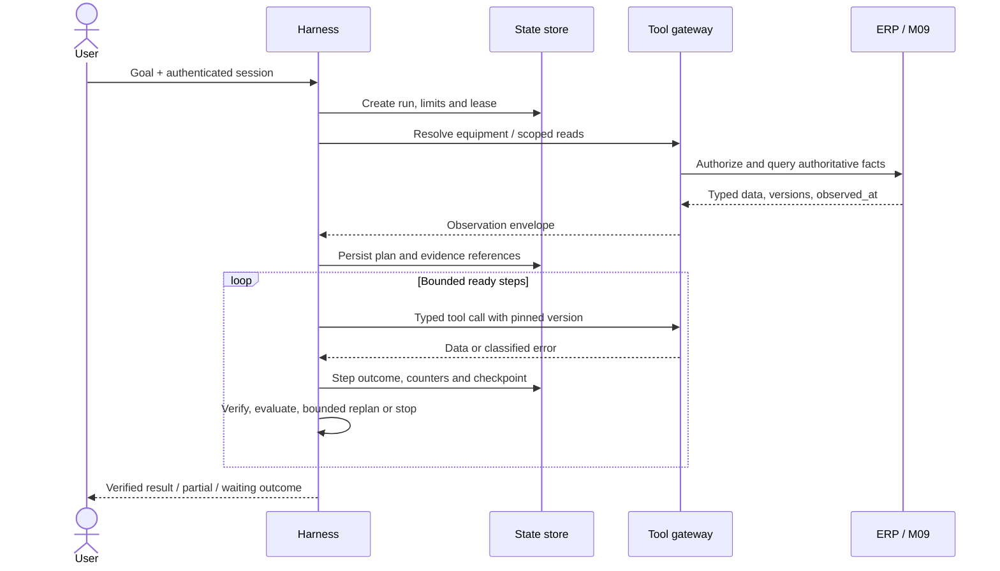

**Lệnh sử dụng:** “Vẽ sơ đồ `ai_02_agent_orchestration_workflow_02` theo brief này, giữ đủ quan hệ và quy tắc; chọn bố cục đề xuất, chữ có dấu, icon outline và footer thiết kế mục tiêu.”

### 19. AI — Sequence prepare, approve và commit

**Mã:** `ai_02_agent_orchestration_workflow_03`. **Ảnh đối chiếu:** [ai_02_agent_orchestration_workflow_03.svg](ai_02_agent_orchestration_workflow_03.svg). **Tài liệu chuẩn:** [ai_architecture/02_agent_orchestration_workflow.md](../ai_architecture/02_agent_orchestration_workflow.md).

**Mục tiêu:** Người duyệt exact binding; gateway không tạo effect trùng khi retry và commit có tính nguyên tử.

**Bố cục:** Poster ngang 3:2; năm lifeline, một khung ALT ba nhánh; transaction màu amber và note crash/reconcile.

**Quy tắc bắt buộc:** Notification không là authority: Harness đọc quyết định lại. CAS/lease trước dispatch. Lookup receipt cùng key/hash/scope trước kiểm approval mới: APPLIED trả cũ dù đã consume/expired, nếu còn quyền đọc receipt. Key khác hash conflict; command mới stale bị chặn. Draft+consume approval+receipt+outbox trong cùng ERP transaction. Crash sau commit tra receipt cùng key, không key mới.

**Nguồn graph chính xác:** Các node/edge/transition/cardinality dưới đây là hợp đồng nội dung. GPT dựng lại bằng hình đẹp, không in nguyên mã lên ảnh.

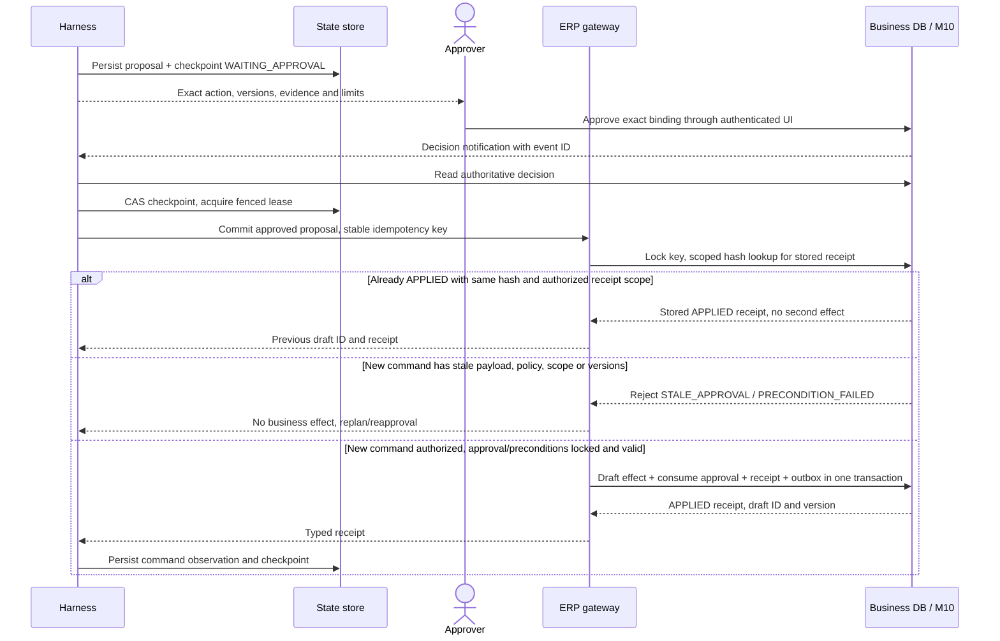

**Lệnh sử dụng:** “Vẽ sơ đồ `ai_02_agent_orchestration_workflow_03` theo brief này, giữ đủ quan hệ và quy tắc; chọn bố cục đề xuất, chữ có dấu, icon outline và footer thiết kế mục tiêu.”

### 20. AI — Dữ liệu runtime và authority

**Mã:** `ai_03_agent_state_and_memory_01`. **Ảnh đối chiếu:** [ai_03_agent_state_and_memory_01.svg](ai_03_agent_state_and_memory_01.svg). **Tài liệu chuẩn:** [ai_architecture/03_agent_state_and_memory.md](../ai_architecture/03_agent_state_and_memory.md).

**Mục tiêu:** Tách plan/checkpoint/evidence runtime khỏi business approval và command receipt.

**Bố cục:** Ngang 3:2; ranh giới runtime store bên trái và ERP authority bên phải; ER cardinality, hộp metadata/lease dưới.

**Quy tắc bắt buộc:** Definition/version pinned; step logical identity ổn định, tool attempts riêng. Checkpoint có state_version/CAS, counters và pending command keys. ApprovalRef chỉ tham chiếu authority, không tự tạo quyết định. Session memory không thay stock/permissions. Không lưu raw chain-of-thought. ER là lát cắt; Lease/fencing có trong tài liệu dù không là node của graph hiện tại.

**Nguồn graph chính xác:** Các node/edge/transition/cardinality dưới đây là hợp đồng nội dung. GPT dựng lại bằng hình đẹp, không in nguyên mã lên ảnh.

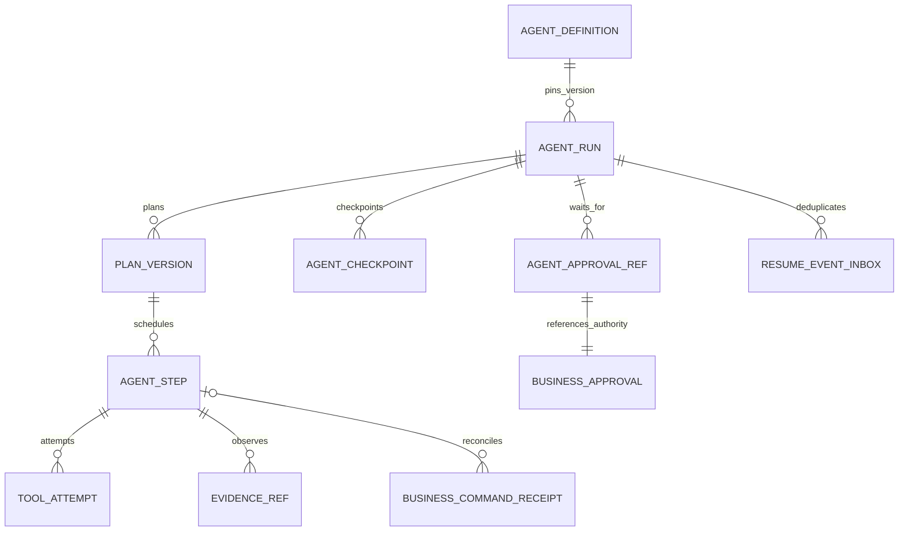

**Lệnh sử dụng:** “Vẽ sơ đồ `ai_03_agent_state_and_memory_01` theo brief này, giữ đủ quan hệ và quy tắc; chọn bố cục đề xuất, chữ có dấu, icon outline và footer thiết kế mục tiêu.”

### 21. AI — Nạp và công bố tri thức

**Mã:** `ai_04_rag_ingestion_and_retrieval_01`. **Ảnh đối chiếu:** [ai_04_rag_ingestion_and_retrieval_01.svg](ai_04_rag_ingestion_and_retrieval_01.svg). **Tài liệu chuẩn:** [ai_architecture/04_rag_ingestion_and_retrieval.md](../ai_architecture/04_rag_ingestion_and_retrieval.md).

**Mục tiêu:** Tạo index từ nguồn được phép dùng và công bố đúng phiên bản.

**Bố cục:** Ngang 16:9 hoặc dọc 4:5; bước staging→review→publish rõ, quarantine là nhánh màu amber.

**Quy tắc bắt buộc:** Kiểm source/file/hash/scope; OCR giữ trang/bảng/đơn vị. Metadata không đủ không publish. Lexical+vector, retrieval tests trước reviewer publish. Active generation chuyển atomic, cache invalidation theo event. Live catalog vẫn kiểm tra quyền/thu hồi ngay cả index lag. Không thêm bước tự học mọi chat thành SOP.

**Nguồn graph chính xác:** Các node/edge/transition/cardinality dưới đây là hợp đồng nội dung. GPT dựng lại bằng hình đẹp, không in nguyên mã lên ảnh.

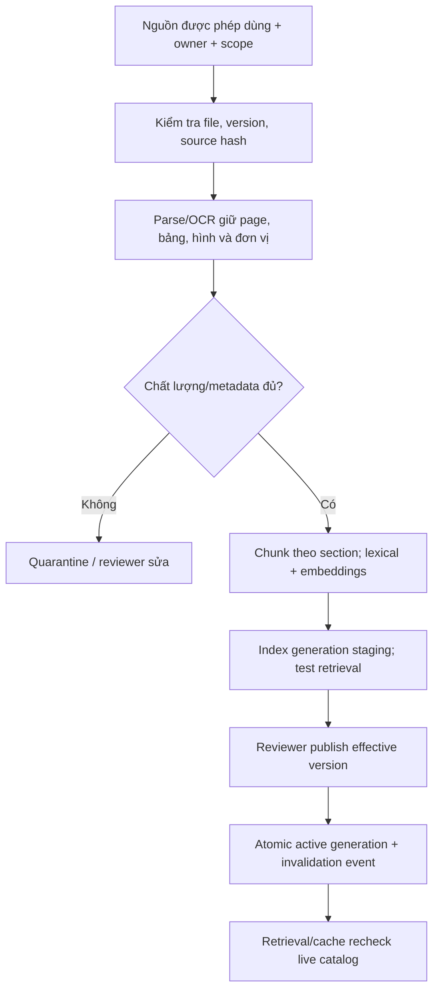

**Lệnh sử dụng:** “Vẽ sơ đồ `ai_04_rag_ingestion_and_retrieval_01` theo brief này, giữ đủ quan hệ và quy tắc; chọn bố cục đề xuất, chữ có dấu, icon outline và footer thiết kế mục tiêu.”

### 22. AI — Tìm kiếm và kiểm chứng nguồn

**Mã:** `ai_04_rag_ingestion_and_retrieval_02`. **Ảnh đối chiếu:** [ai_04_rag_ingestion_and_retrieval_02.svg](ai_04_rag_ingestion_and_retrieval_02.svg). **Tài liệu chuẩn:** [ai_architecture/04_rag_ingestion_and_retrieval.md](../ai_architecture/04_rag_ingestion_and_retrieval.md).

**Mục tiêu:** Tìm đúng mã/model và cả ý nghĩa triệu chứng, sau đó kiểm phù hợp trước trả lời.

**Bố cục:** Ngang 16:9; lexical/vector hai nhánh cân đối, merge→rerank→evidence→verifier.

**Quy tắc bắt buộc:** Resolved model/trusted scope trước query. Eligibility trước retrieval và recheck applicability/version/source sau rerank. Evidence có page/version/conflict. Similarity không thay quyền hoặc độ đúng. Thiếu nguồn/mâu thuẫn không bỏ qua; verifier trả partial/hỏi thêm theo policy. Chỉ số confidence không là bằng chứng.

**Nguồn graph chính xác:** Các node/edge/transition/cardinality dưới đây là hợp đồng nội dung. GPT dựng lại bằng hình đẹp, không in nguyên mã lên ảnh.

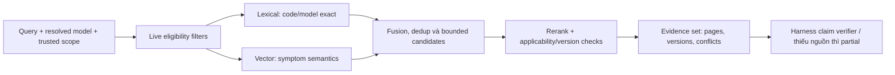

**Lệnh sử dụng:** “Vẽ sơ đồ `ai_04_rag_ingestion_and_retrieval_02` theo brief này, giữ đủ quan hệ và quy tắc; chọn bố cục đề xuất, chữ có dấu, icon outline và footer thiết kế mục tiêu.”

### 23. AI — Gate công cụ và giao dịch

**Mã:** `ai_05_tool_registry_and_contracts_01`. **Ảnh đối chiếu:** [ai_05_tool_registry_and_contracts_01.svg](ai_05_tool_registry_and_contracts_01.svg). **Tài liệu chuẩn:** [ai_architecture/05_tool_registry_and_contracts.md](../ai_architecture/05_tool_registry_and_contracts.md).

**Mục tiêu:** Phân biệt đọc, chuẩn bị proposal và ghi draft được duyệt.

**Bố cục:** Poster ngang 3:2; gate chung trên, ba lane Read/Prepare/Approved draft; nhánh receipt/conflict/stale và unknown ở lane write.

**Quy tắc bắt buộc:** Schema/allowlist/scope bị từ chối có zero new effects. Same key/same hash trả receipt; same key/different hash conflict. Command mới lock/recheck scope/policy/version/expiry. Commit atomic draft+approval+receipt+outbox. APPLIED trả kết quả; chỉ UNKNOWN cần reconcile trước retry. Không vẽ submit/reserve như effect enabled. Context actor/admin không do model cấp.

**Nguồn graph chính xác:** Các node/edge/transition/cardinality dưới đây là hợp đồng nội dung. GPT dựng lại bằng hình đẹp, không in nguyên mã lên ảnh.

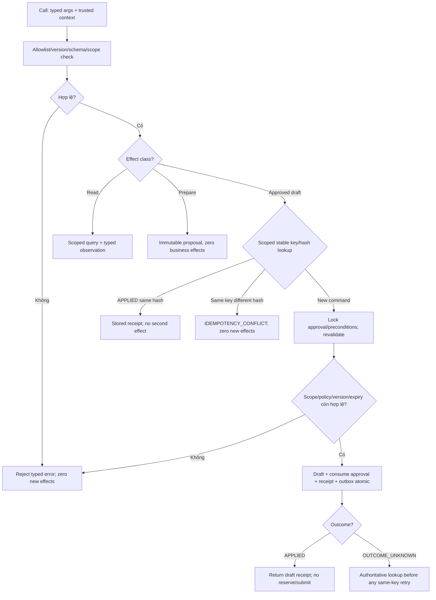

**Lệnh sử dụng:** “Vẽ sơ đồ `ai_05_tool_registry_and_contracts_01` theo brief này, giữ đủ quan hệ và quy tắc; chọn bố cục đề xuất, chữ có dấu, icon outline và footer thiết kế mục tiêu.”

### 24. AI — Vòng lặp lập kế hoạch và đánh giá

**Mã:** `ai_06_reasoning_planning_execution_01`. **Ảnh đối chiếu:** [ai_06_reasoning_planning_execution_01.svg](ai_06_reasoning_planning_execution_01.svg). **Tài liệu chuẩn:** [ai_architecture/06_reasoning_planning_execution.md](../ai_architecture/06_reasoning_planning_execution.md).

**Mục tiêu:** Kết quả mỗi hành động quyết định bước tiếp theo trong giới hạn.

**Bố cục:** Ngang 3:2; vòng chính clockwise với label; stop/wait/reconcile đặt ngoài vòng, final bên phải.

**Quy tắc bắt buộc:** Kiểm lease/permission/limits trước dispatch. Observation typed fact/error/unknown/conflict. Persist evidence/counters/checkpoint. Đủ evidence phải verify claims/final policy. Cần người thì checkpoint wait; write unknown reconcile cùng command. Replan tăng version nhưng không reset budget. Final phải nêu pending effect, không suy success từ HTTP 200.

**Nguồn graph chính xác:** Các node/edge/transition/cardinality dưới đây là hợp đồng nội dung. GPT dựng lại bằng hình đẹp, không in nguyên mã lên ảnh.

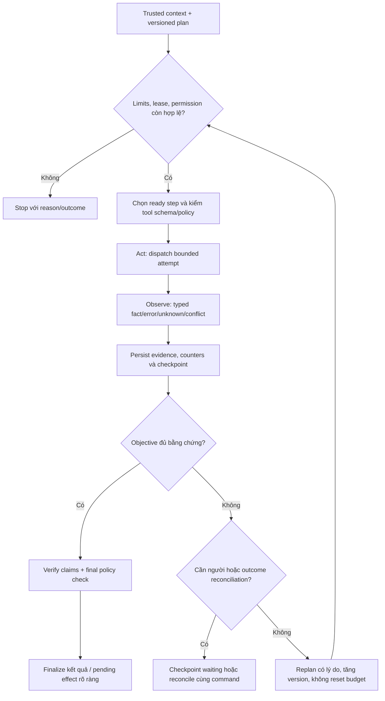

**Lệnh sử dụng:** “Vẽ sơ đồ `ai_06_reasoning_planning_execution_01` theo brief này, giữ đủ quan hệ và quy tắc; chọn bố cục đề xuất, chữ có dấu, icon outline và footer thiết kế mục tiêu.”

### 25. AI — Human approval và tiếp tục

**Mã:** `ai_07_security_and_human_approval_01`. **Ảnh đối chiếu:** [ai_07_security_and_human_approval_01.svg](ai_07_security_and_human_approval_01.svg). **Tài liệu chuẩn:** [ai_architecture/07_security_and_human_approval.md](../ai_architecture/07_security_and_human_approval.md).

**Mục tiêu:** Chờ người có thẩm quyền và tiếp tục mà không tin một callback tự khai approved.

**Bố cục:** Ngang 16:9; sáu lifeline, note checkpoint trên, approval authority khác Harness, ALT valid/stale dưới.

**Quy tắc bắt buộc:** Immutable binding/hash/version/scope/expiry. Approver xác thực ghi quyết định ở M10. Notification chỉ tín hiệu. Read authoritative, inbox dedup/CAS/fenced lease. Lookup prior APPLIED receipt trước new-command checks; receipt cũ không consume lần hai. Command mới expired/revoked/stale có zero new effects. Chữ commit ở đây chỉ draft enabled.

**Nguồn graph chính xác:** Các node/edge/transition/cardinality dưới đây là hợp đồng nội dung. GPT dựng lại bằng hình đẹp, không in nguyên mã lên ảnh.

```mermaid
sequenceDiagram
    participant H as Harness
    participant S as Checkpoint store
    actor A as Approver
    participant P as M10 approval authority
    participant G as Business gateway
    H->>S: Immutable binding + WAITING_APPROVAL
    H-->>A: Exact preview, scope, versions, expiry
    A->>P: Authenticated decision for binding hash
    P-->>H: Decision event (notification only)
    H->>P: Read decision and current authority
    H->>S: Dedup event + CAS resume + fenced lease
    H->>G: Commit exact approved command with same key
    G->>P: Scoped key/hash lookup for prior APPLIED receipt
    alt Prior APPLIED same hash and authorized receipt scope
        G-->>H: Stored receipt, no second effect or approval consumption
    else New command
        G->>P: Lock and recheck authority, versions and expiry
        alt Expired, revoked or changed version
            G-->>H: STALE_APPROVAL / EXPIRED, zero new effects
        else Valid
            G->>P: Draft + consume approval + receipt + outbox atomic
            G-->>H: APPLIED receipt or OUTCOME_UNKNOWN to reconcile
        end
    end
```

**Lệnh sử dụng:** “Vẽ sơ đồ `ai_07_security_and_human_approval_01` theo brief này, giữ đủ quan hệ và quy tắc; chọn bố cục đề xuất, chữ có dấu, icon outline và footer thiết kế mục tiêu.”

### 26. AI — Các cổng đánh giá và phát hành

**Mã:** `ai_08_observability_and_evaluation_01`. **Ảnh đối chiếu:** [ai_08_observability_and_evaluation_01.svg](ai_08_observability_and_evaluation_01.svg). **Tài liệu chuẩn:** [ai_architecture/08_observability_and_evaluation.md](../ai_architecture/08_observability_and_evaluation.md).

**Mục tiêu:** Chỉ mở baseline sau kiểm tra contracts, tích hợp, chất lượng nguồn/model và pilot.

**Bố cục:** Ngang 16:9; bốn cổng nối tiếp, hình thoi critical gates, nhánh sửa và quay lại có label.

**Quy tắc bắt buộc:** Offline conformance không thay ERP fault/concurrency/auth tests. Holdout có expert gold. Pilot đo traces/cost/recovery/limits. Critical gate fail chưa release. Rollback bundle gồm phiên bản/policy liên quan. Không vẽ đã đạt production hoặc accuracy 100%; các mốc sau offline chưa được chạy trong phiên kiểm tra này.

**Nguồn graph chính xác:** Các node/edge/transition/cardinality dưới đây là hợp đồng nội dung. GPT dựng lại bằng hình đẹp, không in nguyên mã lên ảnh.

```mermaid
flowchart LR
    C["Contracts/schemas/protocol vectors"] --> A["Adapter/state/ERP fault injection"]
    A --> E["RAG/model holdout + expert gold"]
    E --> P["Pilot: traces, cost, recovery and limits"]
    P --> G{"Critical gates pass?"}
    G -->|"No"| F["Fix version/policy and rerun affected tests"]
    F --> C
    G -->|"Yes"| R["Release bounded baseline with rollback bundle"]
```

**Lệnh sử dụng:** “Vẽ sơ đồ `ai_08_observability_and_evaluation_01` theo brief này, giữ đủ quan hệ và quy tắc; chọn bố cục đề xuất, chữ có dấu, icon outline và footer thiết kế mục tiêu.”

### 27. AI — Kịch bản kỹ thuật và vật tư xuyên suốt

**Mã:** `ai_09_end_to_end_agent_scenarios_01`. **Ảnh đối chiếu:** [ai_09_end_to_end_agent_scenarios_01.svg](ai_09_end_to_end_agent_scenarios_01.svg). **Tài liệu chuẩn:** [ai_architecture/09_end_to_end_agent_scenarios.md](../ai_architecture/09_end_to_end_agent_scenarios.md).

**Mục tiêu:** Kết hợp dữ liệu máy, tài liệu và kho để chuẩn bị đề xuất có căn cứ.

**Bố cục:** Poster ngang 3:2; năm lifeline KTV/Harness/M09/ERP Gateway/Approval authority; ALT stock timeout và verified stock.

**Quy tắc bắt buộc:** AC-102 và vật tư/mã lỗi là ví dụ synthetic, không là hướng dẫn nhà sản xuất. Timeout→PARTIAL, không stock=0/MR tự động. Verified compatibility/available/held/version trước proposal. Đọc authoritative approval sau notification, dedup/CAS/revalidate. APPLIED chỉ draft; UNKNOWN nêu pending và reconcile cùng key. Không kết luận đã giữ hàng/submit.

**Nguồn graph chính xác:** Các node/edge/transition/cardinality dưới đây là hợp đồng nội dung. GPT dựng lại bằng hình đẹp, không in nguyên mã lên ảnh.

```mermaid
sequenceDiagram
    actor U as KTV
    participant H as Harness
    participant K as M09 Knowledge
    participant T as ERP Gateway
    participant A as Approval authority
    U->>H: Analyze AC-102 demo and prepare materials if justified
    H->>T: Resolve equipment, context and history
    T-->>H: Authorized model/site/versions
    H->>K: Hybrid retrieval for model/error
    K-->>H: Approved evidence/version or conflicts
    H->>T: Verify item compatibility and stock
    alt Stock timeout after bounded retries
        T-->>H: Typed READ_TIMEOUT, no stock data
        H-->>U: PARTIAL, diagnosis evidence, stock not verified
    else Verified item and fresh stock
        T-->>H: Compatibility + available/held/versions
        H->>H: Prepare immutable proposal and checkpoint
        H-->>A: Exact action review
        A-->>H: Authenticated decision notification
        H->>A: Read authoritative decision and current authority
        H->>H: Dedup event, CAS checkpoint and revalidate scope
        H->>T: Revalidate and commit approved draft with stable key
        T-->>H: APPLIED receipt or unknown to reconcile
        H-->>U: Evidence + draft/pending status, no claim of reserve/submit
    end
```

**Lệnh sử dụng:** “Vẽ sơ đồ `ai_09_end_to_end_agent_scenarios_01` theo brief này, giữ đủ quan hệ và quy tắc; chọn bố cục đề xuất, chữ có dấu, icon outline và footer thiết kế mục tiêu.”

## 7. Checklist kiểm tra ảnh GPT sinh ra

- Đủ các khối và mọi đường/nhánh trong mục đã chọn, kể cả bảng handoff của hình 03.
- Tên/mã, tiếng Việt và thuật ngữ kỹ thuật đúng; chữ không quá nhỏ hoặc bị cắt.
- Connector không chạy qua chữ; đầu mũi tên và label Có/Không hoặc state transition phân biệt được.
- Có legend/cardinality cho ER, lifeline và ALT/loop cho sequence; không đổi chúng thành process tuyến tính.
- M03 sở hữu khôi phục/nghiệm thu; M02 phản chiếu; M07 quyết toán; M09 tri thức khác Harness runtime.
- Không nói draft là giữ hàng/submit; không nói timeout là tồn 0; approval event không thay quyết định nguồn.
- Những ràng buộc XOR/unique/atomic và giới hạn chưa triển khai được giữ trong callout khi cần.
- Không tự sinh tên hãng/model/cách sửa, tỷ lệ cải thiện, cloud stack hoặc cam kết chính xác tuyệt đối.
- Bản ảnh phù hợp nguồn graph và footer trạng thái thiết kế mục tiêu.

## 8. Nguồn chuẩn và cách cập nhật brief

Nguồn ưu tiên theo nội dung: [workflow contracts](../05_domain_workflow_contracts.md) cho bất biến/ownership/P1; [kiến trúc logic](../02_kien_truc_logic_va_du_lieu.md) cho handoff/ER; bản module cho flow; bản AI cho runtime. [Giải thích và so sánh hệ thống cũ](../06_giai_thich_thiet_ke_va_so_sanh_he_thong_cu.md) cung cấp ví dụ dễ hiểu, không thay các hợp đồng kỹ thuật.

Khi sửa tài liệu, sửa Mermaid tại file thiết kế gốc hoặc generator bốn hình trình bày, render lại, rồi chạy `python docs/design/diagrams/build_gptweb_brief.py`. Script kiểm đủ 27 mã và xác nhận graph export khớp Markdown chuẩn. Brief copy nhãn/graph trực tiếp, nên không cần GPT web mở từng link local. Vẫn review phần mô tả và constraints khi chính sách thay đổi.
